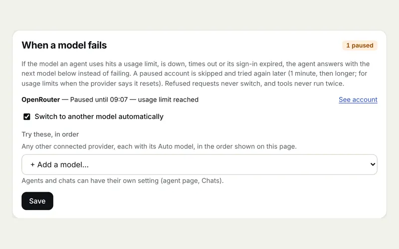

<p align="center">
  
</p>

<h1 align="center">Duniya</h1>

<p align="center"><b>AI agents for your WhatsApp and Telegram groups and chats, on your own free server, run from a calm web panel.</b></p>

<p align="center">
  <a href="https://github.com/vikramgorla/duniya/actions/workflows/ci.yml"></a>
  <a href="https://github.com/vikramgorla/duniya/releases/latest"></a>
  <a href="LICENSE"></a>
</p>

<p align="center">
  <a href="https://cloud.oracle.com/resourcemanager/stacks/create?zipUrl=https://github.com/vikramgorla/duniya/releases/latest/download/duniya.zip"></a>
  <a href="https://shell.cloud.google.com/cloudshell/editor?cloudshell_git_repo=https%3A%2F%2Fgithub.com%2Fvikramgorla%2Fduniya&cloudshell_git_branch=main&cloudshell_tutorial=infra%2Fgcp%2Ftutorial.md"></a>
  <a href="https://vikramgorla.github.io/duniya/"></a>
</p>

<p align="center">
  <a href="docs/README.md"><b>Guides</b></a> · <a href="docs/install.md">Install</a> ·
  <a href="docs/getting-started.md">Getting started</a> · <a href="CONTRIBUTING.md">Contributing</a> ·
  <a href="SECURITY.md">Security</a>
</p>

<p align="center">
  
</p>

Duniya links to a spare WhatsApp number and runs helpers in the chats you choose: a car-pool planner, a school-class
assistant, a family organiser. Groups on Telegram too: add a bot, and the same agents answer there, with the same
person on both apps. **You** pick which chats they join, which model they use and what they may do. Every chat is
silent until you switch it on.

**For** organisers of family, school, club and neighbourhood groups who want their data on their own server. **Not**
the official WhatsApp Business API, and not for bulk marketing. **Costs:** free software (MIT), a free server on
Oracle or Google Cloud, free or cheap models (OpenRouter's free ones, your ChatGPT or Claude plan, or a key with a
spending cap). [Is it for me?](docs/README.md#what-is-duniya-and-is-it-for-me)

## Install

```bash
curl -fsSL https://raw.githubusercontent.com/vikramgorla/duniya/main/install.sh | sudo bash
```

Any Ubuntu/Debian server with 1 GB of memory, or one click on Oracle Cloud or Google Cloud (free tiers), or
[Docker](docs/deploy/docker.md). It ends with the panel address and a setup code; **Getting started** on Overview
then takes about five taps: link WhatsApp, connect a model, pick a template, switch a group on, send a test.
[Install guide →](docs/install.md) · [Where is my panel?](docs/install.md#where-is-my-panel-find-the-ip--url) ·
[Stuck? Troubleshooting](docs/troubleshooting.md)

## Highlights

<table>
<tr>
<td width="25%" valign="top"><a href="docs/agents.md"></a><br><b>Agents in plain words</b><br>A template or a sentence; every change as a visual diff. Wake it once, then just talk: it follows up on replies meant for it, one answer at a time, and corrects itself instead of posting twice. Quick replies and FAQ without AI. Test before, <b>Review &amp; teach</b> after: your corrections become <a href="docs/intelligence.md#lessons">lessons</a> it follows once you approve them.</td>
<td width="25%" valign="top"><a href="docs/owner-assistant.md"></a><br><b>Your own assistant</b><br>A <a href="docs/owner-assistant.md#morning-brief">morning brief</a> with next steps to approve, <i>what did I miss?</i>, questions across People, events and orders, recaps, GIFs and sends — in your WhatsApp or the <b>Ask</b> box. Changes wait for your OK.</td>
<td width="25%" valign="top"><a href="docs/chats.md#search-messages-owner"></a><br><b>Find &amp; search</b><br>Press <b>/</b> for any agent, chat or setting, or search what was said in every chat. Each chat's <b>Messages</b> (with their photos, stickers, GIFs and voice notes) and <b>Memory</b> one tap away, a page per person, answers rated (and edited) right there. <i>Why didn't it answer?</i> by chat name, with a fix.</td>
<td width="25%" valign="top"><a href="docs/models.md"></a><br><b>Any model, with a backup</b><br>OpenRouter (free models), ChatGPT plan, Claude, OpenAI, Copilot, Ollama, and your Claude or ChatGPT plan through Claude Code or Codex. A <a href="docs/intelligence.md">light model for simple messages</a>, a strong one when needed; figures checked against your records. Photos &amp; voice. Spending caps.</td>
</tr>
<tr>
<td valign="top"><a href="docs/privacy.md"></a><br><b>Silent by default</b><br>Off chats are never stored or sent to a model; groups are told once. Tools are allowed per role, in code; an organizer's <a href="docs/agents.md#how-sure-before-changing-things">clear request is the go-ahead</a> for small changes, deletes and money still ask. Reads and types at a <a href="docs/sending-pace.md">person's pace</a>.</td>
<td valign="top"><a href="docs/everyday.md#on-your-phone"></a><br><b>On your phone</b><br>Installs on your home screen: tab bar at your thumb, compact screens, live, light and dark. Nothing from a store.</td>
<td valign="top"><a href="docs/small-servers.md"></a><br><b>Made for a 1 GB VM</b><br>~180 MB of RAM. Channels load only when used: WhatsApp, and <a href="docs/telegram.md">Telegram</a> (a bot, a few MB). Old data pruned by itself; reconnects, crashes and a full disk handled without you.</td>
<td valign="top"><a href="docs/backups-and-updates.md"></a><br><b>Backups &amp; updates</b><br>Encrypted to GitHub or S3. One-click updates that show what's new; breaking ones wait for you, and a release that does not start is rolled back by itself. No SSH.</td>
</tr>
</table>

More: [People](docs/people.md) (everyone from your chats and your phone in one place: families, kids, notes, tags, lists, consent, each person's language (Telugu, Hindi, Tamil, Arabic, Chinese … and Telugu or Hindi in Latin letters too) and hours; family ties suggested from conversations; agents know who is writing and see only their own chats' people) · [promises kept](docs/people.md#promises) (one gentle reminder when due; every agent's promises in one list, overdue first) · [cost per feature](docs/spending.md#cost-per-feature) · [Events](docs/events.md) and [orders & payments](docs/orders.md) (registrations with kids, waiting list, duties, who paid; agents register people) · [Lists and sending](docs/sending.md) (message a list, an event's families or everyone who owes: consent checked per message, each person's own wording, a person's pace, stop signals, payment reminders) · [Surveys](docs/surveys.md) and [campaigns](docs/campaigns.md) (answers in chat or by link; follow-ups only to who has not answered or paid) · [Telegram](docs/telegram.md) · [web search](docs/web-search.md) (agents look up current facts with your AI provider's built-in search; on by default, per role) · [MCP tool services](docs/agents.md#tool-services-mcp) ([how agents use each one](docs/tool-services.md): when, how carefully, GIFs on their own at the right moments, limits; risk from what each tool declares) · [manage it from ChatGPT or Claude](docs/admin-mcp.md) ·
[your own domain](docs/domains-and-access.md) · [how it works](docs/architecture.md).

**Fork it:** MIT licensed. Fork on GitHub, enable Actions, and a workflow points the install command, buttons, website
and image at your fork ([Forking](CONTRIBUTING.md#forking)); servers install from it with `DUNIYA_REPO=you/duniya`.

> [!WARNING]
> Use a **dedicated WhatsApp number**: Duniya links as a normal linked device (via
> [Baileys](https://github.com/WhiskeySockets/Baileys)), and unofficial clients can be banned.

<p align="center">
  <a href="docs/README.md"></a>
</p>

---

<sub>[Feature specs](specs) · [Design language](DESIGN.md) · [AGENTS.md](AGENTS.md) (working rules, Definition of
Done) · [Contributing](CONTRIBUTING.md) · [Code of conduct](CODE_OF_CONDUCT.md) · [Security policy](SECURITY.md) ·
[MIT license](LICENSE). Duniya is an independent open-source project, not
affiliated with, endorsed by or sponsored by WhatsApp, Telegram or Meta. WhatsApp and Telegram are trademarks of their
owners.</sub>
