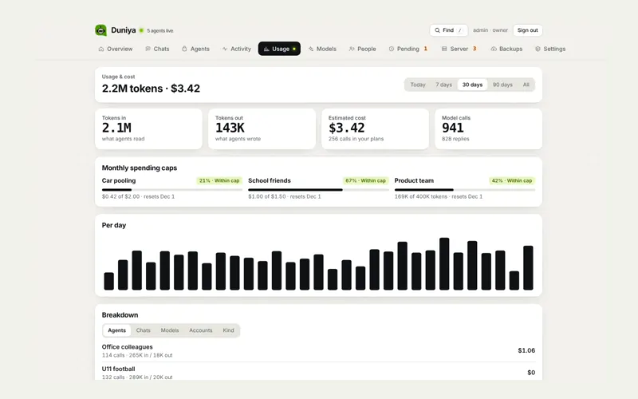
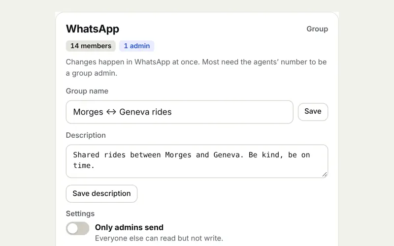
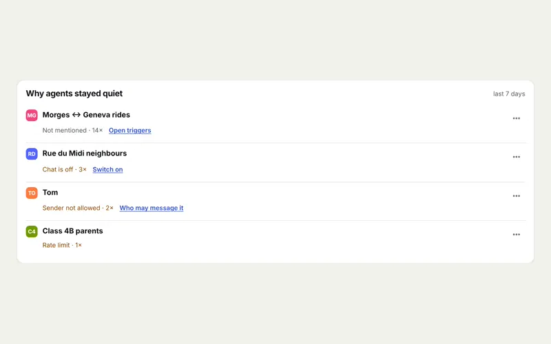
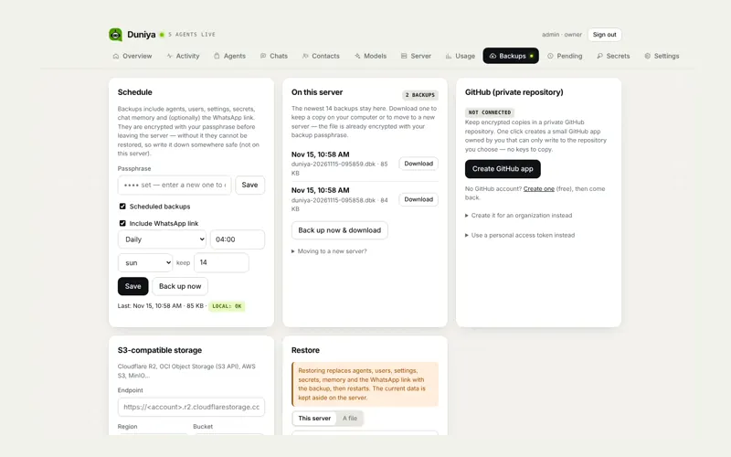

<p align="center">
  
</p>

<h1 align="center">Duniya</h1>

<p align="center"><b>AI agents for your WhatsApp groups and chats, on your own free server, run from a calm web panel.</b></p>

<p align="center">
  <a href="https://cloud.oracle.com/resourcemanager/stacks/create?zipUrl=https://github.com/vikramgorla/whatsapp-agent-duniya/releases/latest/download/whatsapp-agent-duniya.zip"></a>
  <a href="https://shell.cloud.google.com/cloudshell/editor?cloudshell_git_repo=https%3A%2F%2Fgithub.com%2Fvikramgorla%2Fwhatsapp-agent-duniya&cloudshell_git_branch=main&cloudshell_tutorial=infra%2Fgcp%2Ftutorial.md"></a>
  <a href="https://vikramgorla.github.io/whatsapp-agent-duniya/"></a>
</p>

<p align="center">
  <a href="docs/README.md"><b>Guides</b></a> · <a href="docs/install.md">Install</a> ·
  <a href="docs/install.md#where-is-my-panel-find-the-ip--url">Where is my panel?</a> ·
  <a href="CONTRIBUTING.md">Contributing</a> · <a href="SECURITY.md">Security</a>
</p>

<p align="center">
  
</p>

> [!TIP]
> Free to host on Oracle Cloud or Google Cloud, ~180 MB of RAM, no SSH needed after the install. Open the buttons
> in a new tab (Ctrl/⌘-click or long-press) so this page stays open.

## What it does

<table>
<tr>
<td width="33%" valign="top"><a href="docs/agents.md"></a><br><b>Agents in plain words</b><br>Templates or describe it; review a visual diff. Quick replies, welcomes and FAQ answers without AI.</td>
<td width="33%" valign="top"><a href="docs/privacy.md"></a><br><b>Silent by default</b><br>Chats are off until you switch them on; then recent messages load from your phone (retried by itself). Set up a person's chat before they write.</td>
<td width="33%" valign="top"><a href="docs/owner-assistant.md"></a><br><b>Your own super agent</b><br>Recaps, GIFs, voice and pictures in your own WhatsApp chat; posts into your groups after you confirm. Keys and passwords never go through the chat: one-time links instead.</td>
</tr>
<tr>
<td valign="top"><a href="docs/models.md"></a><br><b>Any model, with a backup</b><br>ChatGPT, Copilot, OpenRouter, keys, Ollama.</td>
<td valign="top"><a href="docs/models.md#photos--voice"></a><br><b>Photos &amp; voice</b><br>Sees photos, hears and sends voice notes.</td>
<td valign="top"><a href="docs/spending.md"></a><br><b>Spending caps</b><br>Monthly caps, 80 % alert, weekly summary.</td>
</tr>
<tr>
<td valign="top"><a href="docs/agents.md#tool-services-mcp"></a><br><b>Real tools via MCP</b><br>Browse the MCP Registry and add in one click; per-role allow lists, confirm step for changes.</td>
<td valign="top"><a href="docs/agents.md#whatsapp-actions"></a><br><b>WhatsApp powers</b><br>Media, polls, reactions, group admin per role. Names from your phone contacts and group member tags.</td>
<td valign="top"><a href="docs/getting-started.md#why-didnt-it-answer"></a><br><b>"Why didn't it answer?"</b><br>Reasons per chat, one-click fixes. Press <b>/</b> to find anything.</td>
</tr>
<tr>
<td valign="top"><a href="docs/domains-and-access.md"></a><br><b>Your domain, any proxy</b><br>Automatic HTTPS, a switch that never locks you out.</td>
<td valign="top"><a href="docs/backups-and-updates.md"></a><br><b>Backups &amp; updates</b><br>Encrypted to GitHub or S3; updates wait for your OK when breaking; no SSH needed, even for the root helper.</td>
<td valign="top"><a href="docs/admin-mcp.md"></a><br><b>From ChatGPT, Claude or your phone</b><br>The app is an MCP server too, and the panel <a href="docs/phone.md">installs on your home screen</a> and opens fast on a slow connection.</td>
</tr>
</table>

## How it works

<p align="center"></p>

<details><summary>Diagram as text</summary>

1. A message arrives on the WhatsApp linked device.
2. Is the chat switched on? If not, it is dropped, never stored, and the agent stays silent (when you switch it on, its recent messages are loaded from your phone).
3. The router checks the trigger, the role and the rate limits.
4. The agent (stored in the app) answers with its model, which falls back to another one if needed.
5. The agent can use tools: MCP services, WhatsApp actions and memory.
6. Tools that change something wait until an organizer replies `confirm CODE`.
7. The owner manages agents from the panel (installable on a phone) or ChatGPT/Claude.

</details>

## Get it running

| Host | Cost | Start |
|---|---|---|
| **Oracle Cloud** (Always Free) | free | Deploy button above → **Apply** → open `http://<server-ip>/` ([guide](docs/deploy/oci-free-tier.md)) |
| **Google Cloud** (e2-micro) | free | Cloud Shell button above → follow the tutorial ([guide](docs/deploy/google-cloud.md)) |
| **Any Ubuntu/Debian server** | your VM | one command, below ([options](docs/install.md)) |
| **Docker** | your machine | `docker compose up -d` ([guide](docs/deploy/docker.md)) |

```bash
curl -fsSL https://raw.githubusercontent.com/vikramgorla/whatsapp-agent-duniya/main/install.sh | sudo bash
```

Then **Getting started** on Overview walks you through it in place, about five taps: link WhatsApp, paste any model
key (or start free), tap a template, switch a group on, send a test. Afterwards press **/** to find any agent, chat or
setting. [Getting started →](docs/getting-started.md)

A free 1 GB VM is enough: heavier extras (on-server speech, local tool services) stay off there unless you switch on
**Small server mode** in Settings → Server. [Small servers →](docs/small-servers.md)

> [!IMPORTANT]
> **Where is my panel?** Open `http://<server-ip>/`: a live progress page that turns into the panel at
> `https://<ip-with-dashes>.sslip.io`.
> **Oracle:** job *Succeeded* → **reload the page** → **Application information** → **Open the panel** (sign in as
> `admin` with the stack's owner password). **Google:** the last lines in Cloud Shell (`Ready: …` and the setup
> code). **Own server:** the installer's last lines, or `sudo duniya status`.
> [Every host, step by step →](docs/install.md#where-is-my-panel-find-the-ip--url)

**Already running?** Update, recreate, remove: [Managing your server](docs/README.md#run-it) ·
a release needs a step: [Upgrading](docs/upgrading.md).

<p align="center">
  <a href="docs/README.md"></a>
</p>

---

<sub>[Feature specs](specs) · [Design language](DESIGN.md) ·
[AGENTS.md](AGENTS.md) (working rules, Definition of Done) · [Security policy](SECURITY.md)</sub>

> [!WARNING]
> Use a **dedicated WhatsApp number**: Duniya links as a normal linked device (via
> [Baileys](https://github.com/WhiskeySockets/Baileys)), and unofficial clients can be banned.

<sub>Duniya is an independent open-source project, not affiliated with, endorsed by or sponsored by WhatsApp or Meta.
WhatsApp is a trademark of its owner.</sub>
