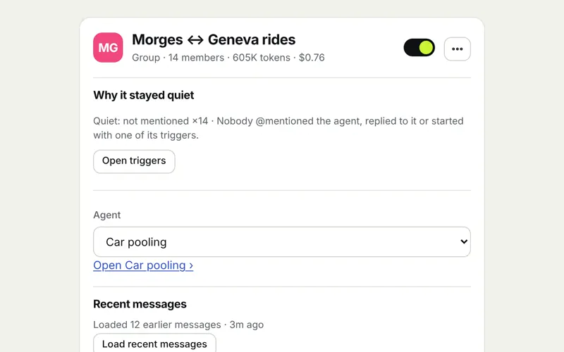
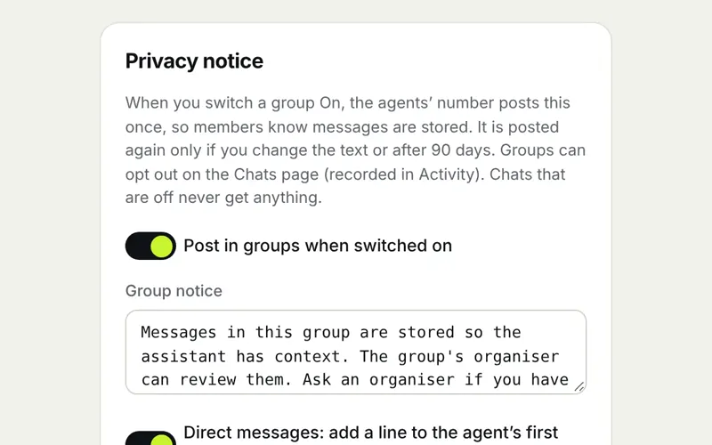

<p align="center">
  
</p>

<h1 align="center">Duniya</h1>

<p align="center"><b>AI agents for your WhatsApp groups and chats, on your own free server, run from a calm web panel.</b></p>

<p align="center">
  <a href="https://cloud.oracle.com/resourcemanager/stacks/create?zipUrl=https://github.com/vikramgorla/whatsapp-agent-duniya/releases/latest/download/whatsapp-agent-duniya.zip"></a>
  <a href="https://shell.cloud.google.com/cloudshell/editor?cloudshell_git_repo=https%3A%2F%2Fgithub.com%2Fvikramgorla%2Fwhatsapp-agent-duniya&cloudshell_git_branch=main&cloudshell_tutorial=infra%2Fgcp%2Ftutorial.md"></a>
  <a href="https://vikramgorla.github.io/whatsapp-agent-duniya/"></a>
</p>

<p align="center">
  <a href="docs/README.md"><b>Guides</b></a> · <a href="docs/install.md">Install</a> ·
  <a href="docs/getting-started.md">Getting started</a> · <a href="CONTRIBUTING.md">Contributing</a> ·
  <a href="SECURITY.md">Security</a>
</p>

<p align="center">
  
</p>

Duniya links to a spare WhatsApp number and runs helpers in the chats you choose: a car-pool planner, a school-class
assistant, a family organiser. **You** pick which chats they join, which model they use and what they may do. Every
chat is silent until you switch it on.

## Install

```bash
curl -fsSL https://raw.githubusercontent.com/vikramgorla/whatsapp-agent-duniya/main/install.sh | sudo bash
```

Any Ubuntu/Debian server with 1 GB of memory, or one click on Oracle Cloud or Google Cloud (free tiers), or
[Docker](docs/deploy/docker.md). It ends with the panel address and a setup code; **Getting started** on Overview
then takes about five taps: link WhatsApp, connect a model, pick a template, switch a group on, send a test.
[Install guide →](docs/install.md) · [Where is my panel?](docs/install.md#where-is-my-panel-find-the-ip--url)

## Highlights

<table>
<tr>
<td width="25%" valign="top"><a href="docs/agents.md"></a><br><b>Agents in plain words</b><br>A template or a sentence; every change as a visual diff. Quick replies and FAQ without AI. Test before, <b>Review &amp; teach</b> after.</td>
<td width="25%" valign="top"><a href="docs/owner-assistant.md"></a><br><b>Your own assistant</b><br>Recaps, GIFs, voice and sends into your groups, in your WhatsApp or the <b>Ask</b> box. Changes wait for your OK.</td>
<td width="25%" valign="top"><a href="docs/chats.md#search-messages-owner"></a><br><b>Find &amp; search</b><br>Press <b>/</b> for any agent, chat or setting, or search what was said in every chat. <i>Why didn't it answer?</i> with a fix.</td>
<td width="25%" valign="top"><a href="docs/models.md"></a><br><b>Any model, with a backup</b><br>OpenRouter (free models), ChatGPT plan, Claude, OpenAI, Copilot, Ollama. Photos &amp; voice. Spending caps.</td>
</tr>
<tr>
<td valign="top"><a href="docs/privacy.md"></a><br><b>Silent by default</b><br>Off chats are never stored or sent to a model; groups are told once. Tools are allowed per role, in code.</td>
<td valign="top"><a href="docs/everyday.md#on-your-phone"></a><br><b>On your phone</b><br>Installs on your home screen: tab bar at your thumb, live, light and dark. Nothing from a store.</td>
<td valign="top"><a href="docs/small-servers.md"></a><br><b>Made for a 1 GB VM</b><br>~180 MB of RAM. Old data pruned by itself; reconnects, crashes and a full disk handled without you.</td>
<td valign="top"><a href="docs/backups-and-updates.md"></a><br><b>Backups &amp; updates</b><br>Encrypted to GitHub or S3. One-click updates that show what's new; breaking ones wait for you. No SSH.</td>
</tr>
</table>

More: [MCP tool services](docs/agents.md#tool-services-mcp) · [manage it from ChatGPT or Claude](docs/admin-mcp.md) ·
[your own domain](docs/domains-and-access.md) · [how it works](docs/architecture.md).

> [!WARNING]
> Use a **dedicated WhatsApp number**: Duniya links as a normal linked device (via
> [Baileys](https://github.com/WhiskeySockets/Baileys)), and unofficial clients can be banned.

<p align="center">
  <a href="docs/README.md"></a>
</p>

---

<sub>[Feature specs](specs) · [Design language](DESIGN.md) · [AGENTS.md](AGENTS.md) (working rules, Definition of
Done) · [Security policy](SECURITY.md). Duniya is an independent open-source project, not affiliated with, endorsed by
or sponsored by WhatsApp or Meta. WhatsApp is a trademark of its owner.</sub>
