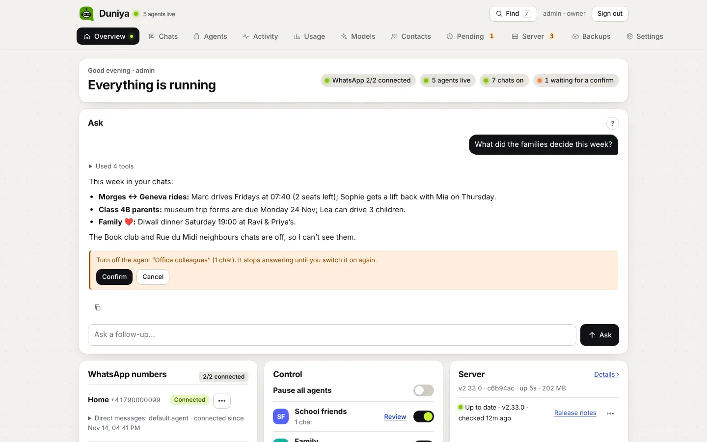

<p align="center">
  
</p>

<h1 align="center">Duniya</h1>

<p align="center"><b>AI agents for your WhatsApp groups and chats, on your own server, managed from a calm web panel.</b></p>

<p align="center">
  <a href="https://vikramgorla.github.io/whatsapp-agent-duniya/">Website</a> ·
  <a href="#quick-start">Quick start</a> ·
  <a href="docs/configuration.md">Docs</a> ·
  <a href="CONTRIBUTING.md">Contributing</a> ·
  <a href="SECURITY.md">Security</a>
</p>

<p align="center">
  
</p>

## Highlights

- **Agents from templates or plain words.** School friends, Family, Car pooling, Office, Neighbours, or describe one
  and let the AI helper draft it; review before saving. Group memory, organizers, scheduled posts, test console.
- **Silent by default.** Every chat is off until you switch it on; off chats are never stored or sent to a model.
- **Several WhatsApp numbers, groups and 1:1 chats.** Linked-device login by QR or pairing code, no commercial API.
- **Any model.** Sign in with ChatGPT, GitHub Copilot, OpenRouter (free models), Anthropic or OpenAI keys,
  Ollama and other compatible endpoints, or *Auto*; per agent and per chat.
- **Real tools via MCP.** Remote servers with OAuth sign-in or tokens, or local ones from npm/GitHub; per-role allow
  lists and a `confirm CODE` step for changes. WhatsApp actions too: media, reactions, polls, group admin.
- **Manage it from ChatGPT or Claude.** The app is an MCP server with OAuth 2.1, your panel role and confirmations.
- **Run it without SSH.** Usage and cost reports, activity log with a logging policy, server metrics, OS updates,
  one-click app updates and encrypted backups to GitHub, S3 or a download.
- **Free to host.** One click on Oracle Cloud Always Free; about 180 MB of RAM.

## Quick start

**Oracle Cloud (free, one click)**

[](https://cloud.oracle.com/resourcemanager/stacks/create?zipUrl=https://github.com/vikramgorla/whatsapp-agent-duniya/releases/latest/download/whatsapp-agent-duniya.zip)

Pick your home region, click **Apply**, and open `http://<server-ip>/` to follow the install.
Walkthrough: [docs/deploy/oci-free-tier.md](docs/deploy/oci-free-tier.md).

**Any Ubuntu/Debian server (x86_64 or arm64)**

```bash
curl -fsSL https://raw.githubusercontent.com/vikramgorla/whatsapp-agent-duniya/main/install.sh | sudo bash
```

The installer prints the panel address and a one-time setup code. Then: link a dedicated WhatsApp number, connect a
model, create an agent, switch a chat on. Options (`--ip-https`, `--domain`, Cloudflare Tunnel, Docker) and every
setting are in [docs/configuration.md](docs/configuration.md).

## Learn more

- [Website with screenshots and short videos](https://vikramgorla.github.io/whatsapp-agent-duniya/)
- [Reference: install options, first steps, AI assistants, architecture, settings](docs/configuration.md)
- Deploy guides: [Oracle Cloud](docs/deploy/oci-free-tier.md) · [Docker](docs/deploy/docker.md) ·
  [Cloudflare Tunnel](docs/deploy/cloudflare-tunnel.md) · [Terraform + GitHub Actions](docs/deploy/terraform-github-actions.md)
- Feature specs: [`specs/`](specs) · design language: [DESIGN.md](DESIGN.md)
- [Contributing](CONTRIBUTING.md) · [Security policy](SECURITY.md)

> Use a dedicated WhatsApp number: Duniya links as a normal linked device (via
> [Baileys](https://github.com/WhiskeySockets/Baileys)), and unofficial clients can be banned.
