# Duniya guides

**Everything you need to run AI agents in your WhatsApp and Telegram groups, in the order you'll need it.**

  
  

**In 30 seconds**
- New here? Follow **1 → 8** below: install, then the panel's *Getting started* does the rest in about five taps.
- Every page opens with what it is for, the one thing to do and a 30-second summary.
- Already running? Jump to [Run your server](#run-your-server). Stuck? [Troubleshooting](troubleshooting.md).

## What is Duniya, and is it for me?

Duniya puts AI helpers into the WhatsApp and Telegram groups you choose: a car-pool planner, a school-class assistant,
a family organiser. It runs on a small server you own (free on Oracle or Google Cloud) and you manage it from a web
panel on your phone or computer. Chats stay silent until you switch them on.

| It is for you if… | It is not for you if… |
|---|---|
| you organise a family, school, club or neighbourhood group and want a helper that answers, reminds and keeps track | you need the official WhatsApp Business API, a customer-support desk or marketing at scale |
| you want your chats and data on your own server, and to choose the AI model (free ones included) | you cannot use a spare phone number for the agents (a prepaid SIM is enough) |
| you can click through a cloud sign-up, or paste one command into a server | you want a hosted app with nothing to install |

What it costs: the software is free (MIT). The server can be free (Oracle or Google free tier) or a few euros a month
anywhere else. Models: free OpenRouter models, your ChatGPT or Claude plan, or pay per use with a key; spending caps
stop it at your limit.

## Start here

| | Step | Guide | Use this when… |
|---|---|---|---|
| 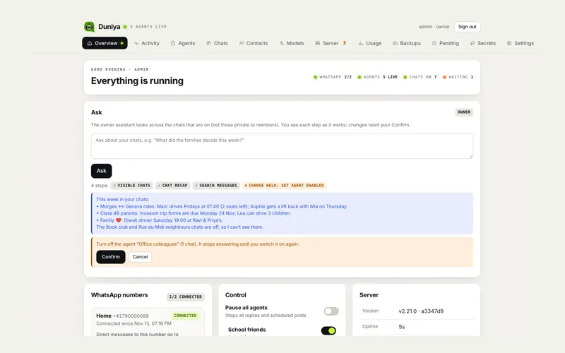 | **1** | **[Install](install.md)** | you want Duniya on a server: one click on Oracle or Google Cloud, or one command |
|  | **2** | **[Getting started](getting-started.md)** | the panel is open: five taps to a first answer, and *Where is my panel?* |
| 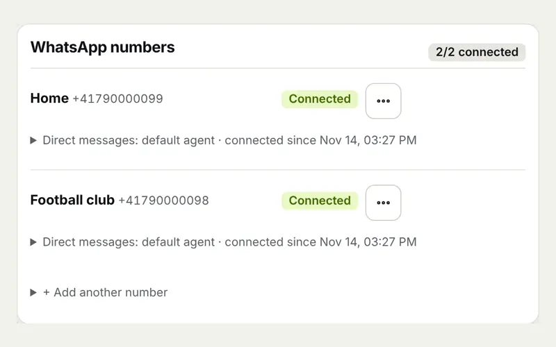 | **3** | **[Connect WhatsApp](whatsapp.md)** | you link the agents' number (QR or pairing code), or add another one |
| 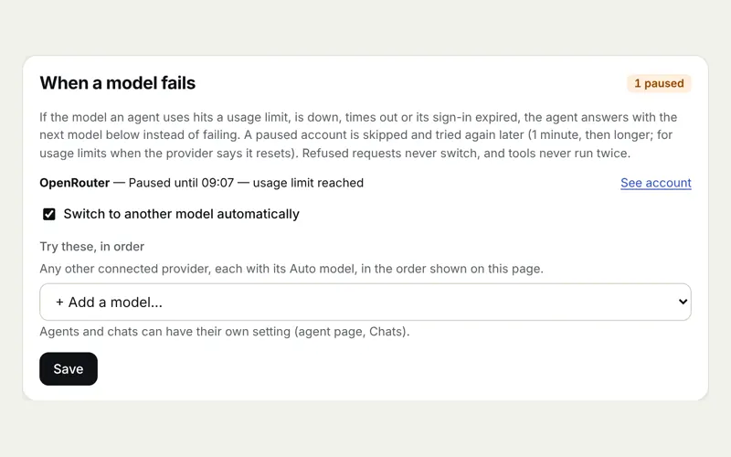 | **4** | **[Add a model](models.md)** | you connect OpenRouter, ChatGPT, Claude, OpenAI, Copilot, Claude Code, Codex or Ollama, with a backup model |
|  | **5** | **[Agents](agents.md)** | you create your first agent, test it, review its answers, give it tools and quick replies |
| 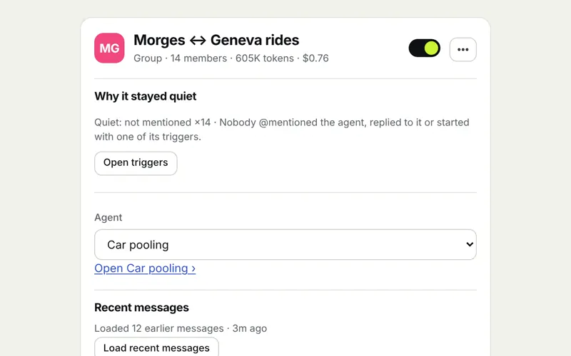 | **6** | **[Chats](chats.md)** | you switch groups on, set up a person's chat, search messages, sort out names |
|  | **7** | **[Owner assistant](owner-assistant.md)** | you want your own agent in your WhatsApp and the Ask box: recaps, sends, alerts, weekly summary |
| 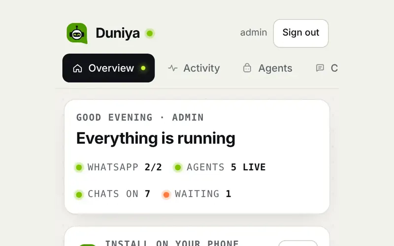 | **8** | **[Everyday use](everyday.md)** | you use Overview, Find anything, *Why didn't it answer?*, Activity, and the panel on your phone |

> [!WARNING]
> Use a **dedicated WhatsApp number**: Duniya links as an unofficial client, and those can be banned.

## More for agents and models

| | Guide | Use this when… |
|---|---|---|
| 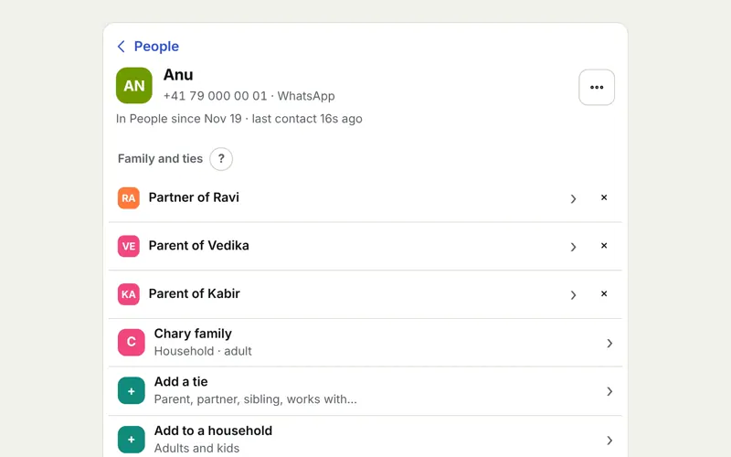 | **[People](people.md)** | you want one place for who is who: families and kids, notes, tags, lists, merge, export and erase |
| 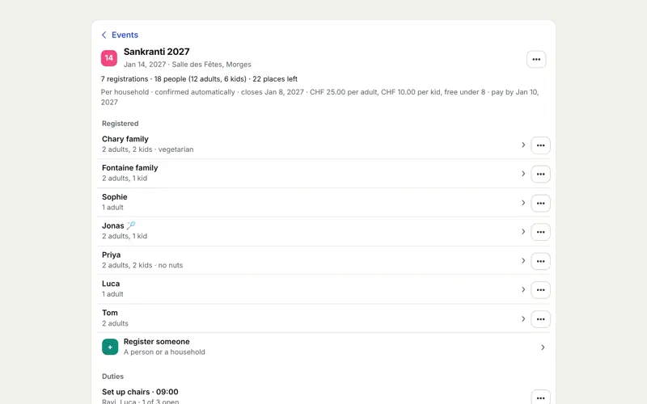 | **[Events](events.md)** · [Orders and payments](orders.md) · [Modules](modules.md) | you run family events: registrations with kids, a waiting list, duties, who paid what |
| 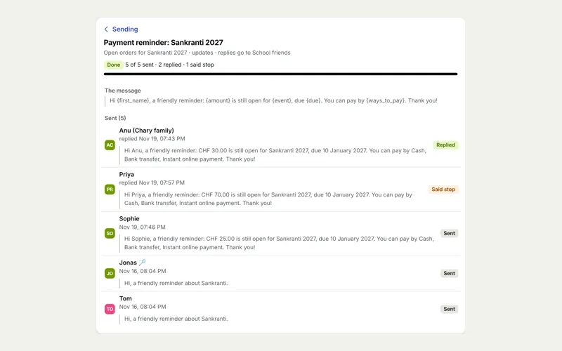 | **[Lists and sending](sending.md)** | you want to message a list, an event's families or everyone who owes: with consent, each person's own wording, at a person's pace |
| 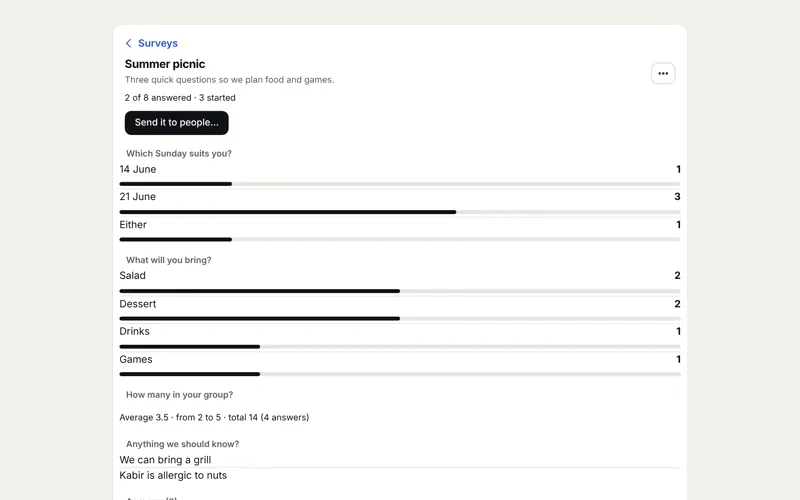 | **[Surveys](surveys.md)** · [Campaigns](campaigns.md) | you want answers to a few questions (in chat or by link), or a short series of messages with follow-ups only to who has not answered or paid |
| `WEB` | **[Web search](web-search.md)** | agents should look up current facts (hours, prices, train times, news) with your AI provider's built-in search |
| 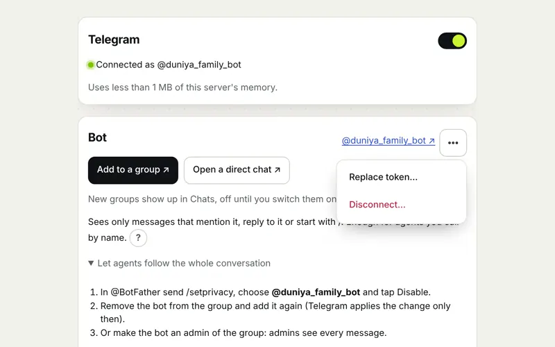 | **[Connect Telegram](telegram.md)** | your groups are on Telegram too: add a bot, same agents, one person on both apps |
|  | **[Photos & voice](models.md#photos--voice)** | agents should see photos, hear voice notes or reply with voice |
| 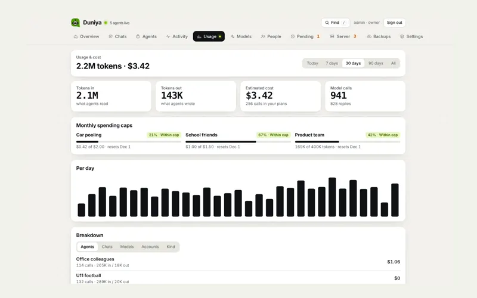 | **[Usage & spending caps](spending.md)** | you want to see or limit what it costs |
| `AI` | **[Smarter agents](intelligence.md)** | agents should use a cheap model for simple messages and never send a wrong amount or date |
| 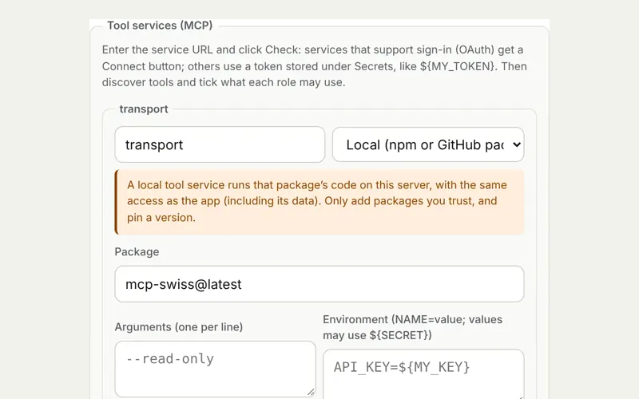 | **[Tool services (MCP)](agents.md#tool-services-mcp)** | agents need real tools: a calendar, a planner, GIFs; [how they use each one](tool-services.md) (when, changes, sharing GIFs on their own, limits) and [how sure they must be before changing things](agents.md#how-sure-before-changing-things) |
|  | **[Manage from ChatGPT or Claude](admin-mcp.md)** | you want to run Duniya by chatting with an AI assistant |
| 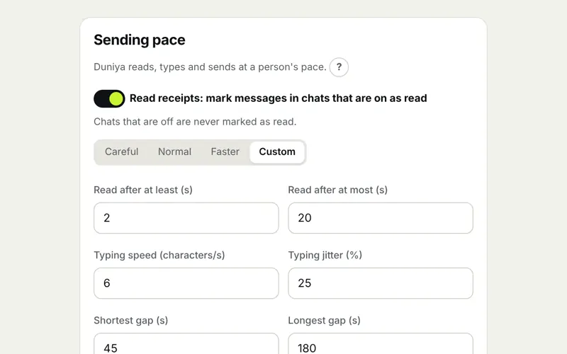 | **[Sending pace](sending-pace.md)** | messages should be read, answered and sent at a person's pace: read receipts, typing, new chats a day |
| 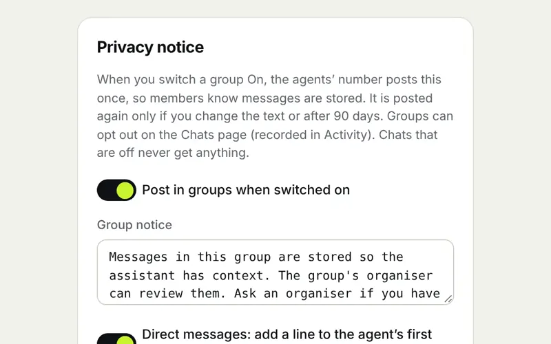 | **[Privacy](privacy.md)** | you want to know what is stored, who sees it, and what groups are told |

## Run your server

| | Guide | Use this when… |
|---|---|---|
| 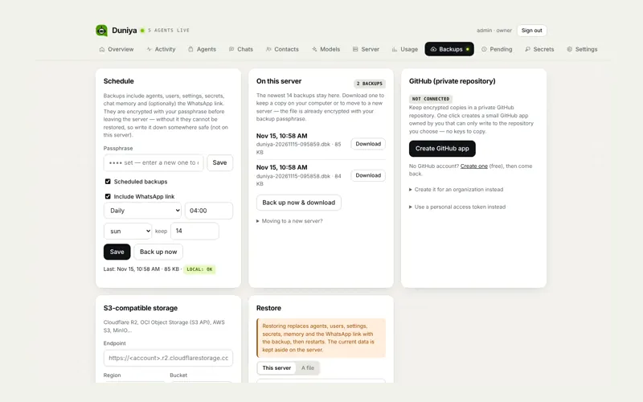 | **[Backups & updates](backups-and-updates.md)** | you set up backups, update, or move to a new server |
| 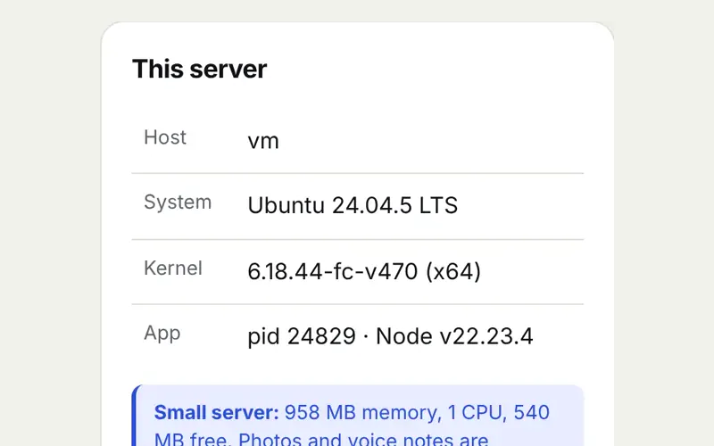 | **[Small servers](small-servers.md)** | you run on 1 GB / 1 CPU: what adapts, Health, automatic clean-up |
|  | **[Domains & access](domains-and-access.md)** | you want your own domain, a proxy/CDN, an IP allow-list, or no open ports |
| `GOOGLE` | **[Sign in with Google](google-sign-in.md)** | people should sign in with Google |
| `2.x` | **[Upgrading](upgrading.md)** | a release needs a step from you |
| `HELP` | **[Troubleshooting](troubleshooting.md)** | something does not work on the first day: QR code, phone offline, model key, silent agent, HTTPS, memory, updates |
| `CLI` | **[Command line](cli.md)** | the panel is not enough: lost password, locked out |

<b>Every task per host</b>: update, recreate, remove, find the IP and logs

| Hosted on | Update the app | Update the infrastructure | Recreate | Remove | Find IP, logs, errors |
|---|---|---|---|---|---|
| Oracle Cloud stack ([guide](deploy/oci-free-tier.md)) | [panel](deploy/oci-free-tier.md#update-the-app) | [new zip → Plan → Apply](deploy/oci-free-tier.md#update-the-stack-infrastructure) | [Destroy → Apply → restore](deploy/oci-free-tier.md#recreate-from-scratch) | [Destroy, then Delete](deploy/oci-free-tier.md#remove-everything) | [console](deploy/oci-free-tier.md#find-things-fast) · [errors](deploy/oci-free-tier.md#common-errors) |
| Google Cloud script ([guide](deploy/google-cloud.md)) | [panel](deploy/google-cloud.md#update-the-app) | [re-run safely](deploy/google-cloud.md#update-the-infrastructure) | [delete VM → script → restore](deploy/google-cloud.md#recreate-from-scratch) | [VM, firewall rule, IPs](deploy/google-cloud.md#remove-everything) | [console](deploy/google-cloud.md#find-things-fast) · [errors](deploy/google-cloud.md#common-errors) |
| Own server (installer) | [panel / `duniya update`](install.md#update-the-app) | [re-run the installer](install.md#change-how-the-panel-is-reached) | [backup → install → restore](install.md#recreate-from-scratch-new-server-or-fresh-os) | [commands](install.md#remove-duniya-from-a-server) | [where to look](install.md#find-things-fast) |
| Docker ([guide](deploy/docker.md)) | [pull + up](deploy/docker.md#update-the-app) | n/a | [down / new machine](deploy/docker.md#recreate-from-scratch) | [down (-v)](deploy/docker.md#remove-everything) | [commands](deploy/docker.md#find-things-fast) |

Also: [Cloudflare Tunnel](deploy/cloudflare-tunnel.md) · [Terraform + GitHub Actions](deploy/terraform-github-actions.md).
The panel's **Server** page has a **Hosting help** card that links to the right guide.

## Reference

| | Guide | Use this when… |
|---|---|---|
| `ENV` | **[Optional settings](settings.md)** | you set environment variables for the service |
| `ARCH` | **[How it works](architecture.md)** | you want the big picture: routing, roles, data |
| `DEV` | **[Development](development.md)** | you run it locally, test, take screenshots, release |
| `RULES` | **[AGENTS.md](../AGENTS.md)** | you contribute (people or AI agents): rules and Definition of Done |
| `SECURITY` | **[Security policy](../SECURITY.md)** | you found a vulnerability |

Feature specs: [`specs/`](../specs) · design language: [DESIGN.md](../DESIGN.md).

---
**Next:** [Install](install.md) · [Getting started](getting-started.md) · [Website](https://vikramgorla.github.io/duniya/)
