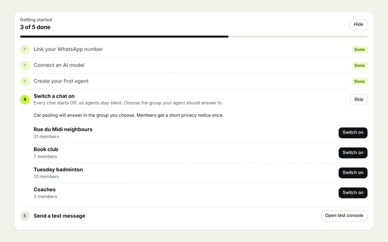
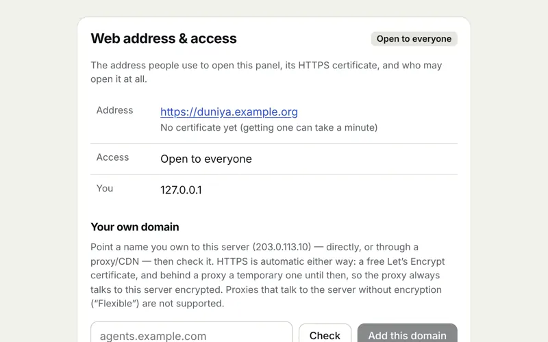
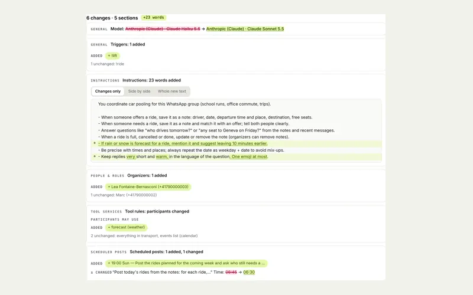
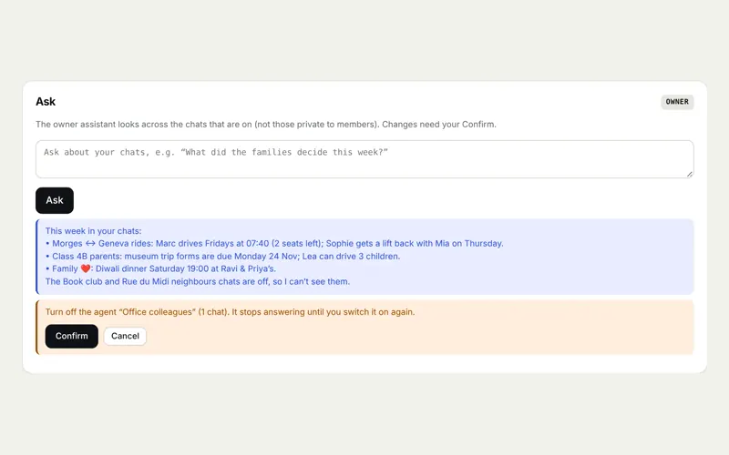
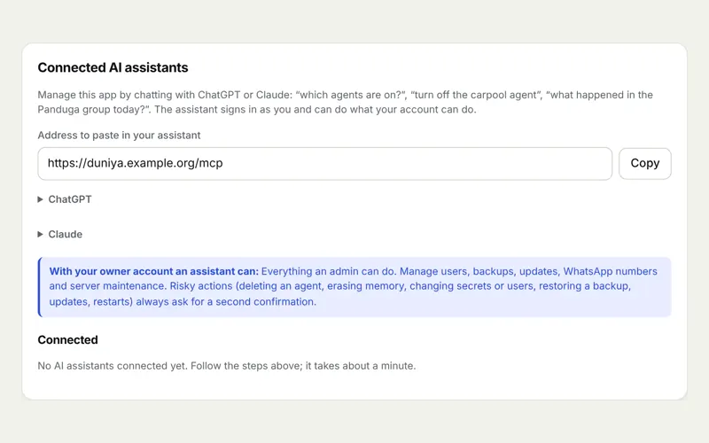
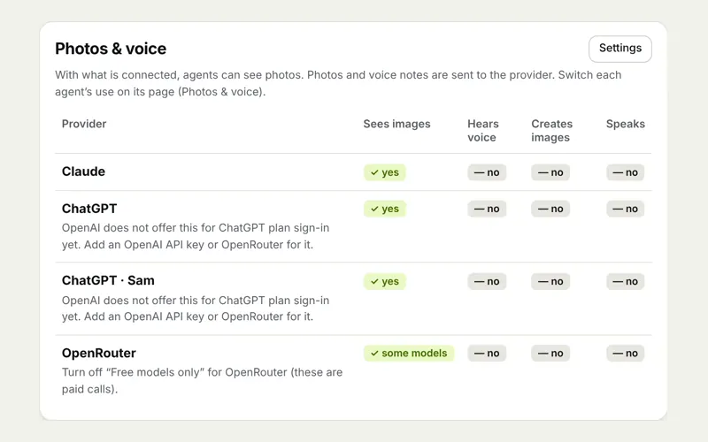

# Duniya guides

Find your goal, click the guide. Each page opens with a 30-second summary and the one thing to do next.

  
  

## Get started

| | Guide | Use this when… |
|---|---|---|
|  | **[Install](install.md)** | you want Duniya on a server: choose a host, one command or one button |
|  | **[Getting started](getting-started.md)** | the panel is open and you want a first agent answering in a group |
| `FIND` | **[Where is my panel?](install.md#where-is-my-panel-find-the-ip--url)** | the install finished and you can't find the address or setup code |
| `2.x` | **[Upgrading](upgrading.md)** | a release needs a step from you |

## Run it

| | Guide | Use this when… |
|---|---|---|
| `OCI` | **[Oracle Cloud](deploy/oci-free-tier.md)** | you deploy, update, recreate or remove the Oracle stack |
| `GCP` | **[Google Cloud](deploy/google-cloud.md)** | you run the free e2-micro: IP, serial console, recreate, remove |
| `DOCKER` | **[Docker / Compose](deploy/docker.md)** | you prefer containers on your own machine |
|  | **[Domains & access](domains-and-access.md)** | you want your own domain, a proxy/CDN, or an IP allow-list |
| `TUNNEL` | **[Cloudflare Tunnel](deploy/cloudflare-tunnel.md)** | you want no open ports at all |
|  | **[Backups & updates](backups-and-updates.md)** | you set up backups, update, or move to a new server |
|  | **[Small servers](small-servers.md)** | you run on 1 GB / 1 CPU and wonder what adapts |
| `CLI` | **[Command line](cli.md)** | the panel is not enough: lost password, locked out |
| `IaC` | **[Terraform + GitHub Actions](deploy/terraform-github-actions.md)** | you want infrastructure changes reviewed in pull requests |

<b>Managing your server: every task per host</b>

| Hosted on | Update the app | Update the infrastructure | Recreate | Remove | Find IP, logs, errors |
|---|---|---|---|---|---|
| Oracle Cloud stack | [panel](deploy/oci-free-tier.md#update-the-app) | [new zip → Plan → Apply](deploy/oci-free-tier.md#update-the-stack-infrastructure) | [Destroy → Apply → restore](deploy/oci-free-tier.md#recreate-from-scratch) | [Destroy, then Delete](deploy/oci-free-tier.md#remove-everything) | [console](deploy/oci-free-tier.md#find-things-fast) · [errors](deploy/oci-free-tier.md#common-errors) |
| Google Cloud script | [panel](deploy/google-cloud.md#update-the-app) | [re-run safely](deploy/google-cloud.md#update-the-infrastructure) | [delete VM → script → restore](deploy/google-cloud.md#recreate-from-scratch) | [VM, firewall rule, IPs](deploy/google-cloud.md#remove-everything) | [console](deploy/google-cloud.md#find-things-fast) · [errors](deploy/google-cloud.md#common-errors) |
| Own server (installer) | [panel / `duniya update`](install.md#update-the-app) | [re-run the installer](install.md#change-how-the-panel-is-reached) | [backup → install → restore](install.md#recreate-from-scratch-new-server-or-fresh-os) | [commands](install.md#remove-duniya-from-a-server) | [where to look](install.md#find-things-fast) |
| Docker | [pull + up](deploy/docker.md#update-the-app) | n/a | [down / new machine](deploy/docker.md#recreate-from-scratch) | [down (-v)](deploy/docker.md#remove-everything) | [commands](deploy/docker.md#find-things-fast) |

The panel's **Server** page has a **Hosting help** card that links to the right guide.

## Agents

| | Guide | Use this when… |
|---|---|---|
|  | **[Agents, tools & memory](agents.md)** | you create or change an agent, roles, MCP tools, memory, contacts, numbers |
|  | **[Owner assistant](owner-assistant.md)** | you want recaps and changes from your own WhatsApp, alerts, a weekly summary |
|  | **[Manage from ChatGPT or Claude](admin-mcp.md)** | you want to run Duniya by chatting with an AI assistant |
| `PHONE` | **[Mobile app](mobile-app.md)** | you want status, Ask and confirmations on your phone |

## Models

| | Guide | Use this when… |
|---|---|---|
|  | **[Models & fallback](models.md)** | you connect a provider or want a backup when a model fails |
|  | **[Photos & voice](models.md#photos--voice)** | agents should see photos, hear voice notes or reply with voice |
|  | **[Usage & spending caps](spending.md)** | you want to see or limit what it costs |

## Privacy & security

| | Guide | Use this when… |
|---|---|---|
|  | **[Privacy](privacy.md)** | you want to know what is stored, who sees it, and what groups are told |
| `GOOGLE` | **[Sign in with Google](google-sign-in.md)** | people should sign in with Google, or you change the domain while it is on |
| `SECURITY` | **[Security policy](../SECURITY.md)** | you found a vulnerability |

> [!WARNING]
> Use a **dedicated WhatsApp number**: unofficial clients can be banned. Agents only reply when addressed and are
> rate-limited to keep that risk low.

## Reference

| | Guide | Use this when… |
|---|---|---|
| `ENV` | **[Optional settings](settings.md)** | you set environment variables for the service |
| `ARCH` | **[How it works](architecture.md)** | you want the big picture: routing, roles, data |
| `DEV` | **[Development](development.md)** | you run it locally, test, take screenshots, release |
| `RULES` | **[AGENTS.md](../AGENTS.md)** | you contribute (people or AI agents): rules and Definition of Done |

Notes on providers and sign-ins

- Claude **subscriptions** (Pro/Max) can't be used by third-party apps under Anthropic's terms, so Claude needs an
  API key. ChatGPT plan usage uses OpenAI's official open-source flow (preview).
- GitHub *device login* for backups needs a GitHub OAuth App client id (Device Flow enabled); the one-click GitHub App
  or pasting a token always works.
- Feature specs: [`specs/`](../specs) · design language: [DESIGN.md](../DESIGN.md).

