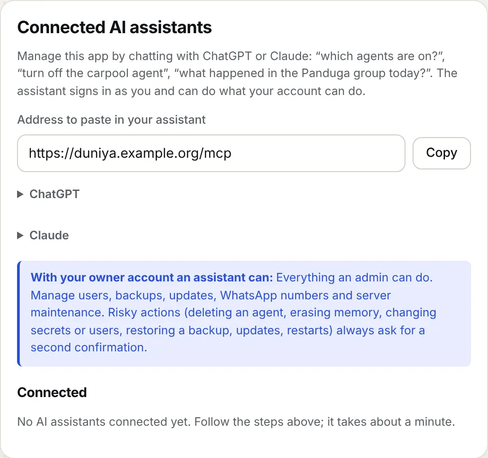
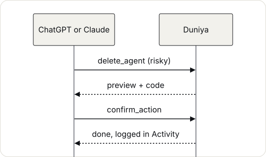

# Manage it from ChatGPT or Claude (admin MCP)

**Run Duniya by chatting: "which agents are on?", "turn off the carpool agent", "what happened in the school group
today?".**

**Do it:** panel → **Settings → Connected AI assistants** → copy `https://YOUR-HOST/mcp`.

**In 30 seconds**
- The assistant acts as you, with your panel role; risky actions need a second `confirm_action`.
- Every call is logged; disconnect any time. Needs public HTTPS (Caddy or Cloudflare Tunnel).

## Connect

| Assistant | Steps |
|---|---|
| **ChatGPT** | Settings → Apps & Connectors → Advanced settings → turn on Developer mode → Create a connector: the address as MCP server URL, OAuth |
| **Claude** | Settings → Connectors → Add custom connector → paste the address → Add → Connect |

Then a Duniya page opens: sign in (if asked), check what the assistant may do, **Approve**.

Diagram as text

1. ChatGPT or Claude calls a risky tool, for example `delete_agent`.
2. Duniya answers with a preview and a code; nothing has changed yet.
3. The assistant calls `confirm_action` with that code (single use, 10 minutes; a restart does not lose it).
4. Duniya does it and logs it in Activity.

> [!IMPORTANT]
> Viewers stay read-only; owner-only actions stay owner-only. Risky: deleting an agent, erasing memory, secrets,
> users, WhatsApp numbers, restoring backups, updates, restarts.

> [!TIP]
> Behind a proxy set `TRUST_PROXY=1`, or `PUBLIC_URL=https://your-host` so the OAuth issuer and MCP address are fixed
> ([settings](settings.md)).

Under the hood

OAuth 2.1 with dynamic client registration, PKCE S256, resource-bound tokens (access 1 h, refresh 30 days with
rotation). Spec: [`specs/017-admin-mcp/`](../specs/017-admin-mcp/spec.md).

## Tools

94 tools cover the panel:

| Area | Covers |
|---|---|
| Overview | status, activity |
| Agents | create, update, draft with AI, test, export, enable |
| Chats | assign, settings (model, fallback mode and chain, logging), private, privacy notice, stored messages, `load_chat_history` (Load recent messages from the phone; the owner assistant runs it without a confirm code), `set_history_on_switch_on`, prepare a direct chat before the person writes (`prepare_direct_chat`; confirmed when `send_intro` is set), first message by the agent (`send_chat_intro`, confirmed) |
| Money | usage, prices, spending caps, owner alerts, weekly summary |
| People & memory | contacts, memory, WhatsApp groups, WhatsApp numbers, users |
| Models | models, accounts, fallback, photos & voice |
| Tools | global tool services, browse and add from the MCP Registry (`search_mcp_registry`, `add_tool_service_from_registry`), secrets, confirmations, logging |
| Server | updates (incl. breaking releases: `apply_update` with `breaking: true`, `snooze_update_decision`), metrics (with hosting), OS updates (`list_os_updates`: will install / rolling out gradually / held back; `run_maintenance` `os-update` or `os-update-all` to include gradual updates; restart-needed status), restart, backups |

The list is in `src/panel/admin-tools.js`; a feature that adds panel functionality adds its tool there
([AGENTS.md](../AGENTS.md)). The [owner assistant](owner-assistant.md) uses the same tools from WhatsApp.

---
**Next:** [Owner assistant](owner-assistant.md) · [Domains & access](domains-and-access.md) · [Docs index](README.md)
