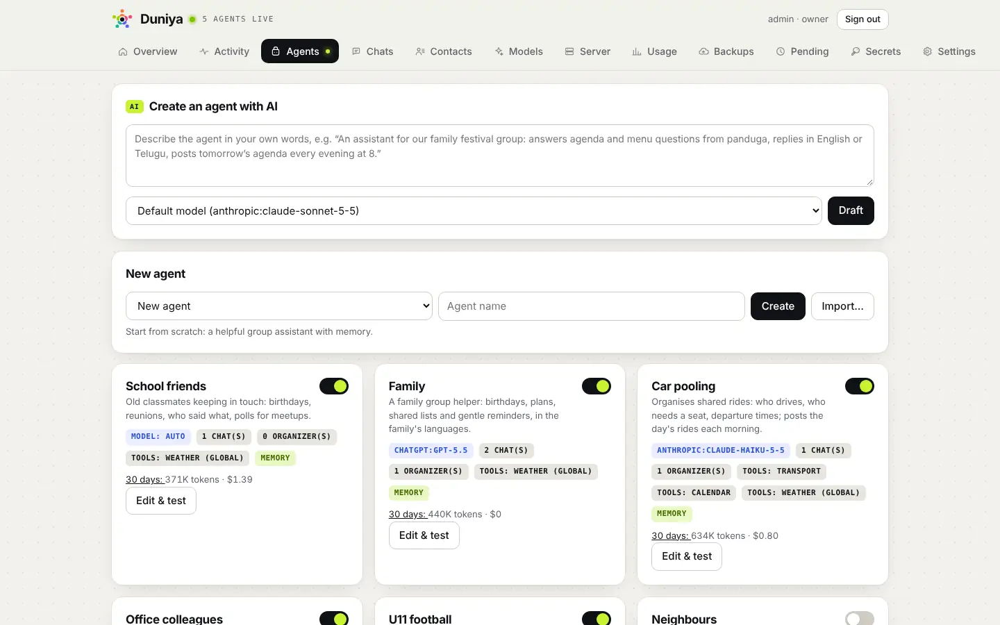
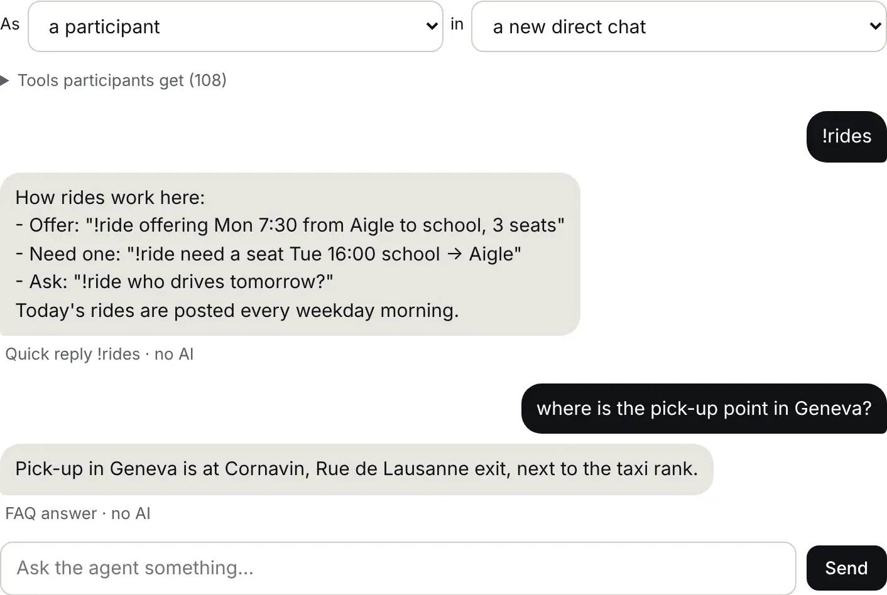

# Agents, tools and memory

**An agent is data, not code: instructions, triggers, organizers, tools, a model, memory, a cap and scheduled posts.**

**Do it:** panel → **Agents → New agent** → pick a template, or **Create an agent with AI**.

**In 30 seconds**
- Template or plain words; every change comes back as a visual diff.
- Tools are allowed per role **in code**; changes need an organizer's `confirm CODE` (kept across restarts until it expires).
- Memory per chat and shared across chats; export/import agents as JSON.

> [!TIP]
> **Triggers work anywhere in a message.** "can mochi help with this?" wakes the agent whose trigger is `mochi`, the
> same as "mochi, help". Only whole words count (`mochiko` doesn't), case doesn't matter, and when several agents'
> triggers appear, the first one in the message wins. In your own direct chat with the owner assistant, a trigger only
> hands the message to that agent when the message *starts* with it, so you can talk *about* agents freely.

## Create and change agents

| Way | How |
|---|---|
| **Templates** (`templates/`) | New agent, School friends, Family, Car pooling, Office colleagues, Event planning, Neighbours |
| **AI helper** | Describe the agent ("a helper for our running club that posts Sunday's run every Saturday") or a change ("shorter replies, make Lea an organizer") |
| **Import** | An agent exported as JSON |

The AI helper shows before → after for model, triggers, organizers, tools and schedules, and the instructions word by
word (*Changes only*, *Side by side*, *Whole new text*). Skip any part; nothing is saved until you apply. Admin MCP:
`draft_agent_with_ai`.

## Quick replies, welcome & FAQ

Built-in answers for the things people ask again and again: **no AI, no tokens**, instant. Agent editor →
**Quick replies, welcome & FAQ** (rows to add, edit and remove, with a live preview).

| Feature | What happens |
|---|---|
| **Quick replies** | A command such as `!rides` as the whole message or its first word (any case, also after a trigger) gets your text right away, before the model. Placeholders: `{name}` (who asked), `{group}`, `{date}`. *Who may use it*: everyone or organizers only (others get no built-in answer; addressed messages go to the model as usual). |
| **`!help`** | When switched on, `!help` lists the quick replies this person may use and how to wake the agent. A quick reply named `!help` wins. |
| **Welcome new members** | When people are added, join by invite link or are let in, the group's agent posts your welcome once per person: `{name}` becomes an @mention, `{rules}` your group rules (added at the end when the text has no `{rules}`). People who join together get **one** message; at most one welcome per group per minute. Only chats that are **on** with an enabled agent; the privacy notice is posted first if it is still due. A group can override the agent's setting under **Chats → Welcome new members** (as the agent / on / off). |
| **FAQ auto-answers** | Question phrasings, optional keywords and an answer. A message that would wake the agent (trigger, @mention, reply, direct message) and clearly matches gets your answer. **Normal**: most of a question's words or all keywords; **Strict**: the whole question or every keyword. *Answer FAQ in the whole group* also answers matching messages without a trigger. Everything else goes to the model, which gets the FAQ as short reference context (capped at 1,500 characters). |

> [!NOTE]
> Built-in answers count in **Usage** as `quick reply`, `faq` and `welcome` with cost 0 and no tokens, and in the
> weekly summary as replies. "Once per person" is stored as a hash of the group and the person's id: no names or
> numbers. The **test console** shows which path answered (*Quick reply !rides · no AI*, *FAQ answer · no AI* or the
> model). The car pooling, family, school, office, event and neighbours templates come with `!rules` (car pooling also
> `!rides`), `!help` and a short welcome switched on; their FAQ starts empty.

Admin MCP and owner assistant: `set_agent_quick_answers` (only the parts given change) and `set_chat_settings`
(`welcome`); the AI helper can propose all of these and shows them in its visual diff.

## Roles

| Role | Who | Gets |
|---|---|---|
| **Organizer** | phone numbers saved on the agent; while none are saved, the WhatsApp admins of its groups | organizer tools; confirms changes |
| **Participant** | everyone else in a bound group | participant tools |

> [!IMPORTANT]
> The model never sees or calls the confirm tool. Permissions are decided in code, not by the prompt.

## Tool services (MCP)

Diagram as text

1. The model wants to use a tool.
2. Is the tool allowed for this role? If not, it is not offered at all.
3. Does it change something? If not, it runs.
4. If it does, a preview is held and an organizer replies `confirm CODE`; then it runs.

1. Agent page → tool services → enter the URL → **Check**.
2. **Connect** to sign in (OAuth, your own OAuth app), or use a token or custom headers.
3. **Discover tools** → tick what participants and organizers may use → save.

Or skip the URL hunting: **Browse tool services** (below).

### Browse tool services (MCP Registry)

**Find a service in the official [MCP Registry](https://registry.modelcontextprotocol.io) and add it in one step.**

1. Agent page → Tool services → **Browse tool services** (or **Settings → Tool services** for all agents).
2. Search by name. Each card shows the publisher, **Hosted** or **Local (npm)**, the keys it needs, a trust hint and a
   link to its source code.
3. **Add** → fill in what it asks for (keys are stored as secrets and never shown again) → the tools are listed with
   **organizers on, participants off**; tools that change things are marked. A service that previews changes
   (`*_preview` + `confirm`) gets the agent's confirm step.
4. Sign-in services (OAuth) get a **Connect** button; local packages an **Install and list tools** button.

| Badge | Meaning |
|---|---|
| Verified publisher | The publisher signed in to the registry with that GitHub account (`io.github.<owner>/…`) or proved the domain (`com.example/…`) |
| Source linked | The entry links its source code |
| Check before adding | No source code for a hosted service, source under another account, or deprecated |
| Not supported here | PyPI, Docker (OCI), NuGet and MCPB packages and SSE-only hosts: this app runs only streamable-HTTP hosts and npm packages over stdio |

> [!WARNING]
> **Local packages run code on this server.** Only the owner can add them, and on small servers (1 GB / 1 CPU) they
> are refused, here and everywhere else, unless [Small server mode](small-servers.md#small-server-mode) is on:
> choose a hosted one there. A trust hint says who published an entry, not that the code is safe.

> [!NOTE]
> **Settings → Tool services → MCP Registry** (owner): switch browsing off, or point it at a private registry with the
> same API (https). The panel only talks to that registry host, sends no credentials, and caches answers for 5
> minutes. Admin MCP and the owner assistant: `search_mcp_registry`, `add_tool_service_from_registry` (confirm
> required; keys are set with `set_secret` or in the panel, never passed to the tool).

Local services from npm or GitHub are owner-only (scrubbed environment, install scripts off unless allowed). On a
small server they are refused and saved ones are not started, unless
[Small server mode](small-servers.md#small-server-mode) is on.

**Global tool services** (035): define once under **Settings → Tool services** for every agent.

- An agent can switch one off (`globalMcp.disabled`); an agent's own service with the same name replaces it.
- Tools still follow the agent's `server:tool` rules; without explicit rules a role gets the service's defaults
  (`server:-` = none).
- OAuth sign-ins are per service (shared by all agents).
- Admin MCP: `list_global_tool_services`, `add_global_tool_service`, `remove_global_tool_service`.

> [!TIP]
> The standard way to give agents ready-made tools is **MCP**: add a tool service (Agents → Tool services, or
> Settings → Tool services for all agents), e.g. with [Browse tool services](#browse-tool-services-mcp-registry) from
> the official MCP Registry. Duniya has no code plugins (removed in 2.16.0).

## WhatsApp actions

23 actions, chosen per role: send images, documents, voice notes, locations and contact cards, react, run polls and
read votes, and (organizers) manage the group: name, description, picture, settings, invite link, members. Every
action is logged (`whatsapp.action`). Admins get the same group tools on **Chats** (a group's *WhatsApp* card).

## Memory

| | What | Who writes |
|---|---|---|
| **Chat memory** | recent messages, a running summary and notes per chat; limits `MEMORY_RETENTION_DAYS`, `MEMORY_MAX_MESSAGES` | the agent |
| **Shared memory** | notes across all of an agent's chats (agent page → *Shared memory*) | organizers only, so one group can't plant facts for another |

Admins can read, search (each look logged), rebuild or erase it. Tools:
`memory__remember`, `list_notes`, `find_notes`, `update_note`, `forget` (last two organizers only), `search_history`.

### Earlier messages when a chat is switched on

Chats start **off**, so the history WhatsApp sends when you link a number is not stored (only the id and time of each
chat's newest message are kept). When you switch a chat **on**, the server asks your phone for its recent messages
(default 50; *When a chat is switched on, load its last …* on **Chats**, 0–200) and builds the running summary from
them. The chat row shows *Loading recent messages from your phone…*, then *Loaded N earlier messages*.

- The phone must be **online** (WhatsApp answers from the phone, not from the server). No answer within a minute →
  *Waiting for your phone to send recent messages. Will retry automatically…*: the server tries again by itself after
  2 min, 15 min, 1 h, 6 h and then daily for three days, and right away (within a minute) when your phone shows it is
  online (the number reconnects, or you write from the phone). It stops once messages arrive or the chat is switched
  off. Nothing to click.
- A chat switched on before any of its messages reached the server loads its recent messages by itself after the next
  message.
- **Load recent messages** (optional) asks now for the messages before the oldest stored one (again for older ones; at
  most every 30 s). Admin MCP: `load_chat_history`.
- The agent is told what it has ("12 stored messages since 3 Nov …", or "none yet") and says so instead of guessing.

> [!NOTE]
> The newest message seen while the chat was off is the starting point, so that one message is not loaded itself.

## Contacts

Names synced from the linked phone(s) plus your own entries with notes (**Contacts**). Agents look people up
(`contacts__find_contact`): participants only see contacts marked **Shared**; organizers see all and can save or
remove entries.

### Which name is shown

Wherever the panel shows a person (agent page people list, Chats, a group's members, stored messages, Activity, the
owner assistant, the mobile app), one rule picks the name:

Diagram as text

1. If WhatsApp shows the person only by a hidden id (LID), look up the number WhatsApp shared for it (the pair can
   arrive later; names are matched up then).
2. Use the first name known: the name you set in Duniya, then the phone contact name (your address book), then a
   WhatsApp Business name, then the profile name the person chose.
3. Otherwise show `+number`, or *Unknown (hidden number)* when WhatsApp hides it.
4. Member tags are kept per group (chats that are on only), from each message the person sends, tag changes and
   loaded history.

- **Phone contact names refresh by themselves**: after a number connects (once fully, then only what changed) and
  once a day. **Contacts** shows how many names of each kind are known and when they were last refreshed;
  **Refresh now** is optional. Admin MCP: `contact_names_status`, `refresh_contact_names`.
- A profile-name change never replaces the name from your address book (both are kept; the row says which one is shown).
- People WhatsApp shows only by a hidden id are listed as *Unknown (hidden number)* (or their profile name) until
  WhatsApp shares the number; roles need a number.
- **Agents use the same name you see**, including the name from your phone contacts, because WhatsApp profile names are
  often incomplete. If your contacts hold private labels ("Raj plumber, don't answer"), switch off *Agents may use the
  names from your phone contacts* on the Contacts page (owner only; admin MCP: `set_contact_names_for_agents`); agents
  then see business or profile names.

### Group member tags

WhatsApp lets group members carry a tag ("Driver", "Treasurer"). For chats that are **on**, Duniya keeps each member's
tag and shows it next to their name (agent page, group members, stored messages). Agents get it as context about who
is speaking: *New message from Priya (tag: Driver)*, and in the recent messages.

- A tag shows up as soon as the person writes in the group (WhatsApp sends it with each message), when it changes,
  and from history loaded from your phone. WhatsApp's group member list does not include tags.
- Removed tags disappear; the newest information wins.
- Chats that are off: no tags are stored. Erasing a chat's memory erases its tags.

> [!NOTE]
> WhatsApp has no way to ask for every member's tag. Members who have not written since the group was switched on
> (and are not in the loaded history) show no tag until they do.

## Several WhatsApp numbers and direct messages

- Link more numbers on **Overview** (QR or pairing code). Replies leave from the number the chat belongs to.
- Each number chooses which agent takes direct messages (or the default under **Settings → Direct messages**); a
  person can be assigned an agent on **Chats**.
- Chats on the first number keep their WhatsApp id; others are `<number>#<jid>`.

### Set up a direct chat before the person writes

1. **Chats → + Add a direct chat** (or **Contacts → Set up chat** on a person's row).
2. Enter the number with country code (`+41 79 123 45 67`) or pick a contact; pick the WhatsApp number if you have
   several.
3. Choose the agent, **On** and, if you like, **Private to members**, then **Set up chat**. Model, logging, fallback and
   spending cap are on the same row afterwards.

The chat shows **Waiting for the first message** until the person writes; that message goes straight to the agent
with these settings. WhatsApp sometimes delivers a person's messages from a private id (`…@lid`) instead of their
number: the app matches it to the prepared chat by phone (or by the id WhatsApp shared when the number was checked)
and keeps using the one chat, so replies, memory and settings stay together.

> [!NOTE]
> A number that does not seem to be on WhatsApp gets a warning but can still be set up. Nothing is sent to the
> person. **Send intro…** on the row lets the agent write first: you see the exact text (and the privacy line, the
> first time) and it goes out only when you press **Send intro now**. A chat that is off never gets one.

Owner assistant and admin MCP: `prepare_direct_chat` (with `send_intro` it needs a confirmation) and
`send_chat_intro` (always confirmed).

---
**Next:** [Models](models.md) · [Owner assistant](owner-assistant.md) · [Privacy](privacy.md) · [Docs index](README.md)
