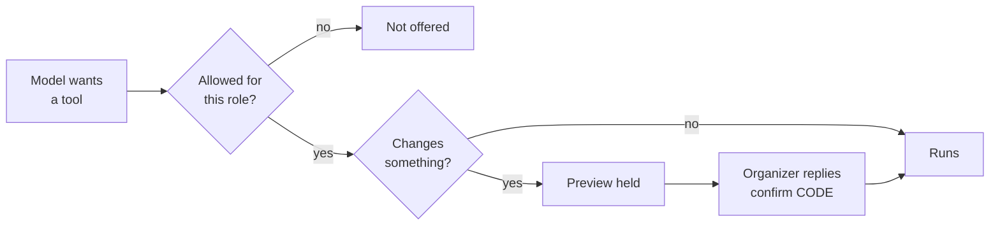
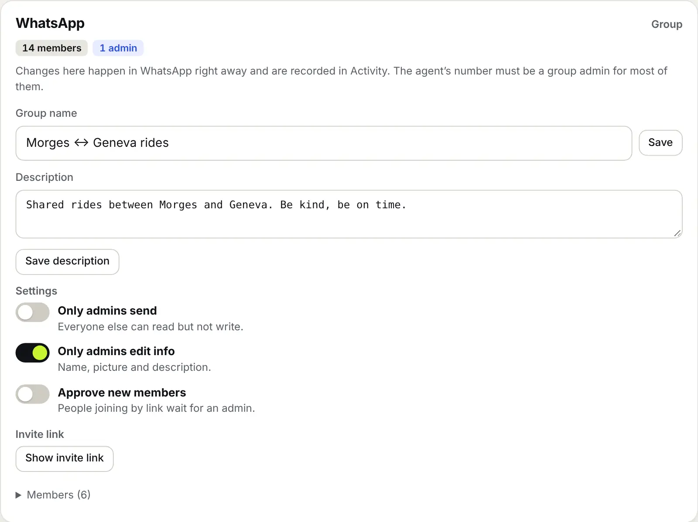

# Agents, tools and memory

**An agent is data, not code: instructions, triggers, organizers, tools, a model, memory, a cap and scheduled posts.**

**Do it:** panel → **Agents → New agent** → pick a template, or **Create an agent with AI**.

**In 30 seconds**
- Template or plain words; every change comes back as a visual diff.
- Tools are allowed per role **in code**; changes need an organizer's `confirm CODE`.
- Memory per chat and shared across chats; export/import agents as JSON.

## Create and change agents

| Way | How |
|---|---|
| **Templates** (`templates/`) | New agent, School friends, Family, Car pooling, Office colleagues, Event planning, Neighbours |
| **AI helper** | Describe the agent ("a helper for our running club that posts Sunday's run every Saturday") or a change ("shorter replies, make Lea an organizer") |
| **Import** | An agent exported as JSON |

The AI helper shows before → after for model, triggers, organizers, tools and schedules, and the instructions word by
word (*Changes only*, *Side by side*, *Whole new text*). Skip any part; nothing is saved until you apply. Admin MCP:
`draft_agent_with_ai`.

## Roles

| Role | Who | Gets |
|---|---|---|
| **Organizer** | phone numbers saved on the agent; while none are saved, the WhatsApp admins of its groups | organizer tools; confirms changes |
| **Participant** | everyone else in a bound group | participant tools |

> [!IMPORTANT]
> The model never sees or calls the confirm tool. Permissions are decided in code, not by the prompt.

## Tool services (MCP)

1. Agent page → tool services → enter the URL → **Check**.
2. **Connect** to sign in (OAuth, your own OAuth app), or use a token or custom headers.
3. **Discover tools** → tick what participants and organizers may use → save.

Local services from npm or GitHub are owner-only (scrubbed environment, install scripts off unless allowed).

**Global tool services** (035): define once under **Settings → Tool services** for every agent.

- An agent can switch one off (`globalMcp.disabled`); an agent's own service with the same name replaces it.
- Tools still follow the agent's `server:tool` rules; without explicit rules a role gets the service's defaults
  (`server:-` = none).
- OAuth sign-ins are per service (shared by all agents).
- Admin MCP: `list_global_tool_services`, `add_global_tool_service`, `remove_global_tool_service`.

> [!TIP]
> **Plugins** (`plugins/<name>/index.js`) add local tools or commands for advanced cases; see `plugins/example-dice`.

## WhatsApp actions

23 actions, chosen per role: send images, documents, voice notes, locations and contact cards, react, run polls and
read votes, and (organizers) manage the group: name, description, picture, settings, invite link, members. Every
action is logged (`whatsapp.action`). Admins get the same group tools on **Chats** (a group's *WhatsApp* card).

## Memory

| | What | Who writes |
|---|---|---|
| **Chat memory** | recent messages, a running summary and notes per chat; limits `MEMORY_RETENTION_DAYS`, `MEMORY_MAX_MESSAGES` | the agent |
| **Shared memory** | notes across all of an agent's chats (agent page → *Shared memory*) | organizers only, so one group can't plant facts for another |

Admins can read, search (each look logged), rebuild or erase it. Tools:
`memory__remember`, `list_notes`, `find_notes`, `update_note`, `forget` (last two organizers only), `search_history`.

## Contacts

Names synced from the linked phone(s) plus your own entries with notes (**Contacts**). Agents look people up
(`contacts__find_contact`): participants only see contacts marked **Shared**; organizers see all and can save or
remove entries.

## Several WhatsApp numbers and direct messages

- Link more numbers on **Overview** (QR or pairing code). Replies leave from the number the chat belongs to.
- Each number chooses which agent takes direct messages (or the default under **Settings → Direct messages**); a
  person can be assigned an agent on **Chats**.
- Chats on the first number keep their WhatsApp id; others are `<number>#<jid>`.

---
**Next:** [Models](models.md) · [Owner assistant](owner-assistant.md) · [Privacy](privacy.md) · [Docs index](README.md)
