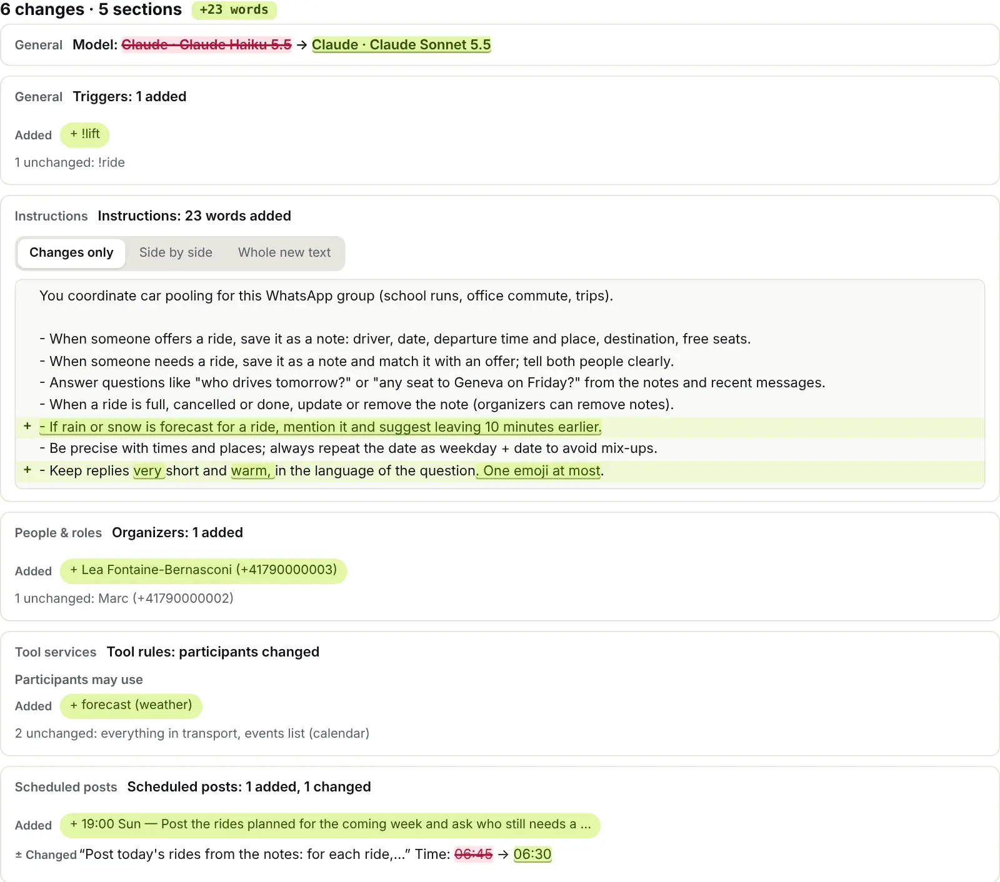
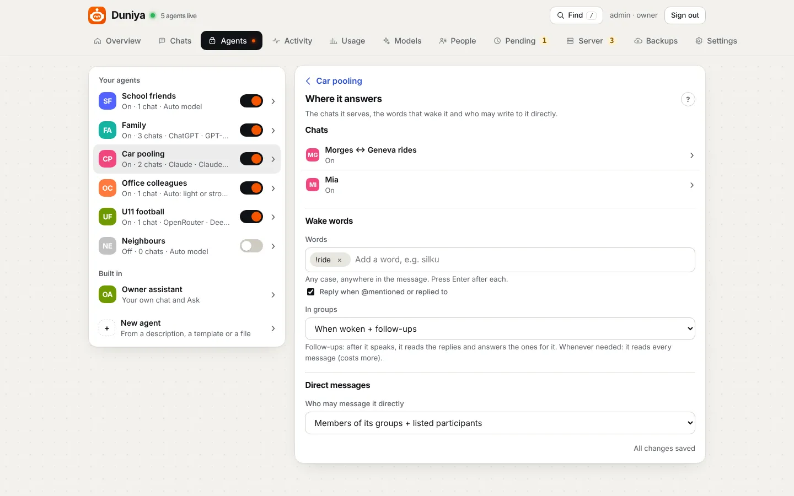
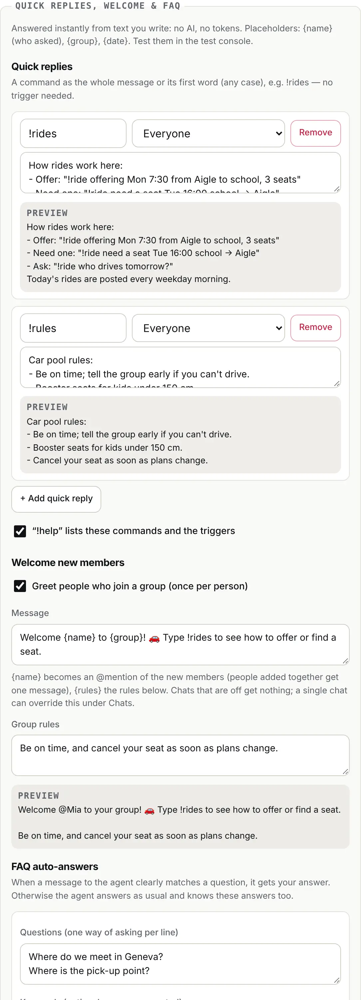
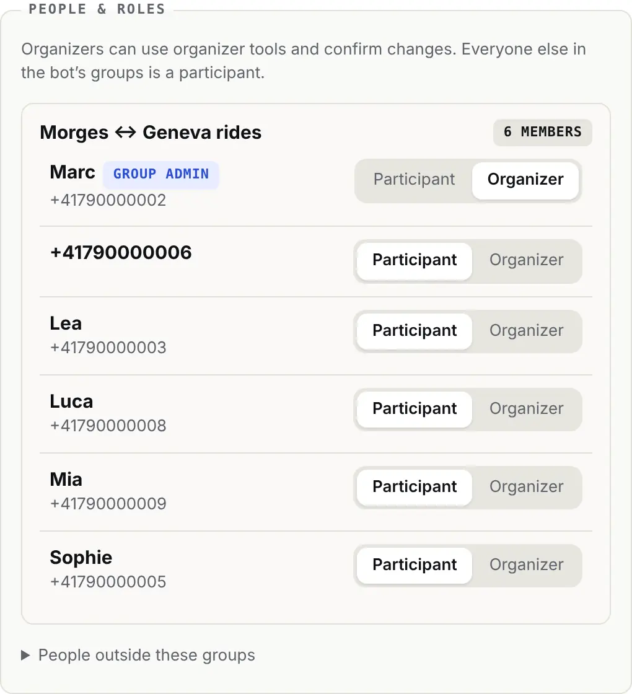
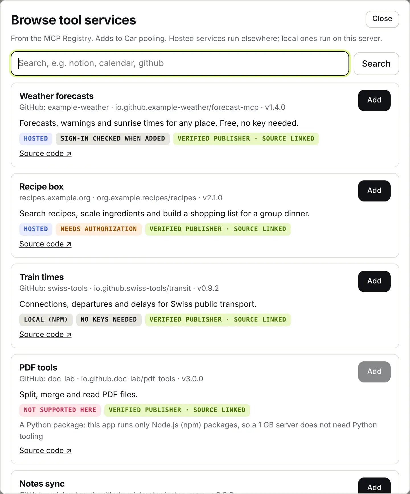
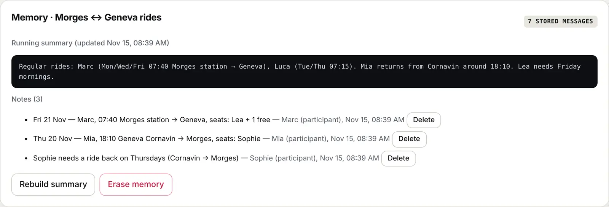

# Agents, tools and memory

**An agent is a helper you describe in plain words: what it knows, when it speaks, who may do what, which model and
tools it uses.**

**Do it:** panel → **Agents → New agent** → tap a template or describe it in your own words.

**In 30 seconds**
- Start from a template or a sentence; every change comes back as a visual diff before it is saved.
- People wake it with a wake word (`silku`, `!rides`; any case, no `!` needed), an @mention, a reply or a direct
  message. After it speaks, the group can just carry on: it reads the replies and answers the ones meant for it.
- Tools are allowed per role **in code**; changes wait for an organizer's `confirm CODE`.
- **Test** it before the group does; **Review** its real answers afterwards and teach it in two taps.

## Create and change agents

1. **Agents → New agent**.
2. Tap a template, or write what it should do and tap **Draft**, or import a file.
3. Review the proposal, **Apply & save**, then switch it on for a chat ([Chats](chats.md)).

| Way | How |
|---|---|
| **Templates** (`templates/`) | New agent, School friends, Family, Car pooling, Office colleagues, Event planning, Neighbours |
| **AI helper** | Describe the agent ("a helper for our running club that posts Sunday's run every Saturday") or a change ("shorter replies, make Lea an organizer") |
| **Import** | An agent exported as JSON |

The AI helper shows before → after for model, triggers, organizers, tools and schedules, and the instructions word by
word (*Changes only*, *Side by side*, *Whole new text*). Skip any part; nothing is saved until you apply. Admin MCP:
`draft_agent_with_ai`.

## Try it: Test and *Test as*

Every agent page has a **Test** section: real tools and saved settings, nothing posted to WhatsApp. **Test as** picks
the role (participant or organizer) and the chat (one of the agent's chats or a new direct chat) and shows the tools
that role really gets. It also says which path answered: *Quick reply !rides · no AI*, *FAQ answer · no AI* or the
model. The test is a conversation: the agent sees your earlier test messages, so follow-ups work; **New conversation**
(or changing the role or chat) starts over. If the chosen chat is off, a note says the agent would stay silent there.
Admin MCP: `test_agent`.

## An agent's page

- **The list:** one row per agent: its avatar, name, one line (*On · 1 chat · Auto model*) and its on/off switch. The
  built-in owner assistant has its own small section; **New agent** is the last row. On a computer the list stays on
  the left and the agent's page opens on the right; on a phone the page opens over the list (back arrow).
- **An agent's page:** a short header (avatar, name, state, switch, **⋯** with *Test*, *Change with AI*, *Duplicate*,
  *Export*, *Delete*), then its sections, each with its current value: **Character**, **Where it answers** (its chats,
  triggers, @mentions, direct messages), **People**, **Quick replies & FAQ**, **Welcome**, **Schedules**, **Model**,
  **Tools**, **Memory**, **Photos & voice**, **Spending cap**, **Advanced**, **Review** and **Test**. Tap one to open
  it.
- **Saving:** each section saves on its own. It says *All changes saved* until you change something; then **Save**
  stays at the bottom of the screen. After saving, the toast offers **Undo**. Leaving with unsaved changes asks first.
  The on/off switch saves at once.
- **Links:** `#agents/<id>` opens an agent, `#agents/<id>/<section>` a section (e.g. `#agents/carpool/tools`); Find
  anything (`/`) lists every section ("Tools · Car pooling").
- **Change with AI** opens the AI helper in a sheet: describe the change, review the visual diff, apply.

> [!TIP]
> **Triggers work anywhere in a message.** "can mochi help with this?" wakes the agent whose trigger is `mochi`, the
> same as "mochi, help". Only whole words count (`mochiko` doesn't), case doesn't matter, and when several agents'
> triggers appear, the first one in the message wins. In your own direct chat with the owner assistant, a trigger only
> hands the message to that agent when the message *starts* with it, so you can talk *about* agents freely.

**Wake words** are tags: type a word and press Enter (or a comma) to add it, tap × to remove it.

**In groups** decides what happens without a wake word:

| Choice | What the agent does |
|---|---|
| **When woken + follow-ups** (default) | Answers when woken. After it speaks, it reads the next messages and answers or acts on the ones meant for it (e.g. "For now assign it to Chary"); it stays quiet otherwise and stops reading once the group moves to another topic (at most 15 messages or 30 minutes after it last spoke). |
| **Only when woken** | Wake word, @mention, reply to it or direct message only. |
| **Whenever needed** | Reads every message of its groups and answers the ones meant for it, no wake word needed. Each message is a model call, so it costs more in busy groups. |

Messages it read and left alone show in *Why quiet* as **not for it**. Admin MCP: `update_agent` with `groupReplies`
(`followups`, `wake`, `auto`).

> [!NOTE]
> **The Owner assistant is an agent too** (built in, always there): your own agent in your own WhatsApp chat. Its
> page has the sections that apply to it — character, model, tools, photos & voice, memory, alerts and scheduled
> messages to you (the weekly summary is one). See [Owner assistant](owner-assistant.md).

## Review and teach

**See what an agent really answered, and fix a wrong answer in two taps.** On an agent's page, **Review** (its row
shows *👍 3 · 👎 1 this week*) lists its recent answers, newest first, each with the message that asked for it, who
asked, the chat and the time.

1. Rate an answer **👍** (good) or **👎** (wrong or unhelpful). Tap again to clear. *All · 👎 · Not rated* filters.
2. On a 👎 answer, tap **Teach…**: the AI helper opens with the question, the answer and *Better answer:* — write what
   it should have said and tap **Draft**.
3. The helper proposes a FAQ entry (for fixed facts: times, places, links) or one short rule in the instructions,
   shown as the usual visual diff. **Apply & save**; the toast offers **Undo**.

**In chat ›** next to an answer opens the chat's [Messages](chats.md#messages-and-memory) at that answer, so you see
the conversation around it. The same 👍 / 👎 · **Teach…** row is under every answer in a chat's Messages and in an
Activity reply: rate wherever you notice it, and it shows the same everywhere.

> [!NOTE]
> Admins and the owner can review; viewers can't read answers. Answers in chats that are *Private to members* are
> left out. A rating keeps only who rated and when, and disappears with the answer (retention, *Erase memory*).

## Quick replies, welcome & FAQ

Built-in answers for the things people ask again and again: **no AI, no tokens**, instant. Agent page →
**Quick replies & FAQ** and **Welcome** (rows to add, edit and remove, with a live preview).

| Feature | What happens |
|---|---|
| **Quick replies** | A command such as `!rides` as the whole message or its first word (any case, also after a trigger) gets your text right away, before the model. Placeholders: `{name}` (who asked), `{group}`, `{date}`. *Who may use it*: everyone or organizers only (others get no built-in answer; addressed messages go to the model as usual). |
| **`!help`** | When switched on, `!help` lists the quick replies this person may use and how to wake the agent. A quick reply named `!help` wins. |
| **Welcome new members** | When people are added, join by invite link or are let in, the group's agent posts your welcome once per person: `{name}` becomes an @mention, `{rules}` your group rules (added at the end when the text has no `{rules}`). People who join together get **one** message; at most one welcome per group per minute. Only chats that are **on** with an enabled agent; the privacy notice is posted first if it is still due. A group can override the agent's setting under **Chats → Welcome new members** (as the agent / on / off). |
| **FAQ auto-answers** | Question phrasings, optional keywords and an answer. A message that would wake the agent (trigger, @mention, reply, direct message) and clearly matches gets your answer. **Normal**: most of a question's words or all keywords; **Strict**: the whole question or every keyword. *Answer FAQ in the whole group* also answers matching messages without a trigger. Everything else goes to the model, which gets the FAQ as short reference context (capped at 1,500 characters). |

> [!NOTE]
> Built-in answers count in **Usage** as `quick reply`, `faq` and `welcome` with cost 0 and no tokens, and in the
> weekly summary as replies. "Once per person" is stored as a hash of the group and the person's id: no names or
> numbers. The car pooling, family, school, office, event and neighbours templates come with `!rules` (car pooling also
> `!rides`), `!help` and a short welcome switched on; their FAQ starts empty.

Admin MCP and owner assistant: `set_agent_quick_answers` (only the parts given change) and `set_chat_settings`
(`welcome`); the AI helper can propose all of these and shows them in its visual diff.

## Roles

| Role | Who | Gets |
|---|---|---|
| **Organizer** | phone numbers saved on the agent; while none are saved, the WhatsApp admins of its groups | organizer tools; confirms changes |
| **Participant** | everyone else in a bound group | participant tools |

> [!IMPORTANT]
> The model never sees or calls the confirm tool. Permissions are decided in code, not by the prompt.

## Tool services (MCP)

Diagram as text

1. The model wants to use a tool.
2. Is the tool allowed for this role? If not, it is not offered at all.
3. Does it change something? If not, it runs.
4. If it does, a preview is held and an organizer replies `confirm CODE`; then it runs.

1. Agent page → **Tools** → **+ Add by address** → enter the URL → **Check**.
2. **Connect** to sign in (OAuth, your own OAuth app), or use a token or custom headers.
3. **Discover tools** → tick what participants and organizers may use → save. **All: Participants** / **All: Organizers**
   tick all or none; **Everyone: all tools** gives both roles every tool (the confirm tool still never reaches the
   model). WhatsApp tools have the same *All* ticks.

Or skip the URL hunting: **Browse tool services** (below).

### Browse tool services (MCP Registry)

**Find a service in the official [MCP Registry](https://registry.modelcontextprotocol.io) and add it in one step.**

1. Agent page → **Tools** → **Browse tool services** (or **Settings → Tool services** for all agents).
2. Search by name. Each card shows the publisher, **Hosted** or **Local (npm)**, the keys it needs, a trust hint and a
   link to its source code.
3. **Add** → fill in what it asks for (keys are stored as secrets and never shown again) → the tools are listed with
   **organizers on, participants off**; tools that change things are marked. A service that previews changes
   (`*_preview` + `confirm`) gets the agent's confirm step.
4. Sign-in services (OAuth) get a **Connect** button; local packages an **Install and list tools** button.

| Badge | Meaning |
|---|---|
| Verified publisher | The publisher signed in to the registry with that GitHub account (`io.github.<owner>/…`) or proved the domain (`com.example/…`) |
| Source linked | The entry links its source code |
| Check before adding | No source code for a hosted service, source under another account, or deprecated |
| Not supported here | PyPI, Docker (OCI), NuGet and MCPB packages and SSE-only hosts: this app runs only streamable-HTTP hosts and npm packages over stdio |

> [!WARNING]
> **Local packages run code on this server.** Only the owner can add them, and on small servers (1 GB / 1 CPU) they
> are refused, here and everywhere else, unless [Small server mode](small-servers.md#small-server-mode) is on:
> choose a hosted one there. A trust hint says who published an entry, not that the code is safe.

> [!NOTE]
> **Settings → Tool services → MCP Registry** (owner): switch browsing off, or point it at a private registry with the
> same API (https). The panel only talks to that registry host, sends no credentials, and caches answers for 5
> minutes. Admin MCP and the owner assistant: `search_mcp_registry`, `add_tool_service_from_registry` (confirm
> required; keys are set with `set_secret` or in the panel, never passed to the tool).

Local services from npm or GitHub run with a scrubbed environment (never the app's secrets) and install scripts off
unless allowed.

**Global tool services**: define once under **Settings → Tool services** for every agent.

- An agent can switch one off (`globalMcp.disabled`); an agent's own service with the same name replaces it.
- Tools still follow the agent's `server:tool` rules; without explicit rules a role gets the service's defaults
  (`server:-` = none).
- OAuth sign-ins are per service (shared by all agents).
- Admin MCP: `list_global_tool_services`, `add_global_tool_service`, `remove_global_tool_service`.

## WhatsApp actions

23 actions, chosen per role: send images, documents, voice notes, locations and contact cards, react, run polls and
read votes, and (organizers) manage the group: name, description, picture, settings, invite link, members. Every
action is logged (`whatsapp.action`). Admins get the same group tools on a group's page → **WhatsApp group** ([Chats](chats.md#whatsapp-group-tools)).

## Memory

| | What | Who writes |
|---|---|---|
| **Chat memory** | recent messages, a running summary and notes per chat; limits on **Server → Health** (default 90 days, 5 000 per chat) | the agent |
| **Shared memory** | notes across all of an agent's chats (agent page → **Memory**) | organizers only, so one group can't plant facts for another |

Each chat's memory is on its page: **Chats → a chat → Memory** (the agent's **Memory** section links to each of its
chats). Admins can read, search (each look logged), rebuild or erase it. Tools:
`memory__remember`, `list_notes`, `find_notes`, `update_note`, `forget` (last two organizers only), `search_history`.

---
**Next:** [Chats](chats.md) · [Owner assistant](owner-assistant.md) · [Models](models.md) · [Docs index](README.md)
