# How it works

**One Node.js app: WhatsApp in, an allow-list and router, agents stored as data, models and tools out, a panel on
top.**

**In 30 seconds**
- Off chats are dropped first; agents are data; tools are allowed per role in code.
- Panel on `localhost:8080` behind Caddy, a tunnel, Tailscale or SSH. Roles: owner, admin (agents, chats, models,
  memory), viewer (read-only).

Diagram as text

1. Messages come from one or more WhatsApp linked devices.
2. Allow-list: chats that are off are dropped.
3. Router: triggers, roles and rate limits; owner DMs go to the owner assistant.
4. The agent (stored in the app) uses a model provider with fallback, MCP tools with per-role allow lists, WhatsApp actions, memory (messages, summary, notes, search) and optional plugins.
5. Preview tools go through the confirm gate: an organizer replies `confirm CODE`.
6. The agent, the panel, the mobile app and the admin MCP use SQLite with encrypted secrets and backups.

| | |
|---|---|
| **Sign-in** | Google (owners invite by email; *Only allow Sign in with Google* turns passwords off) or a password |
| **Data** | SQLite in `DATA_DIR`, WhatsApp sessions, local backups; secrets encrypted, files mode 0600 |
| **Code map** | [AGENTS.md → Architecture map](../AGENTS.md#architecture-map) |
| **Specs / design** | [`specs/`](../specs) · [DESIGN.md](../DESIGN.md) |

---
**Next:** [Development](development.md) · [Docs index](README.md)
