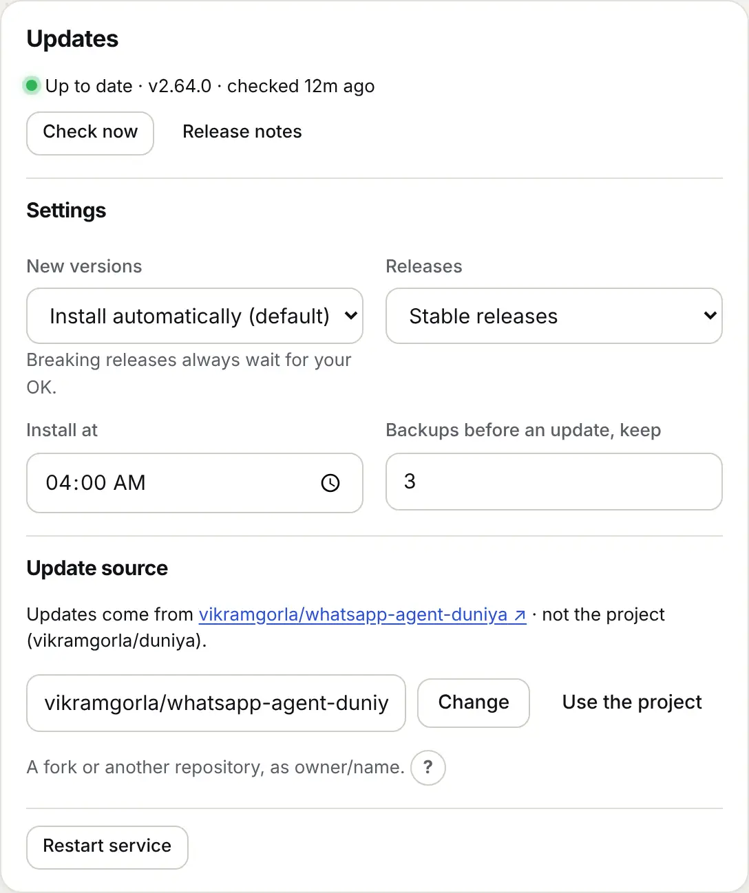

# Backups and updates

**Encrypted backups to GitHub, S3 or a download, and updates that keep your data and never cross a breaking release
without you.**

**Do it:** panel → **Backups** → set a passphrase → choose where → turn on the schedule.

**In 30 seconds**
- Encrypted with your passphrase **before** leaving the server: to this server, a private GitHub repo or S3.
- Every update makes a local backup first (with a passphrase set); no backup, no update.
- Breaking releases wait for an owner: panel, or `confirm CODE` on WhatsApp.

## Backups

1. **Backups** (owner) → set a passphrase. Write it down: without it a backup can't be opened.
2. Choose a destination: this server, **GitHub** (the one-click GitHub App creates a private repository; or a token,
   or device login with your own OAuth app) or **S3-compatible**.
3. Turn on the schedule (e.g. daily at 04:00, keep 14).
4. **Download** a backup any time.

A backup is a `.dbk` file: a snapshot of the database, the master key and the WhatsApp sessions, compressed and
encrypted (AES-256-GCM with a key from your passphrase) while it is written, so it needs only a few MB of memory even
for a large database. A restore checks the whole file before anything is replaced: a wrong passphrase or a damaged
file changes nothing.

A scheduled backup that fails is tried again by itself, up to three times, ten minutes apart; when only the copy to
GitHub or S3 failed, that copy is sent again without making a second backup. If it still fails, you get one message
on WhatsApp (to the [alert number](owner-assistant.md#owner-alerts-and-weekly-summary)) saying what is missing, and
Activity has the details.

> [!IMPORTANT]
> Backups made by Duniya **2.30 or earlier can't be restored** (older file format). If your newest backup is from
> before 2.31, make a new one: **Backups → Back up now**.

> [!NOTE]
> **Pre-update backups** stay on this server only, are listed with the local backups and kept apart from the normal
> retention: the last 3 (**Settings → Updates** → *keep the last N pre-update backups*, 1–20). If one fails, the update is
> not installed.

### Restore

Diagram as text

1. **Backups → Back up now** and download the `.dbk` file; keep its passphrase.
2. On a fresh server: first screen → **Restore a backup** (with the setup code).
3. On a running server: **Backups → Restore** → a file or a stored backup.
4. The server restarts (1–2 min); sign in with the accounts from the backup.

Uploads up to `BACKUP_UPLOAD_MAX_MB` ([settings](settings.md)). Leave the passphrase empty to use the one stored
on this server. Command line: `sudo duniya backup-now`. Admin MCP and the owner assistant: `get_backup_status`,
`list_backups`, `run_backup`, `restore_backup` (with confirmation; it uses the stored passphrase, and a backup made
elsewhere is restored here in the panel).

After the restart, Activity says which backup was restored. The data from before stays on the server in
`data/pre-restore-<time>/` (the last three are kept), so a restore can be undone by hand. A restore that is
interrupted (a power cut during the restart) carries on at the next start.

## Updates

Overview's **Server** card has one update row: *Up to date · v2.33.0 · checked 2m ago* (or *Update available*), with
**Release notes**, the one action and ⋯ (**Check now**, **Update settings**). **Settings → Updates** has the whole story:
the last update with the backup made before it, **Check now**, the settings, the **Update source** (the project or a
fork; [switch it](upgrading.md#update-source)) and **Restart service**.

**Update to vX.Y.Z** (on the row or the page) opens what you get first: every release between your version
and the new one, newest first, with what is **new**, **improved**, **fixed** or **removed** (long lists fold; releases
that need your OK are marked, with what to do), and *Make a backup first*. Confirm with **Update to vX.Y.Z**: it
installs in place, keeps all data, survives a reload.
**Settings → Updates**: *Notify me*, *Install automatically* (time of day) or *Off*; stable or latest `main`
(`--update-mode off|notify|auto`). Also `sudo duniya update [--check]` or re-running the installer.

An update takes a few seconds: packages are installed again only when one the app runs on changed (most releases
change none), and then the update needs the npm registry.

### What's new after an update

After an update, Overview shows **Updated to vX — see what's new** once per person: it opens the changes of the
versions you just got (hide it with ✕). All release notes are in **Settings → Help → Release notes** (or press `/` and
type *release*). An update confirmed on WhatsApp is reported there with what is new. A panel left open during an update
loads the new version by itself at your next tap; nothing to refresh.

Diagram as text

1. A new release is published.
2. Not breaking: with *Install automatically* it is installed after a backup at the set time ([your time zone](owner-assistant.md#your-time-zone)); with *Notify me* it is shown on Updates.
3. Breaking or a new major: automatic updates stop at the last safe release.
4. The owner is told once: Overview banner, Updates, Activity and WhatsApp.
5. The owner decides: **Update to vX** (or `confirm ABCD`) backs up, updates and reports after the restart; **Remind me in 7 days** (or `cancel ABCD`) asks again later; **Dismiss** hides it until a newer breaking release.

### A release that does not start

On installer servers an update is watched while it starts. If the new release cannot start on your server (three
tries in a row, each ending before it has run for a minute), the server puts the previous release back by itself and
runs it again. Nothing for you to do, and no terminal.

- You are told once, in plain words: **Activity**, the owner alert on WhatsApp, **Settings → Updates** and
  `sudo duniya status`: which version did not start and which one runs again.
- Your data is left as it is. The backup made before the update is named in the message.
- *Install automatically* does not install that version again. The next release is installed as usual, and **Update**
  still installs it when you choose so.

> [!NOTE]
> Docker installs are not watched: the image you run is your choice (`docker compose pull` / an older tag). The first
> update that is watched is the one after v2.59.0.

Admin MCP: `get_update_status` → `rolledBack`.

### Breaking releases need your decision

A jump is *breaking* when the major version grows or a release in between is marked breaking in `releases.json`
(read from the release itself with git).

1. You are told **once**: **Overview** banner ("Version 3.0.0 needs your decision"), Updates card, Activity, the
   owner alert number (**Agents → Owner assistant → Alerts**), and a code to every owner linked to the
   [owner assistant](owner-assistant.md).
2. **Review update**: the same dialog as every update: all releases in between with their changes, the breaking ones
   marked with what to do and a docs link, *Make a backup first* (on by default).
3. **Update to vX**, or on WhatsApp reply `confirm ABCD` (backup, update, result reported after the restart).
4. Not now: *Remind me in 7 days* / `cancel ABCD`, or *Dismiss* until a newer breaking release.

> [!IMPORTANT]
> Codes are valid 3 days and only for owners. *Notify me* never installs; *Install automatically* stops before the
> breaking release.

Command line and admin MCP

- `sudo duniya update` installs the newest release that needs no decision and prints the notes;
  `sudo duniya update --breaking` also crosses a breaking one.
- Admin MCP: `get_update_status` (steps, safe target, `notes`: the releases in between with their changes),
  `get_release_notes` (any range of installed versions), `apply_update` (`breaking: true` to cross one; confirmation
  required), `snooze_update_decision`.

### OS updates (installer servers)

**Server → OS updates & maintenance → Install OS updates**, then **Restart server** when the page says so.

- The list is grouped: **Will install** (the count on the **Server** tab), **Rolling out gradually** and **Held
  back** (with the reason, e.g. *On hold (apt-mark hold)*).
- The install uses `apt-get full-upgrade`, so new kernels install too (plain `apt upgrade` keeps them back), then
  removes packages nobody needs any more (`autoremove --purge`; the running kernel is kept). This frees disk on small
  servers.
- **Rolling out gradually**: Ubuntu releases some updates to a growing share of servers over a few days (*phased
  updates*). They install by themselves within days; **Include gradual updates now** installs them right away.
- After a run you get one line, e.g. *Installed 3 updates · 4 new packages · 1 rolling out gradually · restart
  needed*. The full apt output stays under **Output**.
- **Restart needed to finish (new kernel)** shows the packages that asked for it and a **Restart server** button
  (agents are offline 1–2 minutes). If it waits more than 7 days, the [weekly summary](owner-assistant.md#owner-alerts-and-weekly-summary) says so.

> [!NOTE]
> On a 1 GB server a kernel update takes a few minutes and uses swap (the installer adds 2 GB); apt runs at low
> priority so agents keep answering. A run that was cut off is finished first on the next run.

> [!IMPORTANT]
> The OS update steps live in the root maintenance helper. Since 2.17 it updates itself from the release after an app
> update (or **Update maintenance helper** on this page). A helper from before 2.17 needs one root run first:
> [The maintenance helper](upgrading.md#the-maintenance-helper). Admin MCP: `list_os_updates`, `run_maintenance` with
> `os-update`, `os-update-all` or `update-helper`.

### Per host

| Host | App | OS / infrastructure |
|---|---|---|
| Installer server | as above | **Server → OS updates & maintenance** ([details](#os-updates-installer-servers)) |
| Docker | `docker compose pull && docker compose up -d` | host `apt upgrade` |
| Oracle Cloud stack | as above | **Edit** stack → latest zip → **Plan** → **Apply** ([step by step](deploy/oci-free-tier.md#update-the-stack-infrastructure)) |
| Google Cloud | as above ([guide](deploy/google-cloud.md#update-the-app)) | panel OS updates |

## Moving to a new server or recreating one

Back up (**Backups → Back up now & download**), set up the new server, then **Restore a backup** on its first screen
(or **Backups → Restore → A file**). What changes per host (IP, sslip.io address, domain DNS, WhatsApp link):
[Oracle Cloud](deploy/oci-free-tier.md#recreate-from-scratch) · [Google Cloud](deploy/google-cloud.md#recreate-from-scratch) ·
[own server](install.md#recreate-from-scratch-new-server-or-fresh-os) · [Docker](deploy/docker.md#recreate-from-scratch).

---
**Next:** [Upgrading](upgrading.md) · [Managing your server](README.md#run-your-server) · [Docs index](README.md)
