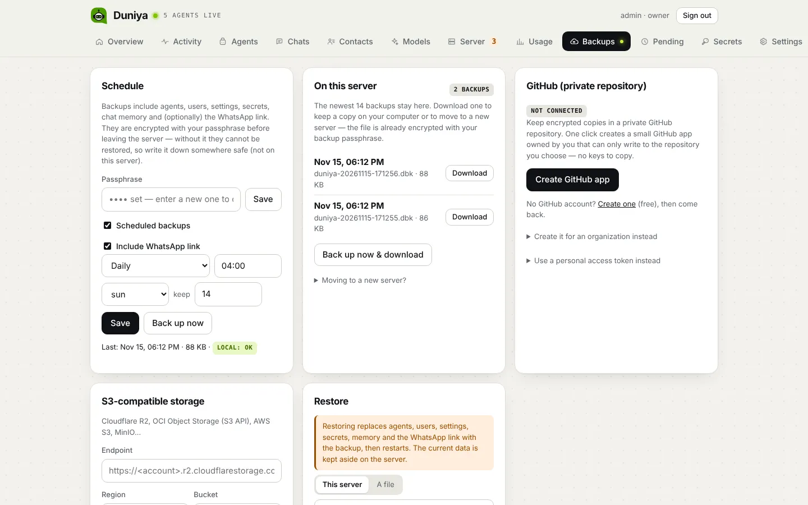
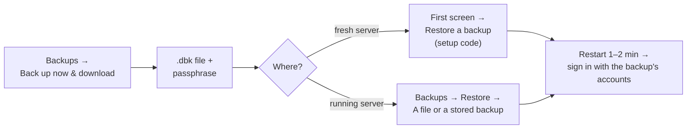
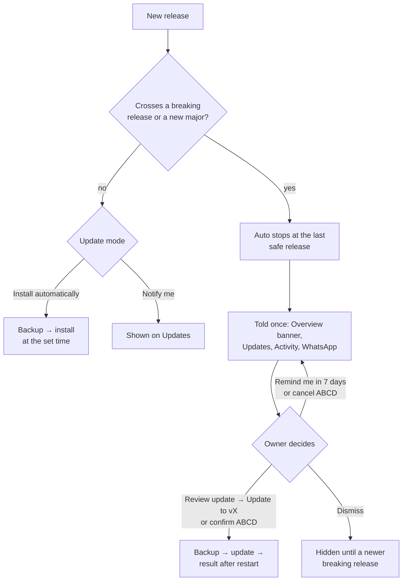

# Backups and updates

**Encrypted backups to GitHub, S3 or a download, and updates that keep your data and never cross a breaking release
without you.**

**Do it:** panel → **Backups** → set a passphrase → choose where → turn on the schedule.

**In 30 seconds**
- Encrypted with your passphrase **before** leaving the server: to this server, a private GitHub repo or S3.
- Every update makes a local backup first (with a passphrase set); no backup, no update.
- Breaking releases wait for an owner: panel, or `confirm CODE` on WhatsApp.

## Backups

1. **Backups** (owner) → set a passphrase. Write it down: without it a backup can't be opened.
2. Choose a destination: this server, **GitHub** (the one-click GitHub App creates a private repository; or a token,
   or device login with your own OAuth app) or **S3-compatible**.
3. Turn on the schedule (e.g. daily at 04:00, keep 14).
4. **Download** a backup any time.

> [!NOTE]
> **Pre-update backups** stay on this server only, are listed with the local backups and kept apart from the normal
> retention: the last 3 (*Update settings → keep the last N pre-update backups*, 1–20). If one fails, the update is
> not installed.

### Restore

Uploads up to `BACKUP_UPLOAD_MAX_MB` ([settings](settings.md)). Command line: `sudo duniya backup-now`. Admin MCP:
`get_backup_status`, `list_backups`, `run_backup`, `restore_backup` (with confirmation).

## Updates

**Overview → Server → Updates** → **Update to vX.Y.Z** installs in place, keeps all data, survives a reload.
**Update settings**: *Notify me*, *Install automatically* (time of day) or *Off*; stable or latest `main`
(`--update-mode off|notify|auto`). Also `sudo duniya update [--check]` or re-running the installer.

### Breaking releases need your decision

A jump is *breaking* when the major version grows or a release in between is marked breaking in `releases.json`
(read from the release itself with git).

1. You are told **once**: **Overview** banner ("Version 3.0.0 needs your decision"), Updates card, Activity, the
   owner alert number (**Settings → Owner alerts**), and a code to every owner linked to the
   [owner assistant](owner-assistant.md).
2. **Review update**: what changes, what to do, a docs link, *Make a backup first* (on by default).
3. **Update to vX**, or on WhatsApp reply `confirm ABCD` (backup, update, result reported after the restart).
4. Not now: *Remind me in 7 days* / `cancel ABCD`, or *Dismiss* until a newer breaking release.

> [!IMPORTANT]
> Codes are valid 3 days and only for owners. *Notify me* never installs; *Install automatically* stops before the
> breaking release.

Command line and admin MCP

- `sudo duniya update` installs the newest release that needs no decision and prints the notes;
  `sudo duniya update --breaking` also crosses a breaking one.
- Admin MCP: `get_update_status` (steps, safe target), `apply_update` (`breaking: true` to cross one; confirmation
  required), `snooze_update_decision`.

### Per host

| Host | App | OS / infrastructure |
|---|---|---|
| Installer server | as above | **Server → OS updates & maintenance** (security updates, restart when needed) |
| Docker | `docker compose pull && docker compose up -d` | host `apt upgrade` |
| Oracle Cloud stack | as above | **Edit** stack → latest zip → **Plan** → **Apply** ([step by step](deploy/oci-free-tier.md#update-the-stack-infrastructure)) |
| Google Cloud | as above ([guide](deploy/google-cloud.md#update-the-app)) | panel OS updates |

## Moving to a new server or recreating one

Back up (**Backups → Back up now & download**), set up the new server, then **Restore a backup** on its first screen
(or **Backups → Restore → A file**). What changes per host (IP, sslip.io address, domain DNS, WhatsApp link):
[Oracle Cloud](deploy/oci-free-tier.md#recreate-from-scratch) · [Google Cloud](deploy/google-cloud.md#recreate-from-scratch) ·
[own server](install.md#recreate-from-scratch-new-server-or-fresh-os) · [Docker](deploy/docker.md#recreate-from-scratch).

---
**Next:** [Upgrading](upgrading.md) · [Managing your server](README.md#run-it) · [Docs index](README.md)
