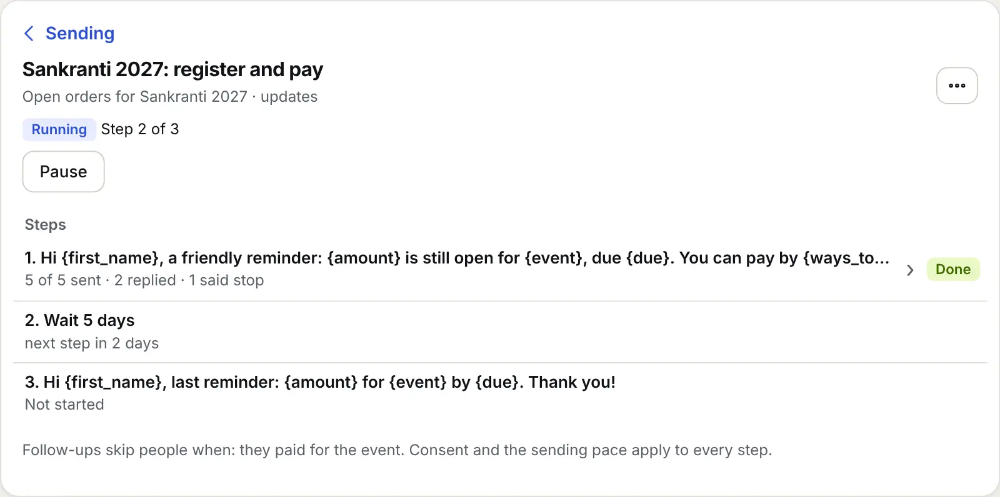

# Campaigns

**A few messages over days to the same people, confirmed once: follow-ups go only to those who have not answered,
registered or paid yet.**

**Do it:** **Settings → Modules** → **Lists and sending** on → **People → Sending → New campaign** → steps → **Preview**
→ **Start the campaign**.

**In 30 seconds**
- **Steps:** a **message** (it can carry a [survey](surveys.md)), a **wait** of some days, another message, …
- **Follow-ups skip people when:** they **replied** (or said stop), **registered** for the event, **paid** for it, or
  **finished the survey**. An optional **last day** ends it.
- You confirm once, for every step. Each message step becomes a normal [send](sending.md) when its turn comes: consent
  checked before every message, each person's own wording, the WhatsApp pace, stop signals.
- The campaign's page shows each step and its progress; **Pause**, **Resume** and **⋯ → Stop…** act on the current
  step too.

## Make a campaign

1. **People → Sending → New campaign**.
2. **Title**, **To** (a list, a tag, a household, an event's registered people, people with an open order, a saved
   audience), **Purpose**, **Replies go to**.
3. **Steps:** the first is a message. **+ Wait** adds days to wait, **+ Message** another message. Messages use the same
   facts as any send (`{first_name}`, `{event}`, `{amount}`, `{survey_link}`, …).
4. **Follow-ups skip people when** — switch on what fits: *they replied*, *they registered for the event*, *they paid
   for the event*, *they finished the survey*. **Event**: the one for *registered* and *paid* (the audience's event by
   default).
5. **Last day** (optional): nothing is sent after it.
6. **Preview**: the whole plan in one line and who the first message reaches → **Start the campaign**.

## How it runs

- The first message goes out at the next check (every 30 seconds), within the sending hours, one person at a time.
- When a message step's send has finished, the next step starts: a wait counts days from then.
- Before each later message the audience is looked at again (new people with an open order are included, facts like
  the open amount are today's), and the people the rules take out are skipped with *Taken out by the campaign's rules*.
- A send that pauses (someone said stop, nobody answers, WhatsApp is down) holds the campaign until you resume it.

> [!WARNING]
> Several messages to the same people raise the risk of reports and of WhatsApp restricting your number. Keep
> campaigns short, with days between messages, and use the rules so people who answered are left alone.

## AI assistants and the owner assistant

Admin MCP ([Manage from ChatGPT or Claude](admin-mcp.md)): `start_campaign`* (preview → confirm), `get_campaign`,
`control_campaign` (pause, resume, stop); `list_sends` lists campaigns too (* needs `confirm_action`).

---
**Next:** [Lists and sending](sending.md) · [Surveys](surveys.md) · [Orders and payments](orders.md) · [Docs index](README.md)
