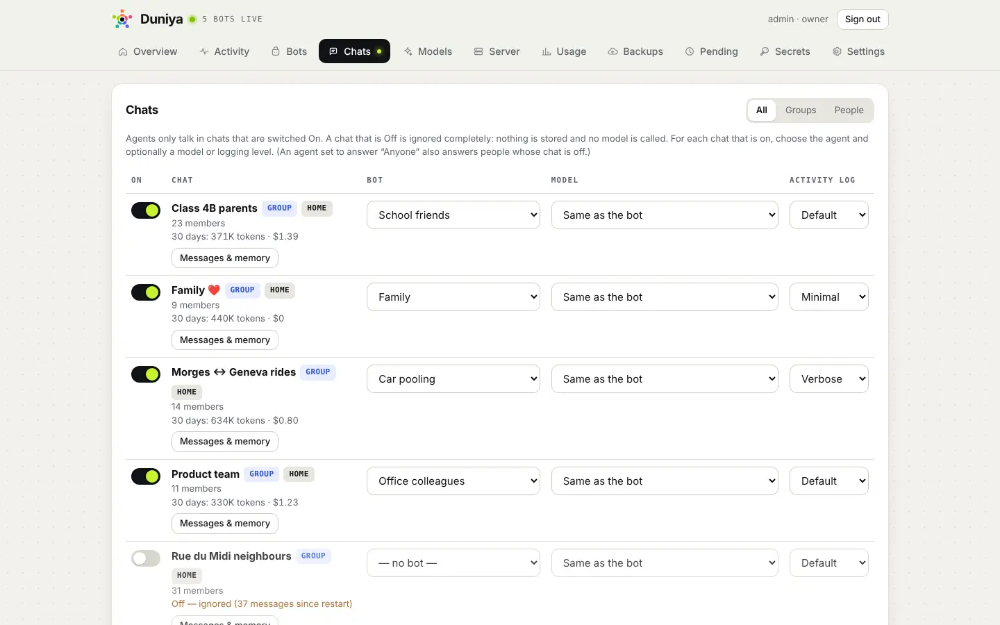
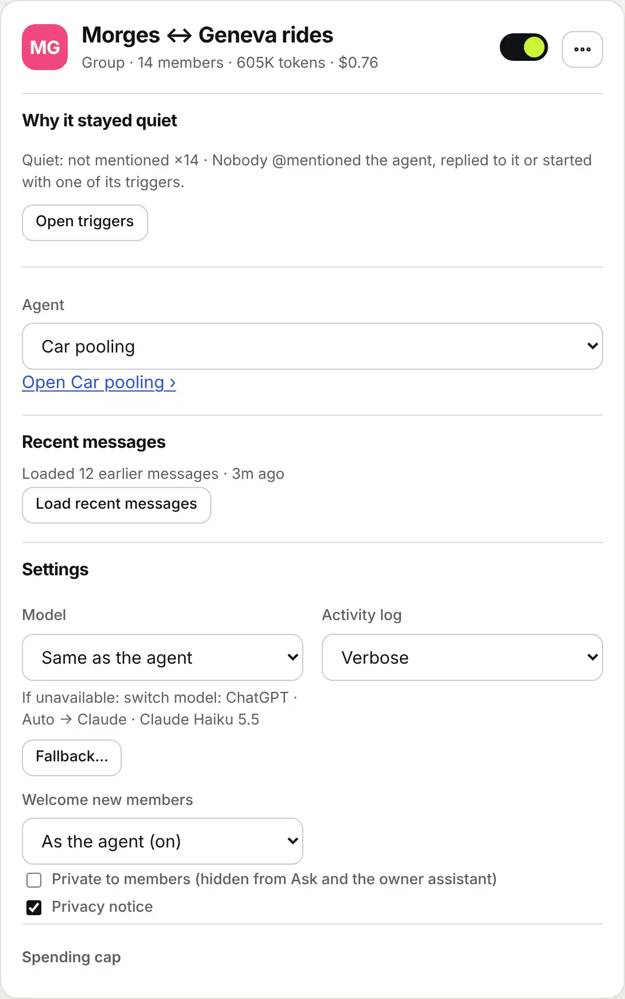
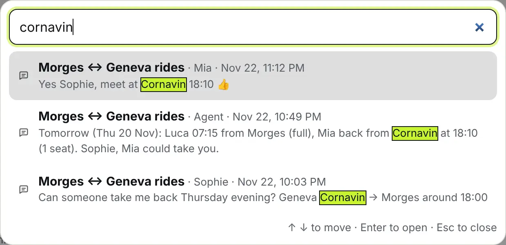

# Chats, contacts and direct messages

**Choose where agents may speak: every group and person starts off, one switch turns a chat on.**

**Do it:** panel → **Chats** → tap the switch next to a group (or **Switch on** in Getting started).

**In 30 seconds**
- Chats that are **off** are dropped before storage and before any model ([Privacy](privacy.md)).
- Switching a chat on picks its agent, posts the privacy notice once and loads recent messages from your phone.
- **Add a direct chat** sets up a person before they write. Names come from your phone's contacts.
- The owner can search what was said in every chat that is on: press **/** and type.

## The Chats screen

- **The list:** one row per chat under *On* and *Off*: avatar, name, one line (*Car pooling · 14 members*, or
  *Off · 12 members*), a short hint when an agent stayed quiet there, and the switch. *All / Groups / People* and a
  search box sit above it; **Add a direct chat** is the last row.
- **A chat's page** (on a computer beside the list, on a phone over it): its agent (**Open <agent>** jumps to the
  agent), why it stayed quiet with a one-tap fix, recent messages, model and **Fallback…**
  ([Models](models.md#fallback-and-several-accounts)), activity log level, welcome override, **Private to members**,
  the privacy notice, the [spending cap](spending.md), and under **⋯**: *Messages & memory* (with the group's
  WhatsApp tools) and, for a person, *Send intro…*.
- Links: `#chats/<chat id>` opens a chat.

> [!TIP]
> **Private to members** hides a chat from the owner assistant, Ask and message search; its agent still answers there.

## Search messages (owner)

1. Press **/** (or ⌘K, or the search button on a phone) and type two or more characters.
2. Pick the last row, **Search messages for "…"**.
3. Tap a result to open that chat's *Messages & memory* with the search filled in.

All words must appear, in any order; word beginnings match (*ride* finds *rides*); case and accents don't matter.
Only chats that are on and not private are searched, newest first (**Show older matches** for more). Each search is
in Activity with its words and the number found, never message text. Admin MCP: `search_messages`.

## Earlier messages when a chat is switched on

Chats start off, so the history WhatsApp sends when you link a number is not stored (only the id and time of each
chat's newest message). When you switch a chat **on**, the server asks your phone for its last 50 messages
(**Settings → Chats & direct messages**, 0–200) and builds the running summary from them.

- The phone must be **online**. No answer within a minute → *Will retry automatically…*: after 2 min, 15 min, 1 h,
  6 h, then daily for three days, and right away when your phone shows up online. Nothing to click.
- **Load recent messages** (optional) asks for messages before the oldest stored one. Admin MCP: `load_chat_history`.
- The agent is told what it has ("12 stored messages since 3 Nov") and says so instead of guessing.

## Set up a direct chat before the person writes

1. **Chats → Add a direct chat** (or **Contacts → ⋯ → Set up chat**).
2. Enter the number with country code (`+41 79 123 45 67`) or pick a contact; pick the WhatsApp number if you have
   several.
3. Choose the agent, **On** and, if you like, **Private to members** → **Set up chat**.

The chat shows **Waiting for the first message** until the person writes; that message goes straight to the agent.
Messages that arrive from WhatsApp's private id (`…@lid`) are matched to the prepared chat, so replies, memory and
settings stay together.

> [!NOTE]
> Nothing is sent to the person. **Send intro…** lets the agent write first: you see the exact text (with the privacy
> line the first time) and it goes out only when you press **Send intro now**. Owner assistant and admin MCP:
> `prepare_direct_chat`, `send_chat_intro` (confirmed).

People who write to an agent number privately get the agent chosen for that number
([Connect WhatsApp](whatsapp.md#the-whatsapp-numbers-card)); a person can be given another agent on their chat's page.

## Contacts

**Contacts** lists the names synced from the linked phone(s) plus your own entries with notes. Agents look people up
(`contacts__find_contact`): participants only see contacts marked **Shared**; organizers see all and can save or
remove entries.

- Phone contact names **refresh by themselves** (after a number connects, then daily). **Refresh now** is optional.
- **Agents may use the names from your phone contacts** (owner, on by default): switch it off if your address book
  holds private labels ("Raj plumber, don't answer"); agents then see business or profile names.
- Admin MCP: `list_contacts`, `save_contact`, `remove_contact`, `contact_names_status`, `refresh_contact_names`,
  `set_contact_names_for_agents`.

### Which name is shown

Everywhere in the panel and for agents, one rule picks a person's name:

Diagram as text

1. If WhatsApp shows the person only by a hidden id (LID), look up the number WhatsApp shared for it (the pair can
   arrive later; names are matched up then).
2. Use the first name known: the name you set in Duniya, then the phone contact name (your address book), then a
   WhatsApp Business name, then the profile name the person chose.
3. Otherwise show `+number`, or *Unknown (hidden number)* when WhatsApp hides it.
4. Member tags are kept per group (chats that are on only), from each message the person sends, tag changes and
   loaded history.

### Group member tags

Members can carry a tag in a group ("Driver", "Treasurer"). For chats that are on, Duniya shows it next to the name
and tells the agent who is speaking (*New message from Priya (tag: Driver)*). A tag appears once the person writes,
changes it, or shows up in loaded history; WhatsApp has no way to ask for every member's tag. Erasing a chat's memory
erases its tags.

---
**Next:** [Owner assistant](owner-assistant.md) · [Everyday use](everyday.md) · [Privacy](privacy.md) ·
[Docs index](README.md)
