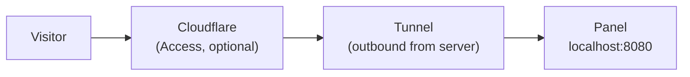

# Cloudflare Tunnel (optional)

**The panel on your own domain with no open ports on the server.**

```bash
curl -fsSL https://raw.githubusercontent.com/vikramgorla/whatsapp-agent-duniya/main/install.sh | sudo bash -s -- --cloudflare-token <token>
```

**In 30 seconds**
- Needs your domain on Cloudflare. Optional: the installer serves HTTPS directly too (`--domain`, `--ip-https`).
- Tunnel token + a hostname to `localhost:8080`, then install with the token.



## Steps

1. Cloudflare dashboard → **Zero Trust → Networks → Tunnels → Create a tunnel → Cloudflared**; name it.
2. Copy the token from the install command shown (the long string after `--token`).
3. **Public hostname**: e.g. `agents.example.com` → service **HTTP** → `localhost:8080` (Docker: `app:8080`).
4. Install with the token (command above). Docker: `TUNNEL_TOKEN` in `.env` and `--profile tunnel`
   ([Docker](docker.md)).

> [!TIP]
> Recommended: **Zero Trust → Access → Applications → Self-hosted** for the same hostname with a policy like
> *Emails = you*. Visitors then need an email code before they even reach the panel's login.

---
**Next:** [Domains & access](../domains-and-access.md) · [Install](../install.md) · [Docs index](../README.md)
