# Google Cloud (Always Free e2-micro)

**Google's free e2-micro with Duniya on it: one button, one command in Cloud Shell, ~15 minutes.**

[](https://shell.cloud.google.com/cloudshell/editor?cloudshell_git_repo=https%3A%2F%2Fgithub.com%2Fvikramgorla%2Fduniya&cloudshell_git_branch=main&cloudshell_tutorial=infra%2Fgcp%2Ftutorial.md)

**In 30 seconds**
- Button → pick a project with billing → `bash infra/gcp/deploy.sh` → **Ready** after 10–15 minutes.
- The script prints the panel address (`https://<ip-with-dashes>.sslip.io`) and the **setup code**.
- The app updates itself; re-running the script is safe and changes nothing that exists.
- **Stopping the VM changes its IP** (and the sslip.io address): restart or reset instead.

**Jump to:** [**Where is my panel?**](#where-is-my-panel-find-the-ip--url) · [Update the app](#update-the-app) ·
[Update the infrastructure](#update-the-infrastructure) · [Recreate](#recreate-from-scratch) ·
[Remove](#remove-everything) · [Find things fast](#find-things-fast) · [Common errors](#common-errors) ·
[Phone or iPad](#on-a-phone-or-ipad)

Console labels checked November 2026. Fastest way to any page: the console **search bar**.

## What you get

| | Free tier |
|---|---|
| VM | one **e2-micro** (2 shared vCPUs, 1 GB) per billing account in `us-central1`, `us-west1` or `us-east1` |
| Disk / traffic | 30 GB standard disk · 1 GB outgoing a month |
| IP | the **ephemeral** external IP is covered; a static IP, a second VM or Cloud NAT are billed |

> [!WARNING]
> Google needs a billing account (a card) even for free resources. Set a budget alert:
> [Budgets & alerts](https://console.cloud.google.com/billing/budgets). Other sizes, regions or a second VM are
> billed.

## Deploy

<p align="center"></p>

<details><summary>Diagram as text</summary>

1. Open in Cloud Shell.
2. Pick a project with billing and run `bash infra/gcp/deploy.sh`.
3. The script turns the API on, creates the `duniya-web` firewall rule and the `duniya` VM.
4. Watch the progress page at `http://ip/` (10–15 min).
5. Ready: open `https://ip.sslip.io` with the setup code.
6. Create the owner account in the panel.

</details>

1. Click **Open in Cloud Shell** and confirm. Cloud Shell opens with the repository and a tutorial on the right.
2. Pick a project with billing enabled, then run:

   ```bash
   bash infra/gcp/deploy.sh --project YOUR-PROJECT-ID
   ```

3. It shows a plan, enables the Compute Engine API, opens ports 80/443 (rule `duniya-web`), creates VM `duniya` and
   waits. Watch the **progress page** it prints (`http://<ip>/`).
4. On **Ready**, open `https://<ip>.sslip.io` and enter the **setup code** to create your owner account.

<details>
<summary>Options</summary>

`--region`, `--exposure cloudflare|tailscale`, `--admin-password`, `--domain`, `--no-external-ip` (billed):
`bash infra/gcp/deploy.sh --help` and the table in [Install](../install.md#google-cloud-always-free-e2-micro).

</details>

### Where is my panel? (find the IP / URL)

- **Cloud Shell**: the script ends with `==> Ready: https://<ip-with-dashes>.sslip.io` and `Setup code: XXXXXX`.
  Closed the tab?

  ```bash
  gcloud compute instances list                     # EXTERNAL_IP column
  gcloud compute ssh duniya --zone us-central1-a -- sudo duniya status            # Address line
  gcloud compute ssh duniya --zone us-central1-a -- sudo duniya show-setup-code
  ```

- **Console**: **Compute Engine → VM instances** → **External IP** of `duniya` → open `http://<external-ip>/`.
- **Tunnel modes**: your Cloudflare public hostname, or `https://duniya.<your-tailnet>.ts.net` (from your tailnet).

**What you see:** `http://<ip>/` is a progress page that becomes the panel at `https://<ip-with-dashes>.sslip.io`.
Enter the **setup code** (with `--admin-password`: sign in as `admin`).

> [!WARNING]
> The address changes if the VM is **stopped and started** (new ephemeral IP). Use **Restart server** or **Reset**.

> [!TIP]
> On a phone, long-press the External IP to copy it.

## Update the app

Nothing to do in Google Cloud: the app updates itself and **keeps everything**.

1. Panel → **Overview** → **Server** card → **Updates** (new versions show up by themselves; **Check now** is optional).
2. **Update to vX.Y.Z** → confirm. Agents pause about a minute.
3. Optional: **Update settings** → *Install automatically*.

Or `gcloud compute ssh duniya --zone us-central1-a -- sudo duniya update`. OS updates install by themselves at
night (**Server → OS updates & maintenance**).

## Update the infrastructure

There is no stack: the script creates a VM and one firewall rule; then the server takes care of itself.

- **Re-running `deploy.sh` is safe**: an existing VM with that name stops it (*"A VM called duniya already exists"*),
  an existing `duniya-web` rule is left as it is, your data is never touched. Use it to recreate a deleted firewall
  rule.
- New script defaults or a newer Debian: [recreate](#recreate-from-scratch).
- Another machine type: **Resize** in [Find things fast](#find-things-fast) (billed beyond e2-micro).

## Recreate from scratch

**When:** the install failed, the VM is broken, you want a fresh Debian, another region or another exposure.

<p align="center"></p>

<details><summary>Diagram as text</summary>

1. Download a backup (`.dbk`) and keep its passphrase.
2. Delete the VM `duniya`.
3. Open in Cloud Shell and run `deploy.sh` again.
4. First screen → **Restore a backup**.
5. Check WhatsApp and your domain DNS.

</details>

1. **Back up first**: **Backups** → passphrase (write it down) → **Back up now & download**.
2. Delete the VM: **Compute Engine → VM instances** → tick `duniya` → **Delete** (or ⋮ → **Delete**) → **Delete**.
   Or `gcloud compute instances delete duniya --zone us-central1-a`.
3. **Open in Cloud Shell** again (choose a fresh copy if asked).
4. `bash infra/gcp/deploy.sh --project YOUR-PROJECT-ID` (same options) → wait for **Ready**.
5. New address → **Restore a backup** → setup code → `.dbk` → passphrase. Restart 1–2 minutes; sign in with the
   **accounts from the backup**. (With `--admin-password`: sign in as `admin`, then **Backups → Restore → A file**.)
6. **Overview**: WhatsApp *connected*? Otherwise link again.
7. Domain? Point its A record to the new IP, then check **Settings → Web address & access**.

> [!NOTE]
> The **external IP changes**: new sslip.io address; update a domain's A record. No *Include WhatsApp link* → scan
> the QR again. Cloudflare Tunnel keeps its token; Tailscale adds a machine (remove the old one).

## Remove everything

1. Optional backup: **Backups → Back up now & download**.
2. **Compute Engine → VM instances** → tick `duniya` → **Delete** → **Delete** (the boot disk goes with it).
3. Search **Firewall** → **Firewall policies** → **VPC firewall rules** → `duniya-web` → **Delete** → **Delete**.
4. Reserved a static IP? **VPC network → IP addresses** → **External IP addresses** → select → **Release static
   address**.
5. Only with `--no-external-ip`: search **Cloud NAT** → tick `duniya-nat` → ⋮ → **Delete**; then **Cloud Routers** →
   delete `duniya-router`.

> [!WARNING]
> A reserved IP not attached to a VM is billed every hour, and Cloud NAT bills until removed.

```bash
gcloud compute instances delete duniya --zone us-central1-a
gcloud compute firewall-rules delete duniya-web
gcloud compute addresses list                       # anything left is billed: gcloud compute addresses delete NAME --region REGION
gcloud compute routers delete duniya-router --region us-central1   # only with --no-external-ip (removes the NAT too)
```

> [!TIP]
> Made the project only for Duniya? **IAM & Admin → Settings** → **Shut down** → project ID → **Shut down anyway**
> (30 days to undo) guarantees nothing bills.

## Find things fast

<details>
<summary>Console menus, logs, reboot, resize, health</summary>

| You want | Where |
|---|---|
| VM and IP | **Compute Engine → VM instances** → **External IP** · `gcloud compute instances list` |
| Install progress (public) | `http://<external-ip>/` while installing |
| Install progress (tunnel, or page unreachable) | **VM instances** → `duniya` → **Logs** → **Serial port 1 (console)**: `== done:` or `install FAILED`. Shell: `gcloud compute instances get-serial-port-output duniya --zone us-central1-a \| tail -50` |
| A shell | **SSH** button in the `duniya` row, or `gcloud compute ssh duniya --zone us-central1-a` |
| App logs | Panel **Server → Logs** · `sudo duniya logs` · install log `sudo tail -100 /var/log/duniya-install.log` |
| Setup code | `gcloud compute ssh duniya --zone us-central1-a -- sudo duniya show-setup-code` |
| Reboot (keeps the IP) | Panel **Server → OS updates & maintenance → Restart server**; panel down: **VM instances** → tick → **Reset** → **Reset** (hard reset) |
| Stop / start | **Stop** **releases the ephemeral IP**: after **Start** the sslip.io address changes. Prefer Restart/Reset |
| Resize | **Stop** → **Edit** → **Machine configuration** → type → **Save** → **Start** (billed beyond e2-micro; IP changes) |
| Firewall rule | Search **Firewall** → **Firewall policies** → **VPC firewall rules** → `duniya-web` |
| Server health | Panel **Server**, or `sudo duniya doctor` |

</details>

## Common errors

| Error | Fix |
|---|---|
| **Billing is not enabled** | Link a billing account at the URL the script prints |
| **A VM called duniya already exists** | You ran it before: `--name` for a second (billed) VM, or delete the old one ([Recreate](#recreate-from-scratch)) |
| **Quota exceeded** / **ZONE_RESOURCE_POOL_EXHAUSTED** | Another free zone or region: `--region us-west1` or `--zone us-central1-b` |
| Not up after 30 minutes | Progress page or **Serial port 1** shows where it stopped; fix and [recreate](#recreate-from-scratch) |
| The panel address changed | The VM was stopped and started (new IP): open `https://<new-ip-with-dashes>.sslip.io`; update your domain's A record |

## On a phone or iPad

- The console works in Safari and Chrome: use the **search bar**, swipe lists for **SSH** and ⋮. The **Google Cloud**
  app can restart a VM, search logs and SSH.
- Typing in Cloud Shell on a phone is slow; day-to-day tasks are in the panel, made for phones.

<details>
<summary>Sources (Google Cloud documentation)</summary>

[Serial port output](https://cloud.google.com/compute/docs/troubleshooting/viewing-serial-port-output) ·
[deleting a VM](https://cloud.google.com/compute/docs/instances/deleting-instance) ·
[VPC firewall rules](https://cloud.google.com/firewall/docs/using-firewalls) ·
[static external IPs](https://cloud.google.com/vpc/docs/reserve-static-external-ip-address) ·
[ephemeral IPs are released on stop](https://cloud.google.com/vpc/docs/ip-addresses) ·
[stopping](https://cloud.google.com/compute/docs/instances/stop-start-instance) ·
[resetting](https://cloud.google.com/compute/docs/instances/reset-instance) ·
[changing the machine type](https://cloud.google.com/compute/docs/instances/changing-machine-type-of-stopped-instance) ·
[SSH-in-browser](https://cloud.google.com/compute/docs/ssh-in-browser) · [Google Cloud app](https://cloud.google.com/app)

</details>

---
**Next:** [Getting started](../getting-started.md) · [Backups & updates](../backups-and-updates.md) ·
[Docs index](../README.md)
