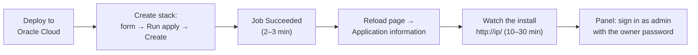
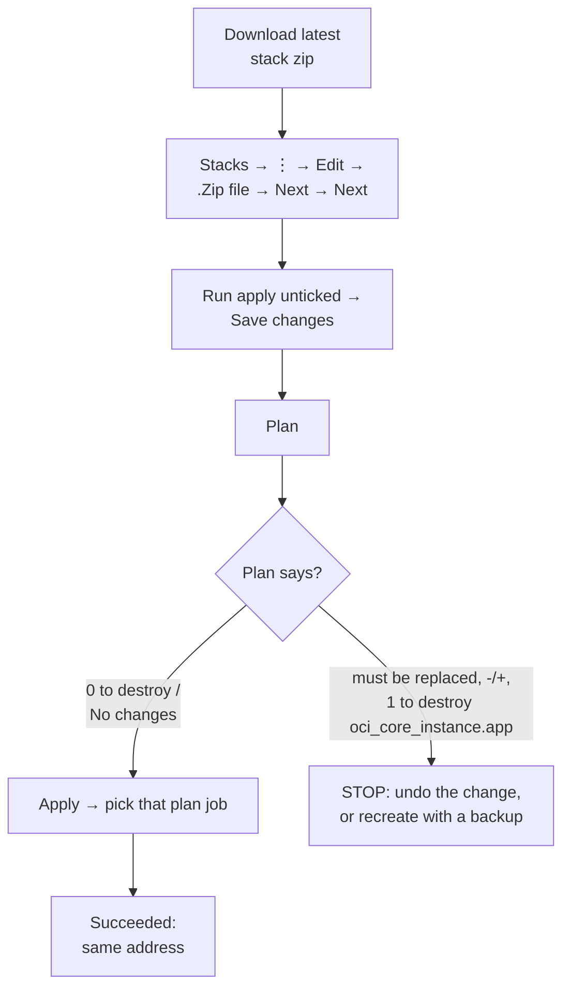
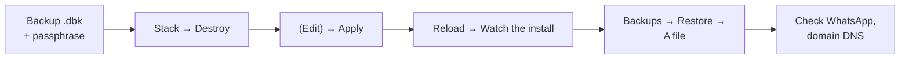

# Oracle Cloud (Always Free)

**A free VM that installs Duniya by itself: one button, one form, no terminal.**

[](https://cloud.oracle.com/resourcemanager/stacks/create?zipUrl=https://github.com/vikramgorla/whatsapp-agent-duniya/releases/latest/download/whatsapp-agent-duniya.zip)

**In 30 seconds**
- Button → form (owner password) → **Create** → job *Succeeded* in 2–3 minutes → install runs 10–15 minutes
  (E2.1.Micro: 20–30).
- The panel link is under **Application information** on the job page, **after a reload**.
- The app updates itself from the panel; the stack (network, VM) rarely needs an update.
- Removing: **Destroy first, then Delete** the stack.

**Jump to:** [**Where is my panel?**](#where-is-my-panel-find-the-ip--url) · [Update the app](#update-the-app) ·
[Update the stack](#update-the-stack-infrastructure) · [Recreate](#recreate-from-scratch) ·
[Remove](#remove-everything) · [Find things fast](#find-things-fast) · [Common errors](#common-errors) ·
[Phone or iPad](#on-a-phone-or-ipad)

Console labels checked November 2026; some pages show **tabs**, others a **Resources** list.

## What you get

| Shape | CPU / memory | Speed | Availability |
|---|---|---|---|
| `VM.Standard.E2.1.Micro` (default) | x86, 1/8 CPU, 1 GB (+2 GB swap from the installer) | slow: first install 20–30 min | always available; up to two per account |
| `VM.Standard.A1.Flex` | Arm, free up to 2 OCPU / 12 GB in total | much faster | often "out of host capacity" |

> [!TIP]
> E2.1.Micro is slow but always there and enough for Duniya (~180 MB). A1.Flex is a matter of capacity luck: try it,
> and fall back to E2.1.Micro if Oracle has none.

> [!NOTE]
> Free resources exist only in your **home region**. Free accounts have at most **2 VCNs** and **200 GB** of block
> storage (boot volumes count).

## Deploy



### Option A: the Deploy button (a "stack")

1. Sign in to Oracle Cloud, then click **Deploy to Oracle Cloud**. **Create stack** opens with the latest release zip.
2. Tick the terms checkbox, keep your home region, pick a compartment → **Next**.
3. Fill the form:
   - **How to reach the admin panel**: `ip` (`https://<ip>.sslip.io`, simplest), `domain`, `tunnel` (Cloudflare, no
     open ports) or `local`.
   - **Owner password** (required, 10+ characters): you sign in as `admin` with it.
   - **Shape**: keep `VM.Standard.E2.1.Micro` unless you have A1 capacity.
4. **Next** → tick **Run apply** → **Create**. The job page opens.
5. When the job shows **Succeeded**, **reload the page** → **Application information** → **Watch the install**. It
   opens your panel when ready.

> [!IMPORTANT]
> Keep the stack: it is Oracle's record of what it created (network, security list, VM). You need it to update,
> recreate and remove the server.

### Where is my panel? (find the IP / URL)

> [!IMPORTANT]
> The job page shows **Succeeded**, but the panel address is not on the first screen. **Reload the page**: the
> **Application information** and **Outputs** tabs often only appear after a reload. Not there? Reload again.

1. **Application information** tab (job page and stack page): **Watch the install**, **Open the panel**, and
   copyable **Panel address**, **Install progress address** and **Public IP**. **Outputs** lists the same values:
   `install_progress_url`, `panel_url`, `public_ip`.
2. Or the job's **Logs**, at the very end after `Apply complete! Resources: … added`:

   ```text
   install_progress_url = "http://203.0.113.10/"
   panel_url = "https://203-0-113-10.sslip.io"
   public_ip = "203.0.113.10"
   ```

3. Or ☰ → **Compute** → **Instances** (right compartment) → `duniya` → **Public IP address**, then open
   `http://<that-ip>/`.

**What you see:** `http://<ip>/` shows the install steps and log, then becomes the panel at
`https://<ip-with-dashes>.sslip.io`. Sign in as **`admin`** with the **Owner password** (no setup code).

<details>
<summary>Other modes: domain, tunnel, local</summary>

| Mode | Panel |
|---|---|
| `ip` | `https://<ip-with-dashes>.sslip.io` |
| `domain` | `https://your-domain` once its A record points to the public IP |
| `tunnel` | your Cloudflare hostname |
| `local` | `ssh -L 8080:127.0.0.1:8080 ubuntu@<ip>` → `http://localhost:8080` (needs *Allow SSH from*) |

</details>

> [!TIP]
> On a phone, use the copy buttons in **Application information → Copy**, not the log.

### Option B: create the VM yourself, then one command

1. **Compute → Instances → Create instance**: Ubuntu 24.04, `VM.Standard.E2.1.Micro`, your SSH key.
2. Direct HTTPS: in the subnet's **Security list**, add ingress TCP 80 and 443 from `0.0.0.0/0` (skip for a tunnel or
   local-only).
3. SSH in and run:

   ```bash
   curl -fsSL https://raw.githubusercontent.com/vikramgorla/whatsapp-agent-duniya/main/install.sh | sudo bash
   ```

The installer opens 80/443 in OCI's iptables for direct HTTPS. Manage it like any server:
[Install → Managing your server](../install.md#managing-your-server).

## Update the app

Nothing to do in Oracle: the app updates itself and **keeps everything**.

1. Panel → **Overview** → **Server** card → **Updates**.
2. **Check now** → *Update available: vX.Y.Z*.
3. **Update to vX.Y.Z** → confirm. Agents pause about a minute; the page reloads by itself.
4. Optional: **Update settings** → *Install automatically* at a time of day.

Or `sudo duniya update` over SSH. OS: **Server → OS updates & maintenance → Install OS updates** → **Restart
server** if asked.

## Update the stack (infrastructure)

Rarely needed: a release note says the stack changed, or you change a stack setting (shape, A1 size, SSH, Logging,
ports).



1. Download [whatsapp-agent-duniya.zip](https://github.com/vikramgorla/whatsapp-agent-duniya/releases/latest/download/whatsapp-agent-duniya.zip)
   (also on [Releases](https://github.com/vikramgorla/whatsapp-agent-duniya/releases)).
2. ☰ → **Developer Services** → **Resource Manager** → **Stacks** (pick the compartment top left if needed).
3. Stack row → **Actions** (⋮) → **Edit**.
4. **Edit stack** → **.Zip file** → drag the zip or **Browse** → **Next**.
5. **Configure variables**: change or keep → **Next**.
6. **Review**: leave **Run apply** **unticked** → **Save changes**.
7. **Plan** → **Plan**. Wait for **Succeeded**, open the job, read the end of the log (see the diagram).
8. **Apply** → under **Apply job plan resolution** pick the plan job you just ran → **Apply**.
9. **Succeeded**: the address is unchanged; after a reboot it is back in 1–2 minutes.

> [!WARNING]
> Any **must be replaced**, `-/+`, or `1 to destroy` for `oci_core_instance.app` deletes the VM and everything on
> it. Stop and [recreate](#recreate-from-scratch) with a backup instead.

<details>
<summary>What an update changes, and what it never touches</summary>

- The VM is **not rebuilt** for a newer Ubuntu image, a changed bootstrap script or another owner password: the
  stack ignores those on purpose, so your data stays.
- Network rules (ports 80/443, SSH from your IP) change in place.
- Changing **A1 OCPUs / memory** or the shape within the same processor family reboots the VM (1–2 minutes).
- **Owner password** and **How to reach the admin panel** in the stack do **not** change the running app: change the
  password in the panel (or `sudo duniya reset-password admin`) and the address in **Settings → Web address &
  access**. The stack only opens or closes 80/443 to match.
- If the job asks: **Show advanced options** → tick **Upgrade provider versions** → Plan again.

</details>

## Recreate from scratch

**When:** the install failed, the VM is broken or reclaimed, you want a fresh Ubuntu, or you switch between x86
(E2.1.Micro) and Arm (A1.Flex), which can't change in place.



1. **Back up first**: **Backups** → passphrase (write it down) → **Back up now & download**. Keep the `.dbk` (GitHub
   or S3 backups work too).
2. **Stacks** → your stack → **Destroy** → **Destroy**. Wait for **Succeeded** (VM and network gone; stack stays).
3. Optional: **Edit** the stack (shape, or the latest zip as in [Update the stack](#update-the-stack-infrastructure)).
4. **Apply** → **Apply** → **Application information** → **Watch the install**.
5. Find the new address ([reload the job page](#where-is-my-panel-find-the-ip--url)); sign in as `admin` with the
   stack's owner password.
6. **Backups → Restore → A file** → `.dbk` → passphrase → **Upload and restore**. Restart 1–2 minutes; then sign in
   with the **accounts from the backup**.
7. **Overview**: WhatsApp *connected*? If not, link again.
8. Domain? Point its A record to the new **Public IP**, then check **Settings → Web address & access**.

> [!NOTE]
> The **public IP changes**: new sslip.io address; update a domain's A record. No *Include WhatsApp link* in the
> backup → scan the QR again. Cloudflare Tunnel keeps its token; Tailscale adds a machine (remove the old one).
> Lost the owner password after a restore? `sudo duniya reset-password <user>` (SSH).

## Remove everything

> [!CAUTION]
> **Destroy first, then Delete the stack.** Deleting the stack first leaves the VM, network and boot volume behind
> with no record, still counting against your free limits (the usual cause of `LimitExceeded` later).

1. Optional backup: **Backups → Back up now & download**.
2. **Developer Services → Resource Manager → Stacks** → your stack → **Destroy** → **Destroy** → wait for **Succeeded**.
3. **Stacks** list → **Actions** (⋮) → **Delete** → confirm.
4. Check for leftovers (same compartment and region), delete any you find:
   - **Compute → Instances**: no `duniya` (terminated ones disappear after a while).
   - **Storage → Block Storage → Boot volumes**: no `duniya` boot volume.
   - **Networking → Virtual cloud networks**: no `duniya-vcn` (open it → **Delete**; removes subnets and gateways).
5. OCI Logging on? **Observability & Management → Logging → Log groups** → delete `duniya`.


## Find things fast

<details>
<summary>Console menus, logs, reboot, resize, health</summary>

| You want | Where |
|---|---|
| Your stack | ☰ → **Developer Services** → **Resource Manager** → **Stacks**, or **Manage stack** in Application information |
| Panel link, IP, progress | Stack or job → **reload** → **Application information** ([details](#where-is-my-panel-find-the-ip--url)) |
| Install progress (direct HTTPS) | `http://<server-ip>/` while installing |
| Install progress (tunnel / local, or page unreachable) | **Compute** → **Instances** → instance → **OS Management** tab (or **Resources**) → **Console history** → **View current history**: `== done:` or `install FAILED` |
| Why Apply failed | Stack → **Jobs** → job → **Logs** |
| App logs | Panel **Server → Logs**, `sudo duniya logs`, or with OCI Logging: **Observability & Management** → **Logging** → **Search** |
| Reboot | Panel **Server → OS updates & maintenance → Restart server**; panel down: **Instances** → **Actions** (⋮) → **Reboot** → **Reboot instance** |
| Resize | A1: **Edit** stack variables → Plan → Apply (reboots). Or instance **Actions** → **More actions** → **Edit** → **Edit shape** → **Save changes**, then set the same values in the stack. x86 ↔ Arm: [recreate](#recreate-from-scratch) |
| Server health | Panel **Server**, or `sudo duniya doctor` |
| Free limits in use | ☰ → **Governance & Administration** → **Tenancy Management** → **Limits, Quotas and Usage** |
| A shell | Only with *Allow SSH from*: `ssh ubuntu@<public-ip>` |

</details>

## Common errors

| Error | Fix |
|---|---|
| **Out of host capacity** (A1) | No free Arm capacity in that availability domain now. **Apply** again later, try another availability domain, or **Edit** → `VM.Standard.E2.1.Micro` → Apply. Pay As You Go gives more capacity and stays free within the limits |
| **LimitExceeded** | Leftovers from an earlier try (a 2nd/3rd VCN, a boot volume, an instance). Clean up as in [Remove everything](#remove-everything) step 4, then **Apply**. Check **Limits, Quotas and Usage** |
| **QuotaExceeded** | A compartment quota from your tenancy admin: another compartment, or ask them |
| Progress page never loads | Wait 2–3 minutes after *Succeeded* (booting). `tunnel` / `local` have no progress page: **Console history** |
| **Install failed** on the progress page | The end of the log says why. Fix it (domain, tunnel token), then [recreate](#recreate-from-scratch) |
| Instance reclaimed / stopped | Always Free instances idle for 7 days (95th-percentile CPU, network and, on A1, memory under 20 %) may be reclaimed. Pay As You Go stops this; keep scheduled backups on |

## On a phone or iPad

- The Console works in Safari and Chrome: swipe wide tables sideways for **Actions** (⋮). The **Oracle Cloud
  Infrastructure** app can reboot instances; stacks need the web Console.
- Stack zip on a phone: download it first, then **Edit stack** → **Browse**. Everything inside the server is in the
  panel, made for phones.

> [!TIP]
> **Keep it alive:** turn on scheduled **Backups** (GitHub private repo, or S3 such as OCI Object Storage's
> S3-compatible API). Pay As You Go prevents idle reclamation and stays free within the Always Free limits.

<details>
<summary>Sources (Oracle documentation)</summary>

[Updating a stack](https://docs.oracle.com/en-us/iaas/Content/ResourceManager/Tasks/update-stack-tf-config.htm) ·
[plan](https://docs.oracle.com/iaas/Content/ResourceManager/Tasks/create-job-plan.htm) ·
[apply](https://docs.oracle.com/iaas/Content/ResourceManager/Tasks/create-job-apply.htm) ·
[destroy](https://docs.oracle.com/iaas/Content/ResourceManager/Tasks/create-job-destroy.htm) ·
[deleting a stack](https://docs.oracle.com/iaas/Content/ResourceManager/Tasks/delete-stack.htm) ·
[Always Free resources](https://docs.oracle.com/en-us/iaas/Content/FreeTier/resourceref.htm) ·
[console history](https://docs.oracle.com/en-us/iaas/Content/Compute/Tasks/displayingconsole-viewing.htm) ·
[rebooting](https://docs.oracle.com/en-us/iaas/Content/Compute/Tasks/restartinginstance-reboot-instance.htm) ·
[changing the shape](https://docs.oracle.com/en-us/iaas/Content/Compute/Tasks/resizinginstances.htm) ·
[service limits](https://docs.oracle.com/en-us/iaas/Content/General/service-limits/view-tenancy.htm) ·
[stack schema outputs](https://docs.oracle.com/en-us/iaas/Content/ResourceManager/Concepts/terraformconfigresourcemanager_topic-schema.htm) ·
[mobile app](https://docs.oracle.com/iaas/Content/GSG/Concepts/mobile.htm)

</details>

---
**Next:** [Getting started](../getting-started.md) · [Backups & updates](../backups-and-updates.md) ·
[Docs index](../README.md)
