# Advanced: Terraform + GitHub Actions on OCI

**The Deploy button's Terraform (`infra/oci/`), run from your fork with infrastructure changes reviewed in pull
requests.**

**Do it:** **Actions → Infrastructure (OCI, advanced example) → Run workflow** → `plan`, then `apply`.

**In 30 seconds**
- OCI API key as repository secrets; state in a private, versioned bucket created on first run.
- Pushes to `infra/oci/**` run `plan`; `apply` is manual; `destroy` removes everything.

Diagram as text

1. Add an OCI API key to the repository secrets.
2. Run the workflow with **plan**.
3. Run the workflow with **apply**.
4. A push to `infra/oci/**` runs **plan** automatically.

## 1. OCI API key → repository secrets

OCI console → profile → **My profile → API keys → Add API key → Generate key pair**, download the private key, then
add secrets under **Settings → Secrets and variables → Actions**:

| Secret | Value |
|---|---|
| `OCI_TENANCY_OCID`, `OCI_USER_OCID`, `OCI_FINGERPRINT`, `OCI_REGION` | from the key's config preview (home region) |
| `OCI_PRIVATE_KEY` | contents of the `.pem` |
| `ADMIN_PASSWORD` | optional owner password |
| `CF_TUNNEL_TOKEN` | only for `EXPOSURE=tunnel` |
| `OCI_COMPARTMENT_OCID`, `SSH_PUBLIC_KEY`, `GIT_CLONE_TOKEN` | optional |

Variables (optional): `EXPOSURE` (`ip` default, `domain`, `tunnel`, `local`), `DOMAIN`, `SHAPE`, `UPDATE_MODE` (`auto` default, `notify`, `off`),
`SSH_INGRESS_CIDR`, `STATE_BUCKET`.

## 2. Run `plan`, read it, then `apply`

> [!WARNING]
> `destroy` removes the VM and everything on it. Take a backup in the panel first.

---
**Next:** [Oracle Cloud](oci-free-tier.md) · [Docs index](../README.md)
