# Development

**Run Duniya locally with fakes for everything external, test it, and ship a release.**

```bash
npm install && ADMIN_PASSWORD=dev-password-123 npm start     # panel on http://127.0.0.1:8080
```

**In 30 seconds**
- Tests fake WhatsApp, models, MCP, GitHub and S3; the demo panel needs no network.
- Every feature has a Spec Kit folder; Definition of Done: [AGENTS.md](../AGENTS.md).

| Command | What |
|---|---|
| `npm test` | e2e tests with fakes, four test files at a time (~30 s) |
| `npm run lint` | ESLint (server code with Node globals, the panel's modules with browser globals) |
| `npm run typecheck` | `tsc` over every file that starts with `// @ts-check` ([Type checking](#type-checking)) |
| `npm run check:panel` | the panel's modules link (every import names a real export) and stay within their budgets ([Panel modules](#panel-modules)) |
| `node scripts/ci-checks.mjs` | versions match, breaking-release entries, **doc links** (`scripts/check-doc-links.mjs`), diagrams, **lean code** (knip, jscpd, panel budgets), types |
| `npm run knip` / `npm run jscpd` | unused files, exports and dependencies / duplicated code ([Lean code](#lean-code)) |
| `node scripts/demo-panel.mjs` | seeded demo panel on :8099 (admin / demo-password-123), no network |
| `DEMO_EMPTY=1 node scripts/demo-panel.mjs` | a fresh install (no provider, no agent, WhatsApp waiting for a scan; *Get code* links it): check the first run |
| `npm run check:responsive` | every screen at 375 / 393 / 1440 px, light + dark: layout, tap targets, text size, and accessibility (every control named, AA contrast) (needs Chrome) |
| `npm run site:shots` | retake the website screenshots and videos (needs Chrome + ffmpeg) |
| `npm run measure:load` | first load of Overview in headless Chrome on slow and fast networks and a phone-speed CPU: bytes and time, cold and warm |

## Spec Kit

Built with [GitHub Spec Kit](https://github.com/github/spec-kit): constitution `.specify/memory/constitution.md`,
every feature under [`specs/`](../specs).

<p align="center"></p>

<details><summary>Diagram as text</summary>

1. `/speckit-specify`
2. `/speckit-plan`
3. `/speckit-tasks`
4. `/speckit-implement`
5. `/speckit-converge`

</details>

Process: [AGENTS.md](../AGENTS.md) and [CONTRIBUTING.md](../CONTRIBUTING.md) · design: [DESIGN.md](../DESIGN.md).

## Lean code

The owner runs the latest version on one server, so the code carries nothing for older ones. Before adding, delete:

1. **Search for what your change replaces** and remove it in the same PR (old function, setting, wording, test).
2. **No compatibility layers or one-time migrations** after the release that needed them: schema changes go into
   `CREATE TABLE`; owners reinstall or restore a backup ([upgrading](upgrading.md)).
3. **One way to do each thing:** reuse the resolvers (`resolveModel`, the name resolver), the scheduler tick
   (`src/core/upkeep.js`), the small-server switch and the shared helpers in `src/core/config.js` (`clip`, `bad`,
   `plural`, `isGroup`, and `fail(message, status, extra)` for any error the panel answers with a status) instead of a
   local copy.
4. **CI checks it** (`node scripts/ci-checks.mjs`, quality job): `knip` (config `knip.json`) fails on unused files,
   exports and dependencies, `jscpd` (`.jscpd.json`, 8 lines) on duplication (both cover the panel's modules too), and
   the panel has two budgets in `scripts/check-panel.mjs`: the first screen and all of its code (raising one needs a
   reason in the PR).
5. **Test behaviour, not internals:** tests go through the panel API, the router and the fakes in `test/harness.js`;
   export something only when the app uses it.
6. **Keep the panel snappy:** no new polling. The status and activity arrive over `/api/events` (server-sent events);
   screens load through `api()`, whose screen-data cache is dropped by any change or live event. Simple switches update
   the screen at once and put the old state back when the server refuses. The shell and its modules are served from
   memory, compressed, with ETag/304; screens load on their first visit ([Panel modules](#panel-modules)).

## Panel modules

The panel is one dependency-free app in native ES modules: no framework, no bundler, no build step. Edit a file, reload.

| File (`src/panel/public/`) | What |
|---|---|
| `index.html` | the shell: meta tags, `app/styles.css`, `<script type="module" src="/app/main.js">` |
| `app/main.js` | entry: page-wide listeners (keyboard, back from the background), then sign-in |
| `app/core.js` | `h()` (untrusted text only through `textContent`), `api()` and its cache, the shared state `S`, the shared components (`ask()` confirmation, `toast()`, `field()`, `toggle()`, `avatar()`, `emptyState()`, `skeleton()`), the shell: top tabs and the phone tab bar, router (`show()`), live stream |
| `app/login.js` | sign-in, first-run setup, one-time sign-up and secret links |
| `app/shared.js` | small helpers several screens use (formatting, model picker, usage line, server size, links) |
| `app/<screen>.js` | one module per screen: `overview`, `chats`, `agents` + `agent-editor`, `activity`, `usage`, `models`, `contacts`, `pending`, `server`, `backups`, `settings`; parts: `start` (Getting started), `ask` (the Ask card), `quiet`, `updates`, `find` (Find anything and the phone's More sheet), `fallback`, `tool-editor`, `registry`, `ai-helper`, `diff` |
| `app/styles.css` | all styles, one set of tokens ([DESIGN.md](../DESIGN.md#tokens-064)) |
| `page.css`, `page.js` | the standalone server pages (sign-in results, Google address help, GitHub app hand-off): files, so their CSP needs no `'unsafe-inline'` |

1. **Static imports for what a module always needs**, `import('./x.js')` for what it may need later. `core.js#show()`
   loads each screen on its first visit; Find anything and the AI helper load when first opened.
2. **The first screen stays small:** `main.js` and `overview.js` with their static imports are preloaded
   (`<link rel=modulepreload>`) and must fit the first-screen budget. Something only another screen needs belongs in
   that screen's module, not in `shared.js` or `core.js`.
3. **Shared state lives in `S`** (`core.js`): a module cannot assign another module's variable, so `S.models`,
   `S.overviewBusy`, `S.dmPrefill` are properties, not `let`s.
4. **Serving** (`src/panel/assets.js`): every file under `/app/` gets a content-hash URL (`?v=…`, cached for a year);
   the shell carries an import map from each plain path to its hashed URL, so relative imports reach the same file and a
   release only re-downloads what changed. The import map is the shell's only inline script; its hash is in the
   Content-Security-Policy, so scripts need no `'unsafe-inline'`.
5. **Checks:** `npm run check:panel` links every module the way the browser does (a missing export fails), checks the
   names loaded through `import()`, refuses the browser's `confirm()`, `alert()` and `prompt()` (use `ask()`), and
   enforces the budgets. ESLint, knip and jscpd cover the modules.
6. **Scripts that drive the page** (`check-responsive`, `site-shots`) reach panel functions with
   `await import('/app/core.js')` (the import map makes it the page's own module); nothing is global.

## Panel server

Routes live in `src/panel/routes/<area>.js` (`auth`, `status`, `agents`, `chats`, `contacts`, `system`, and one per
feature), each exporting `<area>Routes(route, { channel })`. `src/panel/server.js` registers them in one place and keeps
only the router (role gates, the JSON-only CSRF guard), the admin MCP's in-process calls and the static files. A handler
returns the JSON answer, `[status, answer]`, or throws `fail(message, status)` / `bad(message, field)`
(`src/core/config.js`); the router turns the error into `{ error, field, code }` with that status.

## Type checking

`npm run typecheck` runs `tsc` (a dev dependency, nothing is compiled or emitted) over every file that starts with
`// @ts-check`; the quality job runs it through `ci-checks.mjs`. Core modules, the panel server and its routes opt in.

- Add `// @ts-check` to a file you work on when it passes, or with a few JSDoc types where they pay off: a function
  whose options are destructured without defaults (`/** @param {{ count?: number, by?: string }} [o] */`), an array
  that mixes kinds (`/** @type {(string|number)[]} */`). Do not annotate what TypeScript already infers.
- SQLite rows are untyped (`db.prepare()` hands out plain rows, `src/core/db.js`); settings have a `Settings` typedef
  (`src/core/store.js`); route modules type their registrar with `Route` / `RouteContext` (`src/panel/http.js`).

## Releases

1. Bump the version in `package.json`, `package-lock.json` and `infra/oci/schema.yaml` (CI checks they match) and add
   an entry for it to `releases.json` (a one-line `title` is enough; CI fails without one).
2. Merge to `main` (or push a `vX.Y.Z` tag, or run the workflow by hand).
3. The release workflow creates the tag and GitHub release, attaches the OCI stack zip and publishes
   `ghcr.io/vikramgorla/whatsapp-agent-duniya`.

> [!NOTE]
> The website lives in [`docs/site/`](site/) (plain HTML/CSS, no build step) and is deployed to GitHub Pages by
> `.github/workflows/pages.yml` on every push to `main` that touches it.

> [!TIP]
> Docs pages follow one template: promise · primary action · *In 30 seconds* · steps with screenshots · callouts ·
> a diagram for flows · `<details>` for reference · **Next:** links. Thumbnails in `docs/img/` are 800×500 WebP crops of
> `docs/site/img` shots.

## Diagrams

GitHub's Mermaid rendering is unreliable on github.com and absent in the GitHub mobile app, so docs never contain
` ```mermaid ` blocks (CI fails on them). Instead:

1. Write the source in `docs/diagrams/<name>.mmd` (Mermaid; quote every label, use `<br/>` for line breaks, prefer
   `flowchart TD` so it stays narrow enough for a phone, at most ~900 px wide).
2. Run `npm run docs:diagrams` (or `npm run docs:diagrams -- <name> --grid /tmp/grid.png` to render one and check it).
   It renders `docs/diagrams/<name>.svg` with Mermaid in headless Chrome: pure SVG text (no `foreignObject`, works
   inside `` on iOS and in the GitHub app), system fonts only, Constellation colours on a white card that reads
   in dark mode. Needs Chrome (`CHROME_PATH`) and npm; Mermaid itself is fetched into a temp directory and checked
   against a pinned hash, it is not a project dependency.
3. Embed it centred with a meaningful `alt`, at most 720 px wide, followed by a collapsed text version:

   ```html
   <p align="center"></p>

   <details><summary>Diagram as text</summary>

   1. First step.
   2. Second step.

   </details>
   ```

Each SVG stores the hash of its source (`<!-- src-sha256: … -->`); `scripts/ci-checks.mjs` fails when a source changed
without re-rendering, when an SVG has no source, or when a ` ```mermaid ` block is back.

---
**Next:** [How it works](architecture.md) · [Docs index](README.md)
