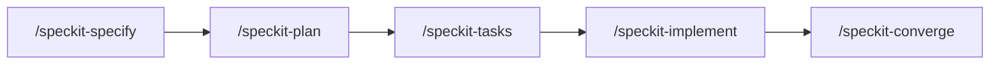

# Development

**Run Duniya locally with fakes for everything external, test it, and ship a release.**

```bash
npm install && ADMIN_PASSWORD=dev-password-123 npm start     # panel on http://127.0.0.1:8080
```

**In 30 seconds**
- Tests fake WhatsApp, models, MCP, GitHub and S3; the demo panel needs no network.
- Every feature has a Spec Kit folder; Definition of Done: [AGENTS.md](../AGENTS.md).

| Command | What |
|---|---|
| `npm test` | e2e tests with fakes |
| `npm run lint` | ESLint |
| `npm run check:panel` | the panel's inline script parses |
| `node scripts/ci-checks.mjs` | versions match, breaking-release entries, **doc links** (`scripts/check-doc-links.mjs`) |
| `node scripts/demo-panel.mjs` | seeded demo panel on :8099 (admin / demo-password-123), no network |
| `npm run check:responsive` | every screen at 375 / 393 / 1440 px, light + dark (needs Chrome) |
| `npm run site:shots` | retake the website screenshots and videos (needs Chrome + ffmpeg) |

## Spec Kit

Built with [GitHub Spec Kit](https://github.com/github/spec-kit): constitution `.specify/memory/constitution.md`,
every feature under [`specs/`](../specs).



Process: [AGENTS.md](../AGENTS.md) and [CONTRIBUTING.md](../CONTRIBUTING.md) · design: [DESIGN.md](../DESIGN.md).

## Releases

1. Bump the version in `package.json`, `package-lock.json` and `infra/oci/schema.yaml` (CI checks they match).
2. Merge to `main` (or push a `vX.Y.Z` tag, or run the workflow by hand).
3. The release workflow creates the tag and GitHub release, attaches the OCI stack zip and publishes
   `ghcr.io/vikramgorla/whatsapp-agent-duniya`.

> [!NOTE]
> The website lives in [`docs/site/`](site/) (plain HTML/CSS, no build step) and is deployed to GitHub Pages by
> `.github/workflows/pages.yml` on every push to `main` that touches it.

> [!TIP]
> Docs pages follow one template: promise · primary action · *In 30 seconds* · steps with screenshots · callouts ·
> Mermaid for flows · `<details>` for reference · **Next:** links. Thumbnails in `docs/img/` are 800×500 WebP crops of
> `docs/site/img` shots.

---
**Next:** [How it works](architecture.md) · [Docs index](README.md)
