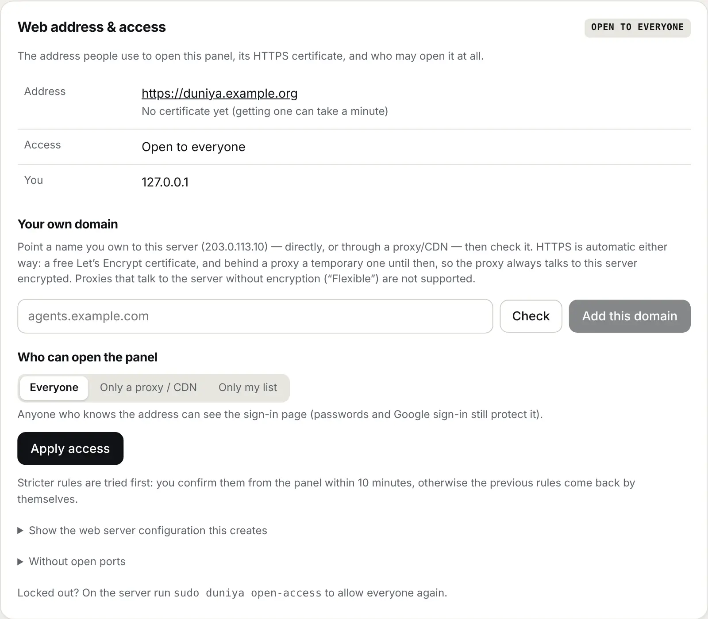

# Domains, proxies, tunnels and access

**Put the panel on your own domain, behind any proxy or CDN, with automatic HTTPS and a switch that never locks you
out.**

**Do it:** panel → **Settings → Web address & access** (owner).

**In 30 seconds**
- Set at [install](install.md), changeable here. HTTPS is automatic in every mode.
- A new address runs **next to** the old one until you confirm it. Nothing switches on a timer.
- Limit access to your proxy/CDN and/or your IPs. Locked out: `sudo duniya open-access`.

## Change the address (two steps)

1. Enter the domain → **Check** → **Add this domain**. It is served next to the current address.
2. Open the panel **at the new address** → **Confirm — new address works**. It becomes the main address; the old one
   keeps working.
3. When nobody needs the old address: **Turn off** (it then only forwards).

Diagram as text

1. **Add this domain**.
2. If HTTPS is not up within 4 minutes, the previous settings come back.
3. Otherwise both addresses work.
4. Open the new address and click **Confirm — new address works**.
5. The new address is the main one; the old one still works.
6. Turn the old one off when you like (it then only forwards).

> [!NOTE]
> **Confirm** is accepted only from a request that really arrived through the new domain. The HTTPS check runs on
> the server itself (127.0.0.1 with the domain as SNI), never through public DNS. Changes are applied by the root
> maintenance helper (older servers: re-run the installer once).

## Does the domain lead here?

DNS is only a hint (*points straight here*, *behind a proxy/CDN*, *other*, *missing*). What decides: the panel
serves a random token at `/.well-known/duniya-check/<token>` and fetches it through the domain, so any proxy works.

## HTTPS

| The domain… | Certificate on this server | Proxy SSL/TLS mode |
|---|---|---|
| points straight here | Let's Encrypt (HTTP-01 / TLS-ALPN) | – |
| goes through a proxy/CDN | Let's Encrypt through the proxy (HTTP-01); until then a temporary certificate from the web server's own CA (2-hour certificates, Let's Encrypt retried about every 80 minutes) | **Full** at once, **Full (strict)** once the card says the real certificate is issued |

> [!WARNING]
> A proxy that talks to this server **without encryption** is never supported. It is detected (the token arrives
> over plain HTTP although the visitor used HTTPS, or a redirect loop) and shown as a blocking error.

> [!TIP]
> Let's Encrypt failing behind a proxy? The card shows the reason. Usually a firewall/bot rule blocks
> `/.well-known/acme-challenge/`: add a rule that skips security checks for that path and turn off "under attack"
> challenges for it. A proxy's "always use HTTPS" is fine (Let's Encrypt follows redirects). Port 80 only answers
> certificate challenges, the token and redirects.

## Who can open the panel

| Choice | Effect |
|---|---|
| Everyone | default |
| Only a proxy/CDN | its published ranges, refreshed daily (Amazon CloudFront, Bunny CDN, Cloudflare, Fastly, Gcore) or your proxy's ranges: nobody bypasses it via the server's IP |
| Your own list | IPs/ranges; your current IP is kept by default |

The visitor's real address is read from the provider's header behind trusted proxies only (Cloudflare:
`CF-Connecting-IP`; others: `X-Forwarded-For` read right to left, which needs Caddy 2.8+ combined with your own list).

> [!IMPORTANT]
> Stricter rules are a **trial**: confirm them from the panel (through the new rules) within 10 minutes, or the
> previous rules come back. You are warned first if the rules would block your own request.

## No open ports at all

Install with a tunnel: [Cloudflare Tunnel](deploy/cloudflare-tunnel.md) (`--cloudflare-token`) or Tailscale
(`--tailscale-authkey`; Funnel can make it public). Other tunnels (frp, ngrok, Pangolin, zrok, …) work with
`--local-only` pointed at `http://127.0.0.1:8080`.

---
**Next:** [Cloudflare Tunnel](deploy/cloudflare-tunnel.md) · [Admin MCP](admin-mcp.md) (needs public HTTPS) ·
[Docs index](README.md)
