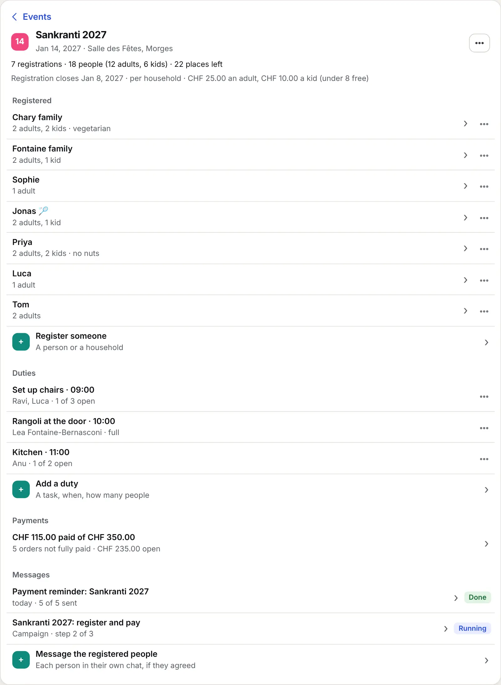

# Events

**Run a family event end to end: who comes, with how many kids, who is on the waiting list, who sets up the chairs.**

**Do it:** **Settings → Modules** → **Events** on → **People → Events** → **+ New**.

**In 30 seconds**
- An event has dates, a place, **places** (people: adults and kids; 0 = no limit), a **deadline**, **one currency**
  (CHF by default), registration **per household** or **per person**, and confirmation **automatic** or **by an
  organizer**. Optionally a **price list** (adult, kid, kids under an age free) and a pay-by date.
- People register through an agent (*"!panduga register us for Sankranti"*) or you register them here.
- Full → **waiting list**. When someone cancels, the first waiting registrations that fit get the place by themselves.
- **Duties**: a task, a time, how many people; anyone takes one (*"I'll do the chairs"*), organizers assign.
- With [Orders and payments](orders.md) on, a registration on an event with prices becomes an order by itself.

## Create an event

1. **People → Events → + New**.
2. Name, start (and end), place, **Places** (0 = no limit), **Registration closes** (organizers can still add people
   after it), **Registration** per household or per person, **Confirmed** automatically or by an organizer.
3. Prices (optional): per adult, per kid, and **Kids under this age are free** (uses their birthday in People). The
   currency is the event's, one per event.
4. **Create event**. Change it any time with **⋯ → Edit…**; a larger capacity lets the waiting list in.

## Registrations

- **Per household**: a family registers once. Adults and kids default to the household's members (kids are the
  household's kid members, with or without a phone). The numbers can be changed (**⋯ → Change numbers…**).
- **Per person**: one person, with extra adults or kids if they bring guests.
- Status: **Registered**, **Waiting list**, **To confirm** (the event needs an organizer), **Cancelled**. Each row's
  **⋯** confirms, moves to the waiting list, cancels, or marks **Came** (attendance).
- Notes (diet, arrives late) show on the row and in the CSV. **⋯ → Download CSV** exports the list; cells that a
  spreadsheet would run as a formula are made safe.
- Every member's **timeline** in People notes when they registered, moved or got a place.

> [!TIP]
> Ask the owner assistant *"how many kids registered for Sankranti?"* or *"who is on the waiting list?"*.

## Message the families

With [Lists and sending](sending.md) on, an event's page has a **Messages** section: what was sent to its people
(messages and campaigns), and **Message the registered people**: a message to its registered people, **one per household** (to one adult who agreed to updates), each with their own numbers
(`{people}`: *2 adults, 1 kid*), the date and the place. With Orders on too, **⋯ → Automatic payment reminders…**
reminds people who have not paid, a few days before the due date. A [campaign](campaigns.md) can invite, wait and
follow up only with those who have not registered or paid.

## What agents can do

| Tool | Who | Confirm |
|---|---|---|
| `list_events`, `show_event` (incl. their own registration) | everyone | – |
| `register` (myself or my household; pending when an organizer confirms; the deadline applies) | everyone | – |
| `cancel_my_registration`, `take_duty` | everyone | – |
| `registration_list` (names, adults, kids, notes, counts) | organizers | – |
| `register_someone`, `update_registration` (confirm, waiting list, cancel), `assign_duty` | organizers | `confirm CODE` |

Agents name only people their [People access](people.md#what-agents-see) lets them see; hidden people never show.
Tick tools per role on the agent's page ([Modules](modules.md#agent-tools)).

## AI assistants and the owner assistant

Admin MCP: `list_events`, `get_event`, `save_event`, `delete_event`*, `register_for_event`, `update_registration`,
`save_event_duty` (* needs `confirm_action`).

---
**Next:** [Orders and payments](orders.md) · [Lists and sending](sending.md) · [Modules](modules.md) · [People](people.md) · [Docs index](README.md)
