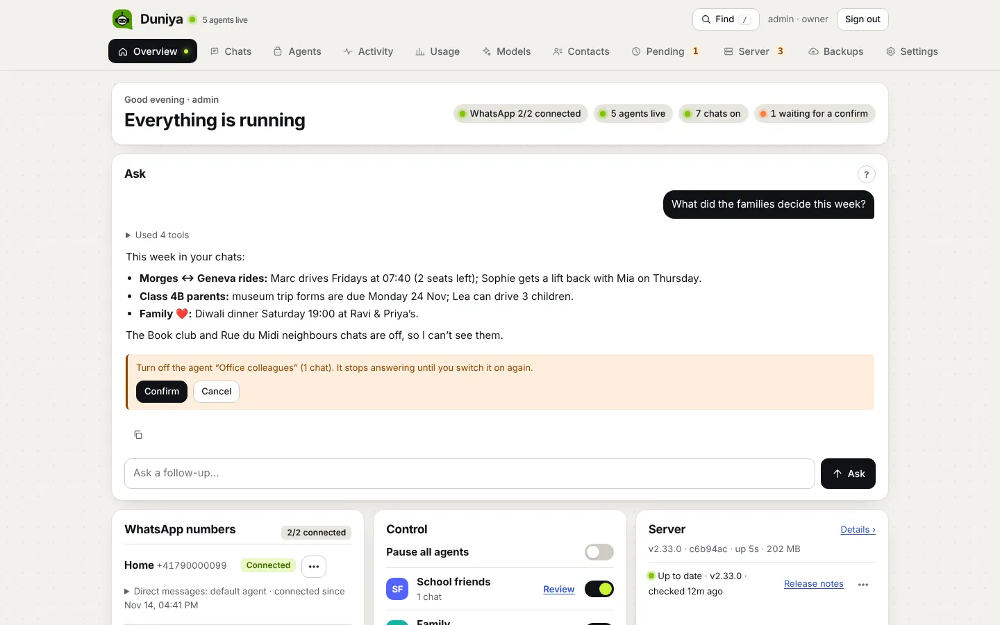
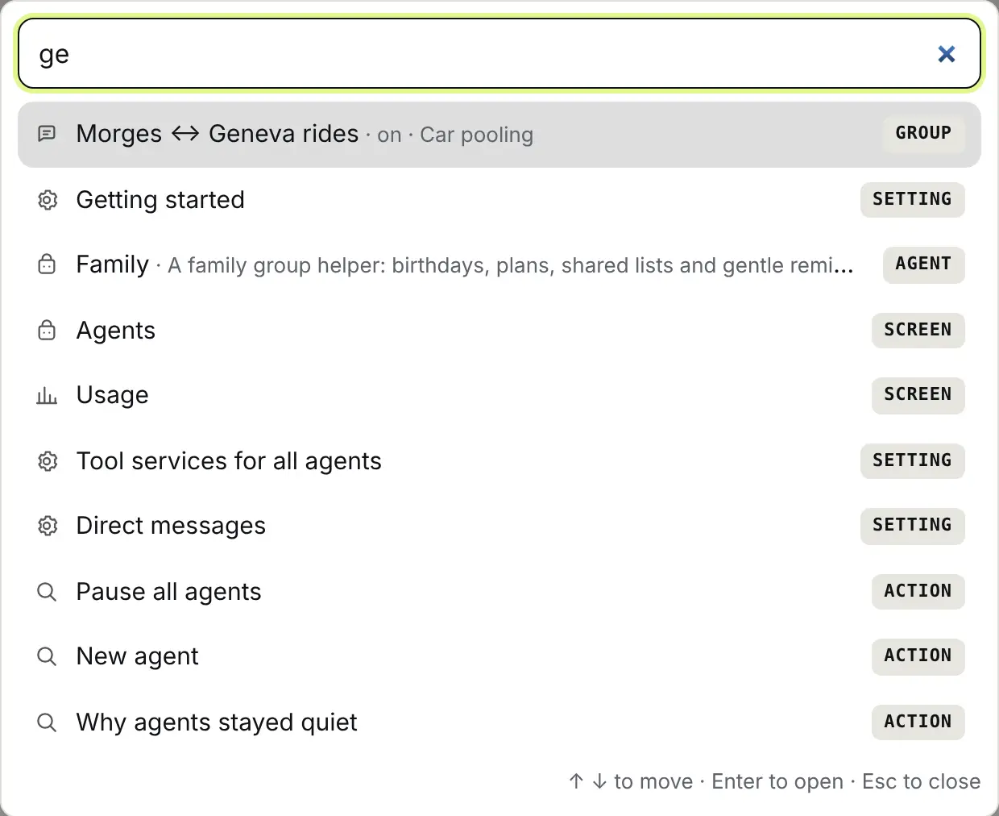
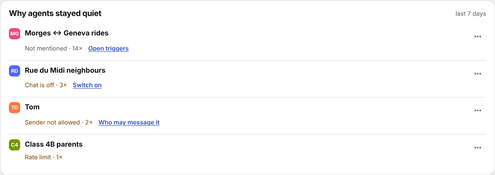
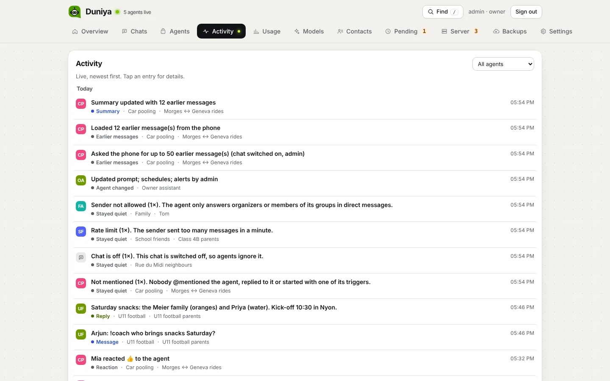
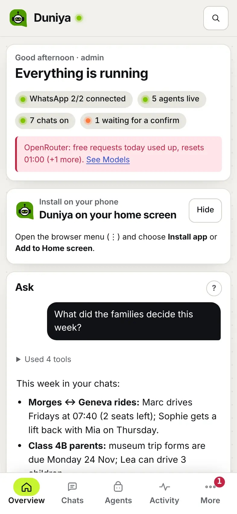

# Everyday use

**Glance at Overview, ask what happened, find anything with one key, and run it all from your phone.**

**Do it:** open the panel → **Overview**. On a phone, add it to your home screen ([below](#on-your-phone)).

**In 30 seconds**
- **Overview** says whether everything runs, with **Ask**, your numbers, agents and the server on one screen.
- Press **/** (or ⌘K) to find any agent, chat, setting or action, and (owner) to search what was said.
- **Why agents stayed quiet** explains every silence, with a one-tap fix.
- Everything is live: no reload, no polling, also on a phone.

## Overview

| Card | What it shows |
|---|---|
| **Header** | *Everything is running* or what needs you: WhatsApp numbers (the chip opens **Settings → WhatsApp**), agents live, chats on, changes waiting for a confirm |
| **Ask** | the [owner assistant](owner-assistant.md) as a conversation: "what did the families decide this week?" |
| **WhatsApp** | each number and its state; **Details ›** opens **Settings → Channels → WhatsApp** (link, add, switch off — [Connect WhatsApp](whatsapp.md)) |
| **Control** | **Pause all agents** and a switch per agent, with a live *reading… / answered* pulse; the name opens the agent, **Review** its answers |
| **Server** | version, memory and one update row: *Up to date · v2.33.0 · checked 2m ago*, **Release notes**, the one action when there is one, ⋯ for **Check now** and the settings ([Backups & updates](backups-and-updates.md#updates)) |
| **Why agents stayed quiet** | the last 7 days, [below](#why-didnt-it-answer) |
| **Recent activity** | the newest entries, live |

After an update, Overview shows **Updated to vX — see what's new** once. Every release's notes are under
**Settings → Help → Release notes**.

## Find anything

Press **/** or **⌘K** (Ctrl+K), or tap the search button on a phone, and type: a group, a person, an agent, a section
(*Tools · Car pooling*), a setting (*secrets*, *privacy*, *backup*) or an action (*pause*, *new agent*, *add a direct
chat*). ↑ ↓ and Enter, or tap. As the owner, the last row searches the messages of every chat
([Search messages](chats.md#search-messages-owner)).

Every screen has its own address, e.g. `#settings/secrets`, `#models/chatgpt`, `#agents/carpool/tools`.

## Why didn't it answer?

**Overview → Why agents stayed quiet** (and a hint on each chat's row) shows the reasons of the last 7 days, grouped
by chat: the chat's name (tap it for the chat's page), then one line per reason with its count and the fix as a small
link, such as **Switch on** or **Open triggers**. **⋯ → Clear** forgets a chat's records. Chats are always shown by
their name (the group's WhatsApp name, or the person's), never by an id.

All reasons

*chat is off*, *not mentioned*, *not for it* (it read the message and left it), *no agent chosen*, *agent is off*, *all agents paused*, *direct messages off*,
*sender not allowed*, *rate limit*, *model error*, *empty answer*, *budget cap reached*, *server busy*, *waited too
long*. Only counts, the last time and one sample sender are kept, never the messages. Admin MCP: `list_silences`.

## Activity, Usage and Pending

| Screen | What for |
|---|---|
| **Activity** | every message in and out, tool call, model call, change and error, grouped by day; filter per agent, or per chat from a chat's **Activity** row. Tap an entry: a reply shows its 👍 / 👎 · **Teach…** row and **See in messages**; every entry links to its chat and agent; *Details* holds the raw entry. What is recorded: **Settings → Activity log** ([Privacy](privacy.md#what-is-kept-and-who-sees-it)) |
| **Usage** | tokens and cost by agent, chat, provider and model (agent and chat names open their page); monthly caps ([Usage & spending caps](spending.md)) |
| **Pending** | changes an agent prepared that wait for an organizer's `confirm CODE` (shown only while there are some): what it would do, which agent, the chat (a link to its messages), **Apply** or **Cancel** |

> [!TIP]
> **Everything links to everything.** A chat's page links to its agent, Messages, Memory and Activity; an agent's
> Review links each answer to its place in the chat; an Activity entry links to its chat, agent and message. The same
> answer has the same 👍 / 👎 wherever it is shown.

## On your phone

The panel installs on your home screen and opens full screen like an app: nothing from a store, nothing to update.

1. Open the panel at its **https** address in your phone's browser and sign in.
2. **iPhone / iPad (Safari):** **Share** → **Add to Home Screen**. **Android:** **Install** on the *Install on your
   phone* card on Overview, or the browser menu (⋮) → **Install app**.
3. Open **Duniya** from the home screen.

- A **tab bar** at your thumb: Overview, Chats, Agents, Activity and **More** (every other screen, Find anything,
  Refresh and your account). Questions open as sheets from the bottom; switching off shows **Undo**.
- Pull down to refresh. Back from the background, it reconnects and redraws by itself.
- Light and dark mode follow the phone; it works with a screen reader and a keyboard too.
- Nothing is stored on the phone except the sign-in cookie. Alerts come in WhatsApp from the
  [owner assistant](owner-assistant.md#owner-alerts-and-weekly-summary).

> [!NOTE]
> Installing needs the public **https** address. On a plain `http://` address Android only adds a shortcut that opens
> a browser tab.

---
**Next:** [Owner assistant](owner-assistant.md) · [Usage & spending caps](spending.md) · [Docs index](README.md)
