# Getting started

**From a fresh panel to an agent answering in your group in about five taps, without leaving Overview.**

**Do it:** open the panel → **Overview** → **Getting started**: the current step opens right there.

**In 30 seconds**
- Five steps, in order: link WhatsApp, connect a model, create an agent, switch a chat on, send a test.
- Chats are **off** until you switch them on: nothing stored, no model call.
- Each step links to its guide: [WhatsApp](whatsapp.md), [models](models.md), [agents](agents.md), [chats](chats.md).

## Where is my panel?

Open `http://<server-ip>/`: while installing it is a progress page that opens the panel by itself; afterwards it
forwards to `https://<ip-with-dashes>.sslip.io`.

| Host | Address |
|---|---|
| Oracle Cloud | Job *Succeeded* → **reload the page** → **Application information** (or **Outputs**) → **Open the panel**. Also job **Logs** (`panel_url = …`) or **Compute → Instances → duniya → Public IP address**. Sign in as `admin` with the stack's owner password |
| Google Cloud | End of the Cloud Shell output (`Ready: https://…sslip.io` + setup code), or **Compute Engine → VM instances → External IP** |
| Own server | The installer's last lines; later `sudo duniya status` and `sudo duniya show-setup-code` |
| Docker | `http://localhost:8080` on that machine (or your domain / tunnel) |

More per host: [Install → Where is my panel?](install.md#where-is-my-panel-find-the-ip--url)

## First steps

**Setup**: enter the setup code, choose your username and password. Then **Overview → Getting started** walks you
through five steps; the one you are on opens in place:

1. **Link your WhatsApp number**: scan the QR code with the phone of the agents' number (*WhatsApp → Settings →
   Linked devices → Link a device*), or get a pairing code. Use a number just for the agents. [Connect WhatsApp](whatsapp.md)
2. **Connect an AI model**: paste any key into the one box: Duniya recognises OpenRouter (`sk-or-`, free models
   only), Anthropic (`sk-ant-`), a Claude Code token from `claude setup-token` (`sk-ant-oat01-`), OpenAI (`sk-`) and GitHub Copilot
   (`github_pat_`). No key yet? **Free key from
   OpenRouter ↗**, or **Use my ChatGPT plan**. Everything else: [Models](models.md).
3. **Create your first agent**: tap a template (Car pooling, Family, Event planning…) or describe it in your own words
   and let the AI helper draft it. You can change everything later. [Agents](agents.md)
4. **Switch a chat on**: tap **Switch on** next to a group. The agent is chosen for it, the group gets a short privacy
   notice once, and its recent messages are loaded from your phone (keep the phone online). [Chats](chats.md)
5. **Send a test message**: ask the agent something; the answer shows right there (nothing is posted to WhatsApp).
   Then try it in the group: `!yourtrigger hello` or @mention the agent.

When the last step is done, the card says **All set** with the test answer and disappears after **Close**. **Skip**
leaves a step for later (**Skipped · undo** brings it back); **Hide** hides the card (bring it back under **Settings →
Getting started**). Afterwards: **Backups** (passphrase, GitHub or S3, schedule), see [Backups](backups-and-updates.md).

> [!TIP]
> For one person instead of a group, **Chats → Add a direct chat** works before they have written
> ([Chats](chats.md#set-up-a-direct-chat-before-the-person-writes)). Tools every agent should have (a calendar, a
> shared planner) go under **Settings → Tool services** once, instead of per agent.

Diagram as text

1. Link WhatsApp.
2. Connect a model.
3. Create an agent.
4. Switch a chat on.
5. Send a test message.

---
**Next:** [Connect WhatsApp](whatsapp.md) · [Agents](agents.md) · [Everyday use](everyday.md) · [Docs index](README.md)
