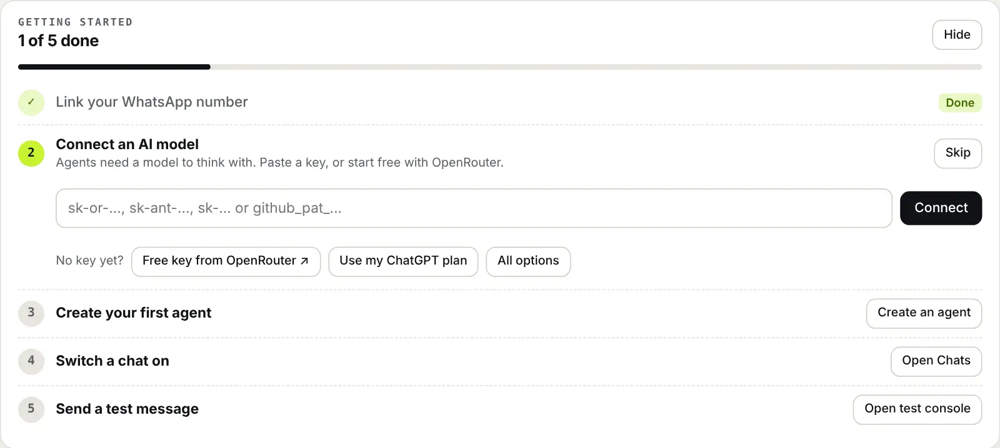
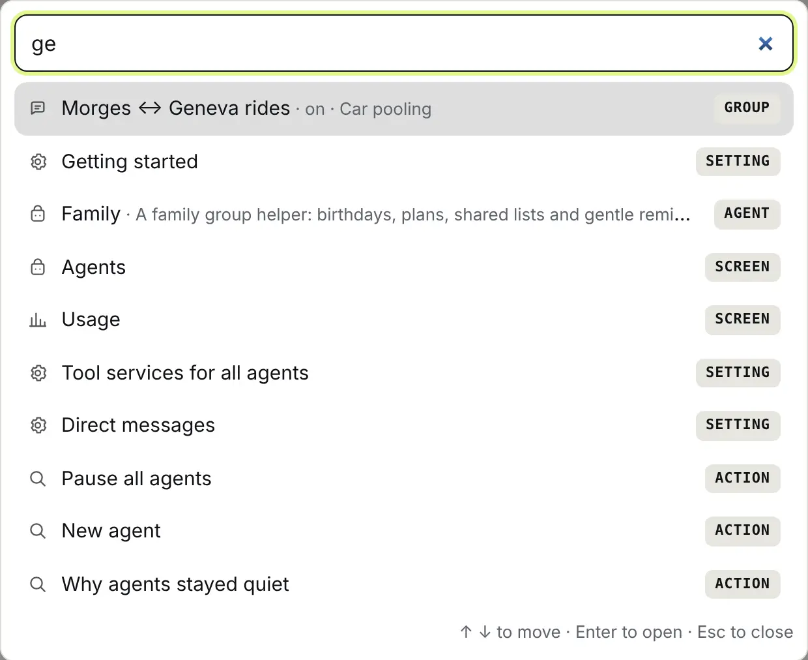
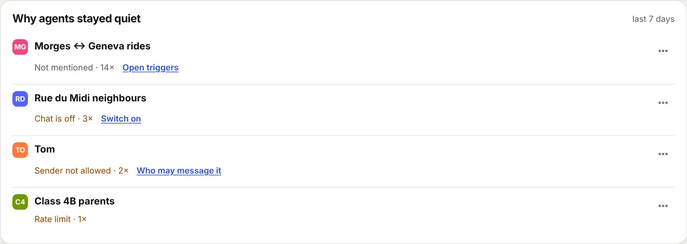

# Getting started

**From a fresh panel to an agent answering in your group in about five taps, without leaving Overview.**

**Do it:** open the panel → **Overview** → **Getting started**: the current step opens right there.

**In 30 seconds**
- Five steps, in order: link WhatsApp, connect a model, create an agent, switch a chat on, send a test.
- Chats are **off** until you switch them on: nothing stored, no model call.
- Lost? Press **/** (or ⌘K, or the search button on a phone) and type what you want: an agent, a group, a setting.
- Agent quiet? **Overview → Why agents stayed quiet** says why, with a fix.

## Where is my panel?

Open `http://<server-ip>/`: while installing it is a progress page that opens the panel by itself; afterwards it
forwards to `https://<ip-with-dashes>.sslip.io`.

| Host | Address |
|---|---|
| Oracle Cloud | Job *Succeeded* → **reload the page** → **Application information** (or **Outputs**) → **Open the panel**. Also job **Logs** (`panel_url = …`) or **Compute → Instances → duniya → Public IP address**. Sign in as `admin` with the stack's owner password |
| Google Cloud | End of the Cloud Shell output (`Ready: https://…sslip.io` + setup code), or **Compute Engine → VM instances → External IP** |
| Own server | The installer's last lines; later `sudo duniya status` and `sudo duniya show-setup-code` |
| Docker | `http://localhost:8080` on that machine (or your domain / tunnel) |

More per host: [Install → Where is my panel?](install.md#where-is-my-panel-find-the-ip--url)

## First steps

**Setup**: enter the setup code, choose your username and password. Then **Overview → Getting started** walks you
through five steps; the one you are on opens in place:

1. **Link your WhatsApp number**: scan the QR code with the phone of the agents' number (*WhatsApp → Settings →
   Linked devices → Link a device*), or get a pairing code. Use a number just for the agents.
2. **Connect an AI model**: paste any key into the one box: Duniya recognises OpenRouter (`sk-or-`, free models
   only), Anthropic (`sk-ant-`), OpenAI (`sk-`) and GitHub Copilot (`github_pat_`). No key yet? **Free key from
   OpenRouter ↗**, or **Use my ChatGPT plan**. Everything else: [Models](models.md).
3. **Create your first agent**: tap a template (Car pooling, Family, Event planning…) or describe it in your own words
   and let the AI helper draft it. You can change everything later. [Agents](agents.md)
4. **Switch a chat on**: tap **Switch on** next to a group. The agent is chosen for it, the group gets a short privacy
   notice once, and its recent messages are loaded from your phone (keep the phone online).
5. **Send a test message**: ask the agent something; the answer shows right there (nothing is posted to WhatsApp).
   Then try it in the group: `!yourtrigger hello` or @mention the agent.

When the last step is done, the card says **All set** with the test answer and disappears after **Close**. **Skip**
leaves a step for later (**Skipped · undo** brings it back); **Hide** hides the card (bring it back under **Settings →
Getting started**). Afterwards: **Backups** (passphrase, GitHub or S3, schedule), see [Backups](backups-and-updates.md).

> [!TIP]
> For one person instead of a group, **Chats → Add a direct chat** works before they have written
> ([Agents](agents.md#set-up-a-direct-chat-before-the-person-writes)). Tools every agent should have (a calendar, a
> shared planner) go under **Settings → Tool services** once, instead of per agent.

Diagram as text

1. Link WhatsApp.
2. Connect a model.
3. Create an agent.
4. Switch a chat on.
5. Send a test message.

## Find anything

Press **/** or **⌘K** (Ctrl+K), or tap the search button in the header, and type: a group, a person, an agent
(*Test · Car pooling* opens its test), a setting (*secrets*, *privacy*, *backup*) or an action (*pause*, *new
agent*, *add a direct chat*). ↑ ↓ and Enter, or tap. Links like `#settings/secrets`, `#models/chatgpt` or
`#chats/<chat id>` open the screen at that spot.

As the owner, the last row is **Search messages for "…"**: what was said in any chat that is on (word beginnings
match, any order), with the words marked; tap a result to open that chat's messages
([Agents → Chats](agents.md#the-chats-screen-and-a-chats-page)).

## Trying an agent: test console and *Test as*

Every agent page has a **Test** section: real tools and saved settings, nothing posted to WhatsApp. **Test as** picks
the role (participant or organizer) and the chat (one of the agent's chats or a new direct chat), and shows the tools
that role really gets.

> [!NOTE]
> If the chosen chat is off, a note says that in WhatsApp the agent would stay silent there.

## Why didn't it answer?

**Overview → Why agents stayed quiet** (and a line per chat on **Chats**) shows the last 7 days with counts and
one-click fixes.

All reasons

*chat is off*, *not mentioned*, *no agent chosen*, *agent is off*, *all agents paused*, *direct messages off*,
*sender not allowed*, *rate limit*, *model error*, *empty answer*, *budget cap reached*, *server busy*, *waited too
long*. Only counts, the last time and one sample sender are kept, never the messages. Admin MCP: `list_silences`.

---
**Next:** [Agents, tools & memory](agents.md) · [Models](models.md) · [Privacy](privacy.md) · [Docs index](README.md)
