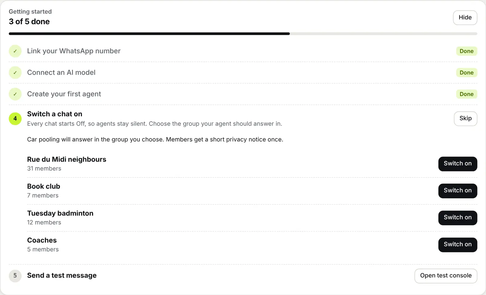
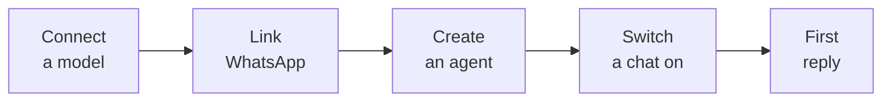
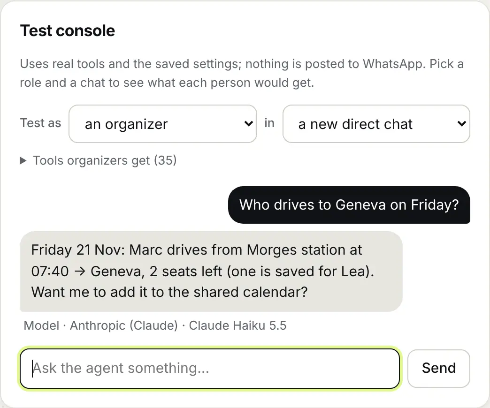

# Getting started

**From a fresh panel to an agent answering in your group, in five checklist steps.**

**Do it:** open the panel → **Overview** → follow the **first-run checklist**.

**In 30 seconds**
- Chats are **off** until you switch them on: nothing stored, no model call.
- Try agents in the **test console**: nothing is posted to WhatsApp.
- Agent quiet? **Overview → Why agents stayed quiet** says why, with a fix.

## Where is my panel?

Open `http://<server-ip>/`: while installing it is a progress page that opens the panel by itself; afterwards it
forwards to `https://<ip-with-dashes>.sslip.io`.

| Host | Address |
|---|---|
| Oracle Cloud | Job *Succeeded* → **reload the page** → **Application information** (or **Outputs**) → **Open the panel**. Also job **Logs** (`panel_url = …`) or **Compute → Instances → duniya → Public IP address**. Sign in as `admin` with the stack's owner password |
| Google Cloud | End of the Cloud Shell output (`Ready: https://…sslip.io` + setup code), or **Compute Engine → VM instances → External IP** |
| Own server | The installer's last lines; later `sudo duniya status` and `sudo duniya show-setup-code` |
| Docker | `http://localhost:8080` on that machine (or your domain / tunnel) |

More per host: [Install → Where is my panel?](install.md#where-is-my-panel-find-the-ip--url)

## First steps

1. **Setup**: enter the setup code, choose your username and password.
2. **Overview**: scan the QR with the agent's WhatsApp (*Settings → Linked devices*), or use a pairing code.
3. **Models**: connect OpenRouter in one tap, paste an Anthropic or OpenAI key, add an OpenAI-compatible endpoint,
   *Sign in with ChatGPT*, or connect GitHub Copilot. [Models](models.md)
4. **Agents → New agent**: pick a template (or *Create an agent with AI*), write the instructions, add organizers,
   connect tool services, save. Try it in the **test console**. [Agents](agents.md)
5. Add the agent's number to a WhatsApp group. **Chats** → switch the chat **on** and choose the agent.
6. In the group: `!yourtrigger hello` (or @mention the agent).
7. **Backups**: set a passphrase, connect GitHub or S3, turn on the schedule. [Backups](backups-and-updates.md)

> [!TIP]
> Tools every agent should have (a calendar, a shared planner) go under **Settings → Tool services** once, instead of
> per agent. The checklist can be dismissed once you know your way around.

## Trying an agent: test console and *Test as*

Every agent page has a **test console**: real tools and saved settings, nothing posted to WhatsApp. **Test as** picks
the role (participant or organizer) and the chat (one of the agent's chats or a new direct chat), and shows the tools
that role really gets.

> [!NOTE]
> If the chosen chat is off, a note says that in WhatsApp the agent would stay silent there.

## Why didn't it answer?

**Overview → Why agents stayed quiet** (and a line per chat on **Chats**) shows the last 7 days with counts and
one-click fixes.

All reasons

*chat is off*, *not mentioned*, *no agent chosen*, *agent is off*, *all agents paused*, *direct messages off*,
*sender not allowed*, *rate limit*, *model error*, *empty answer*, *budget cap reached*, *server busy*, *waited too
long*. Only counts, the last time and one sample sender are kept, never the messages. Admin MCP: `list_silences`.

---
**Next:** [Agents, tools & memory](agents.md) · [Models](models.md) · [Privacy](privacy.md) · [Docs index](README.md)
