# Install

**Duniya on a server of your own in 15–30 minutes, free on Oracle or Google Cloud.**

```bash
curl -fsSL https://raw.githubusercontent.com/vikramgorla/duniya/main/install.sh | sudo bash
```

**In 30 seconds**
- Any Ubuntu/Debian server (x86_64 or arm64), 1 GB of memory (~180 MB used).
- Every way runs the same installer; re-run it to update or change the address. Data stays.
- It ends with the **panel address** and a **one-time setup code** → [Getting started](getting-started.md).

## Choose your host

| | Oracle Cloud | Google Cloud | Own server | Docker |
|---|---|---|---|---|
| **Cost** | free (Always Free) | free (one e2-micro) | your VM | your machine |
| **Speed** | E2.1.Micro slow (1/8 CPU); A1.Flex Arm fast | 2 shared vCPUs, 1 GB | your choice | your choice |
| **Setup time** | ~3 min clicks + 10–15 min install (E2.1.Micro: 20–30) | ~15 min | 10–15 min | minutes (image pull) |
| **Open ports** | 80, 443 (or none with a tunnel) | 80, 443 (or none) | your choice | none by default |
| **Best for** | most people: one click, no terminal | a Google account and a terminal-friendly tutorial | a VPS you already have | a home server or laptop |
| **Start** | [](https://cloud.oracle.com/resourcemanager/stacks/create?zipUrl=https://github.com/vikramgorla/duniya/releases/latest/download/duniya.zip) | [](https://shell.cloud.google.com/cloudshell/editor?cloudshell_git_repo=https%3A%2F%2Fgithub.com%2Fvikramgorla%2Fduniya&cloudshell_git_branch=main&cloudshell_tutorial=infra%2Fgcp%2Ftutorial.md) | [one command](#one-command-ubuntudebian) | [compose](deploy/docker.md) |
| **Guide** | [Oracle Cloud](deploy/oci-free-tier.md) | [Google Cloud](deploy/google-cloud.md) | [below](#managing-your-server) | [Docker](deploy/docker.md) |

> [!NOTE]
> Both free tiers need a card. Oracle: 1 GB AMD VM or Arm up to 2 OCPU / 12 GB, 200 GB disk, 10 TB traffic. AWS and
> Azure only have 6–12 month trials, Hetzner no free tier, Fly.io/Render no always-on VMs; "lifetime free VPS" sites
> are not trustworthy ([research](../specs/030-free-vms/research.md)). From your own fork:
> [Terraform + GitHub Actions](deploy/terraform-github-actions.md).

<p align="center"></p>

<details><summary>Diagram as text</summary>

1. Press the deploy button or run one command.
2. The VM boots and the installer runs.
3. Follow the live progress page at `http://server-ip/`.
4. Open the panel at `https://ip-with-dashes.sslip.io`.
5. Sign in with the setup code or the owner password.
6. Follow **Getting started** on Overview.

</details>

## One command (Ubuntu/Debian)

It asks how the panel should be reached, or say it up front:

```bash
curl -fsSL https://raw.githubusercontent.com/vikramgorla/duniya/main/install.sh | sudo bash -s -- --ip-https --yes
```

| Option | Panel address | Open ports |
|---|---|---|
| `--domain agents.example.com` | `https://agents.example.com` (automatic certificate) | 80, 443 |
| `--ip-https` | `https://<your-ip>.sslip.io` (no domain needed) | 80, 443 |
| `--cloudflare-token <token>` | your Cloudflare Tunnel hostname ([guide](deploy/cloudflare-tunnel.md)) | none |
| `--tailscale-authkey <tskey-…>` | `https://<machine>.<tailnet>.ts.net`, your tailnet only | none |
| `--local-only` | `ssh -L 8080:127.0.0.1:8080 you@server` → `http://localhost:8080`, or your own tunnel (frp, ngrok, Pangolin, zrok) to `http://127.0.0.1:8080` | none |

> [!TIP]
> Tailscale: turn on **MagicDNS** and **HTTPS Certificates** in the Tailscale admin console; Tailscale Funnel can
> make it public. `--help` lists every option (`--admin-password`, `--update-mode off|notify|auto`, `--branch`,
> `--dry-run`, …).

## Google Cloud (Always Free e2-micro)

**Open in Cloud Shell** runs `bash infra/gcp/deploy.sh` for you ([guide](deploy/google-cloud.md)); in any shell
with `gcloud`, clone this repository and run it yourself. How the panel is reached:

| `--exposure` | Panel | Firewall | Cost |
|---|---|---|---|
| `public` (default) | `https://<ip>.sslip.io`, later your domain | tcp 80, 443 (rule `duniya-web`) | free |
| `cloudflare --cloudflare-token …` | your Cloudflare Tunnel hostname | no 80/443 rule | free |
| `tailscale --tailscale-authkey …` | `https://<vm>.<tailnet>.ts.net` (your devices) | no 80/443 rule | free |
| + `--no-external-ip` (tunnel modes) | same | no external IP; outbound via Cloud NAT | **billed** ≈ US$4.70/month + traffic |

> [!WARNING]
> Keep the free ephemeral IP: the VM needs outbound internet. A static IP, a second VM's IP or Cloud NAT is billed.

<details>
<summary>Cloud NAT prices and SSH</summary>

NAT ≈ US$0.0014/h gateway + US$0.005/h IP + US$0.045/GiB ([VPC pricing](https://cloud.google.com/vpc/pricing),
[Cloud NAT pricing](https://cloud.google.com/nat/pricing)). The default network still allows SSH (port 22) unless
you remove the `default-allow-ssh` rule.

</details>

## Where is my panel? (find the IP / URL)

| Installed with | Where the address is |
|---|---|
| **Oracle Cloud stack** | Job page → **reload** after *Succeeded* → **Application information** (or **Outputs**): **Open the panel**, **Watch the install**, copyable **Panel address** / **Public IP**. Also the end of the job **Logs** (`panel_url = "https://…sslip.io"`) or **Compute → Instances → duniya → Public IP address**. [Details](deploy/oci-free-tier.md#where-is-my-panel-find-the-ip--url) |
| **Google Cloud script** | End of the Cloud Shell output (`Ready: https://…sslip.io` and the setup code), or **Compute Engine → VM instances → External IP**. [Details](deploy/google-cloud.md#where-is-my-panel-find-the-ip--url) |
| **One-command installer** | Its last lines: `Admin panel: …` and `Setup code: …`. Later: `sudo duniya status` and `sudo duniya show-setup-code` |
| **Docker** | `http://localhost:8080` on that machine, `https://$DOMAIN` (https profile) or your tunnel hostname. Setup code: `docker compose exec app duniya show-setup-code` |
| **Tunnel / Tailscale / local** | Your Cloudflare hostname · `https://<machine>.<tailnet>.ts.net` · `ssh -L 8080:127.0.0.1:8080 you@server` → `http://localhost:8080` |

> [!TIP]
> `http://<server-ip>/` is a live progress page that becomes the panel (`https://<ip-with-dashes>.sslip.io`). Setup
> code lost? `sudo duniya show-setup-code` (or `/var/lib/duniya/data/setup-code.txt`). With an owner password
> (Oracle stack, `--admin-password`) sign in as `admin` instead.

## Managing your server

Installer servers. Cloud and Docker: [Oracle](deploy/oci-free-tier.md) · [Google](deploy/google-cloud.md) ·
[Docker](deploy/docker.md).

<p align="center"></p>

<details><summary>Diagram as text</summary>

1. **Update** (panel or `duniya update`): everything is kept.
2. **Recreate**: download a backup (`.dbk`), install on a new server, restore the backup on the first screen.
3. **Remove**: back up first, then delete the VM or remove the files.

</details>

### Update the app

Keeps all data, the WhatsApp link and the web address.

1. Panel → **Overview** → **Server** card → the update row, or **Settings → Updates** (a server set up with the installer looks for new versions by itself every 10 minutes; **Check now** is optional).
2. **Update to vX.Y.Z** → confirm. Agents pause for about a minute; the page reloads by itself.
3. Optional: **Settings → Updates** → *Install automatically* at a time of day, or *Off*.

Or `sudo duniya update` (`--check` only looks), or re-run the installer (keeps `/etc/duniya/install.conf`). OS:
**Server → OS updates & maintenance → Install OS updates** → **Restart server** when asked.

### Change how the panel is reached

**Settings → Web address & access** ([Domains & access](domains-and-access.md)), or re-run the installer with another
option, e.g. `… | sudo bash -s -- --domain agents.example.com --yes`. Your data stays.

### Recreate from scratch (new server or fresh OS)

1. Panel → **Backups** → set a passphrase (write it down) → **Back up now & download**. Keep the `.dbk` file.
2. Turn the old server **off**, then install on the new one.
3. New panel's first screen → **Restore a backup** → setup code → pick the file → passphrase. Sign in with the
   accounts from the backup.
4. New IP: the sslip.io address changes; point your domain's A record to the new IP. The WhatsApp link comes back if
   the backup included it; otherwise link again (**Overview**).

> [!WARNING]
> Never run two servers with the same WhatsApp link: switch the old one off first.

### Remove Duniya from a server

Cleanest: delete the VM at your provider. To keep the machine:

```bash
sudo systemctl disable --now whatsapp-agent-duniya duniya-ops.path caddy cloudflared 2>/dev/null
sudo rm -rf /opt/whatsapp-agent-duniya /var/lib/duniya /var/lib/duniya-ops /etc/duniya \
  /usr/local/bin/duniya /usr/local/sbin/duniya-ops /usr/local/lib/duniya-ops \
  /etc/systemd/system/whatsapp-agent-duniya.service /etc/systemd/system/duniya-ops.*
sudo systemctl daemon-reload
```

> [!CAUTION]
> `/var/lib/duniya` holds all data (database, WhatsApp link, local backups): download a backup first. Caddy,
> cloudflared, Tailscale, Node.js and the 2 GB `/swapfile` stay; remove them with `apt` if unused. Close ports 80/443
> at your provider.

### Find things fast

<details>
<summary>Status, logs, restart, setup code</summary>

| You want | Where |
|---|---|
| Is it running? | Panel **Server** · `sudo duniya status` · `sudo duniya doctor` (DNS, HTTPS, ports, disk, memory, with fixes) |
| Logs | Panel **Server → Logs** (App, Web server, Tunnel, Maintenance) · `sudo duniya logs` (`-f`) · cloud first boot: `/var/log/duniya-install.log` |
| Restart | **Settings → Updates → Restart service**, or **Server → Restart server** · `sudo duniya restart` |
| Setup code / password | `sudo duniya show-setup-code` · `sudo duniya reset-password <user>` · locked out by the allow-list: `sudo duniya open-access` |
| Every command | [Command line](cli.md) |

</details>

---
**Next:** [Getting started](getting-started.md) · [Domains & access](domains-and-access.md) · [Docs index](README.md)
