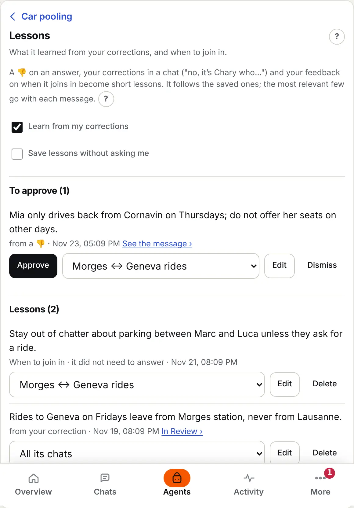

# Smarter agents

**Agents that spend less on simple messages, never send a figure the records do not back, and learn from your
corrections.**

**Do it:** an agent's page → **Model** → choose **Auto: light for simple, strong when needed**, and keep **Self-check**
on.

**In 30 seconds**
- **Smart model choice:** a light (cheap or free) model answers greetings, thanks and short questions; a strong one
  answers the owner, photos, changes, long or multi-step messages and anything that needs the records. Rules decide
  in code; only when they are unsure, a tiny classifier call (4 tokens) asks the light model.
- **Self-check:** amounts, dates and counts an answer takes from People, events, orders, sending or surveys are compared
  with the records of that turn, in code. A wrong figure is rewritten once; still wrong, a plain answer without figures
  goes out. A known-wrong amount or date is never sent.
- **Lessons:** a 👎, your correction in a chat ("no, it's Chary who…") or your feedback on when it joins in becomes a
  short lesson, proposed by the model and **saved only when you approve it** (or at once, if you switch that on).
- Each answer in Activity says which model answered and why, and whether its facts were checked. **Usage** shows what
  Smart choice saved.

| Feature | Switch | Default | Cost | Privacy |
|---|---|---|---|---|
| [Smart model choice](#smart-model-choice) | agent → Model; Settings → Models → Smart choice | off (agents keep their model) | saves on simple messages; a classifier call is at most 400 characters in, 4 tokens out | the classifier sees the message only, never the chat |
| [Self-check](#self-check) | agent → Model → Self-check | on | none when right; one extra call when a figure was wrong | nothing stored but counts |
| [Lessons](#lessons) | agent → Lessons → *Learn from my corrections*, *Save lessons without asking me* | on, asks you first | one small background call per proposal (≤ 120 tokens out, at most 20 a day per agent); about 200 tokens of lessons per turn | lessons are short rules you approve; a chat's lessons go when you erase its memory |
| [Morning brief](owner-assistant.md#morning-brief) | Settings → Owner assistant → Morning brief | on, 08:00 (inside sending hours) | none: built in code | counts and names to you only; nothing stored |
| [Suggested next steps](owner-assistant.md#suggested-next-steps) | approve / dismiss each | on | none | nothing runs without your approval |
| [Ask your data](owner-assistant.md#ask-your-data) | the owner assistant and organizers | on | the assistant's usual turn | read tools only; roles decided in code |
| [Catch-up](owner-assistant.md#catch-up) | a button / a question | on demand | one background call, ≤ 600 tokens out | only chats that are on and not private |
| [Commitments](#commitments) | agent → Promises & people → *Track promises*, *When one is due* | off (opt-in per agent); reminders in the chat | one small background call per promise-like message (≤ 150 tokens, ≤ 50 a day per agent); reminders written in code | the promise's short wording, who, due date; erased with the person or the chat's memory |
| [Relationship cues](people.md#suggestions) | agent → Promises & people → *Suggest family ties* | off (opt-in per agent) | none: in code | suggestions only, saved by you; family words only |
| [Preferences](people.md#preferences) | a person's page → Preferences | automatic, editable | none: in code | language, usual hours, app; erased with the person |
| [When to join in](#when-to-join-in) | the same switches; feedback buttons | on (follow-ups and *Whenever needed* agents) | as lessons; at most 5 short join-in lessons in a judged turn | counts per chat, no message text |

## Smart model choice

1. **Settings → Models → Default models → Smart choice:** the **light** model (Auto = the background model, e.g. Claude
   Haiku or a free OpenRouter model) and the **strong** model (Auto = the default model). Keep *When the rules are
   unsure, ask the light model* on, or off to send unsure messages to the strong model.
2. An agent's page → **Model** → **Auto: light for simple, strong when needed**. Optionally give it its own light and
   strong models (*Same as Models* by default). A chat can choose it too (Chats → a chat → Settings → Model).
3. Watch **Activity**: each answer's model line ends with *light: a greeting or thanks*, *strong: needs the records* and
   so on; **Usage → Smart model choice** shows how many answers were light, the cost per answer and what the strong
   model alone would have cost.

| Goes to the light model | Goes to the strong model |
|---|---|
| greetings, thanks, "ok", "see you" | the owner, photos and files, scheduled posts |
| short questions (12 words or fewer) that need no records | changes ("add", "cancel", "pay", "register"…) when the agent has tools |
| deciding whether to join in a group conversation | long or multi-step messages, three or more questions |
| what the classifier judged simple | a long conversation (more than ~12,000 characters of context), questions about the records ("who paid", "how many") |

> [!NOTE]
> If the light model fails (a limit, an outage, a model that is gone), the strong model answers the same turn, with
> your fallback settings. A spending cap that switches to a cheaper model wins over Smart choice.

Admin MCP: `update_agent` with `{ "model": "smart", "modelTiers": { "light": "", "strong": "" } }`, `set_default_models`
(`light_model`, `strong_model`, `smart_classifier`), `get_smart_model_savings`.

## Self-check

When an answer used People, Events, Orders, Sending or Surveys in that turn, Duniya reads the figures in it before it
goes out:

- **Amounts** (CHF 120.00, €40, 25 francs) must be in the records of the turn (or a sum of them);
- **dates** (8 January, 2027-01-08, 08.01.2027) must be in the records, or be today or tomorrow;
- **counts** ("12 families", "3 seats") must be a number or a list length in the records;
- an **amount next to a name** must belong to that person, not to someone else in the list.

A mismatch: the model gets the facts it got wrong and the records, and rewrites the answer once, without tools. Still
wrong: *"I want to give you exact figures, but I could not double-check them…"* goes out instead. Activity shows
*Checked: 2 facts match the records* (or what was wrong and what happened) on the answer's model line; the rewrite
counts in Usage as **Self-check rewrites**. Names without an amount, and figures from other tools, are not checked.

Switch it off per agent (**Model → Self-check**, or `update_agent { "selfCheck": false }`).

## Lessons

**What it learned from you, in your words, used only after your OK.** An agent's page → **Lessons**.

1. **A lesson is proposed** when you rate an answer 👎 (Review, a chat's Messages, Activity), or when you — the owner,
   from your linked number — correct the agent in a chat within 15 minutes of its answer ("no, it's Chary who drives",
   "don't post the menu here"). The background model writes one short rule (at most 25 words) and says whether it is
   for all its chats or only this one.
2. **Approve it** under *To approve* (or **Edit**, change where it applies, or **Dismiss**). The agent row says
   *1 lesson to approve*. Switch on **Save lessons without asking me** to skip this step.
3. **It is used:** in every turn, the saved lessons that match the message best (full-text search over the lessons),
   then the newest, this chat's first — at most ~800 characters (about 200 tokens).

Add a lesson by hand (**Add**), edit or delete any. **Learn from my corrections** off: nothing is proposed and no
lesson is used. At most 20 proposals per agent per day; each counts in Usage as **Lessons proposed**.

> [!NOTE]
> Lessons never change permissions: tools and confirmations are still decided in code. A lesson is text the agent
> reads, like a note.

## Commitments

**What people promise in your groups, remembered, with one gentle reminder.** An agent's page → **Promises & people** →
**Track promises**.

1. In its chats that are on, a message that reads like a promise ("I'll bring the speakers on Friday", "I can pay on
   Monday") is read by the background model once: *what* (in their words) and *when* it is due ("Friday" becomes a
   date). It shows on the person's page (**Commitments**), on the agent's **Open promises**, and, when due, in your
   [morning brief](owner-assistant.md#morning-brief).
2. **When one is due**: *In the chat where it was promised* (default), *In a direct message* (their direct chat, when it
   is on), or *Don't follow up*. One reminder, inside your sending hours, written in code: *"Anu, a friendly reminder:
   you said you'd bring the speakers (by 2026-11-21). All set? Just reply here."*
3. **Done**: when someone writes that it is done ("brought them ✅", "paid"), the model checks it against the open
   promises of that chat and marks it done. **Done** / **Drop** on any row corrects it.

At most 50 model calls per agent per day (Usage → Kind: *commitments*); other messages are never sent for this.

## When to join in

Agents that read a group by themselves (**In groups:** *When woken + follow-ups* or *Whenever needed*) learn when to
join a conversation from your feedback:

- under an answer it gave **by itself** (no wake word), in Messages, Review or Activity: **Didn’t need to answer**;
- on a **not for it** line in *Why agents stayed quiet*: **It should have answered** (the last message it left alone);
- 👍 on an answer it gave by itself counts as *answered well*.

*Didn't need to answer* and *Should have answered* propose a **join-in lesson** for that chat, e.g. *"Stay out of
chatter about parking between Marc and Luca unless they ask for a ride"*. Approved, the chat's join-in lessons (at most
five) go into the note of every message it judges there. The counts per chat are under **Lessons → When it joins in**.

Admin MCP: `list_lessons`, `add_lesson`, `edit_lesson` (`status: "active"` approves), `delete_lesson`,
`join_in_feedback`, `update_agent { "lessons": { "enabled": true, "autoApprove": false } }`.

---
**Next:** [Models](models.md) · [Usage & spending caps](spending.md) · [Agents](agents.md) · [Docs index](README.md)
