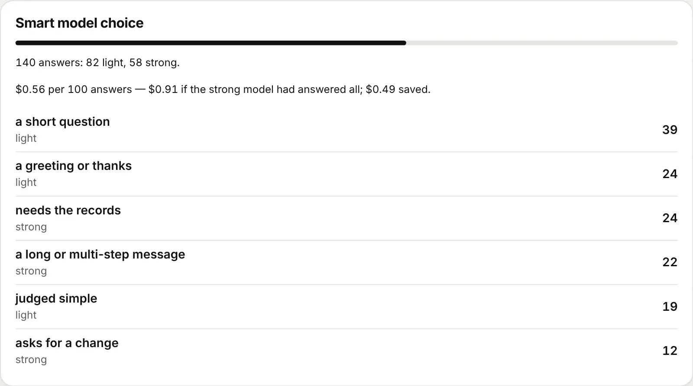

# Smarter agents

**Agents that spend less on simple messages and never send a figure the records do not back.**

**Do it:** an agent's page → **Model** → choose **Auto: light for simple, strong when needed**, and keep **Self-check**
on.

**In 30 seconds**
- **Smart model choice:** a light (cheap or free) model answers greetings, thanks and short questions; a strong one
  answers the owner, photos, changes, long or multi-step messages and anything that needs the records. Rules decide
  in code; only when they are unsure, a tiny classifier call (4 tokens) asks the light model.
- **Self-check:** amounts, dates and counts an answer takes from People, events, orders, sending or surveys are compared
  with the records of that turn, in code. A wrong figure is rewritten once; still wrong, a plain answer without figures
  goes out. A known-wrong amount or date is never sent.
- Each answer in Activity says which model answered and why, and whether its facts were checked. **Usage** shows what
  Smart choice saved.

| Feature | Switch | Default | Cost | Privacy |
|---|---|---|---|---|
| [Smart model choice](#smart-model-choice) | agent → Model; Settings → Models → Smart choice | off (agents keep their model) | saves on simple messages; a classifier call is at most 400 characters in, 4 tokens out | the classifier sees the message only, never the chat |
| [Self-check](#self-check) | agent → Model → Self-check | on | none when right; one extra call when a figure was wrong | nothing stored but counts |

## Smart model choice

1. **Settings → Models → Default models → Smart choice:** the **light** model (Auto = the background model, e.g. Claude
   Haiku or a free OpenRouter model) and the **strong** model (Auto = the default model). Keep *When the rules are
   unsure, ask the light model* on, or off to send unsure messages to the strong model.
2. An agent's page → **Model** → **Auto: light for simple, strong when needed**. Optionally give it its own light and
   strong models (*Same as Models* by default). A chat can choose it too (Chats → a chat → Settings → Model).
3. Watch **Activity**: each answer's model line ends with *light: a greeting or thanks*, *strong: needs the records* and
   so on; **Usage → Smart model choice** shows how many answers were light, the cost per answer and what the strong
   model alone would have cost.

| Goes to the light model | Goes to the strong model |
|---|---|
| greetings, thanks, "ok", "see you" | the owner, photos and files, scheduled posts |
| short questions (12 words or fewer) that need no records | changes ("add", "cancel", "pay", "register"…) when the agent has tools |
| deciding whether to join in a group conversation | long or multi-step messages, three or more questions |
| what the classifier judged simple | a long conversation (more than ~12,000 characters of context), questions about the records ("who paid", "how many") |

> [!NOTE]
> If the light model fails (a limit, an outage, a model that is gone), the strong model answers the same turn, with
> your fallback settings. A spending cap that switches to a cheaper model wins over Smart choice.

Admin MCP: `update_agent` with `{ "model": "smart", "modelTiers": { "light": "", "strong": "" } }`, `set_default_models`
(`light_model`, `strong_model`, `smart_classifier`), `get_smart_model_savings`.

## Self-check

When an answer used People, Events, Orders, Sending or Surveys in that turn, Duniya reads the figures in it before it
goes out:

- **Amounts** (CHF 120.00, €40, 25 francs) must be in the records of the turn (or a sum of them);
- **dates** (8 January, 2027-01-08, 08.01.2027) must be in the records, or be today or tomorrow;
- **counts** ("12 families", "3 seats") must be a number or a list length in the records;
- an **amount next to a name** must belong to that person, not to someone else in the list.

A mismatch: the model gets the facts it got wrong and the records, and rewrites the answer once, without tools. Still
wrong: *"I want to give you exact figures, but I could not double-check them…"* goes out instead. Activity shows
*Checked: 2 facts match the records* (or what was wrong and what happened) on the answer's model line; the rewrite
counts in Usage as **Self-check rewrites**. Names without an amount, and figures from other tools, are not checked.

Switch it off per agent (**Model → Self-check**, or `update_agent { "selfCheck": false }`).

---
**Next:** [Models](models.md) · [Usage & spending caps](spending.md) · [Agents](agents.md) · [Docs index](README.md)
