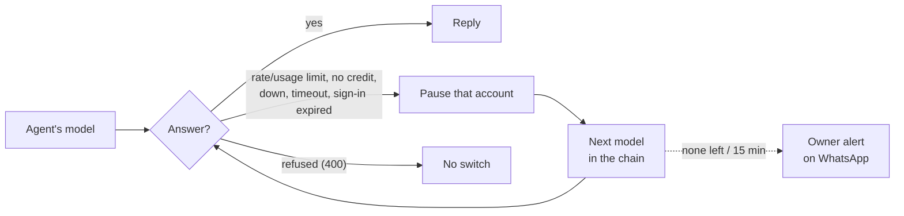
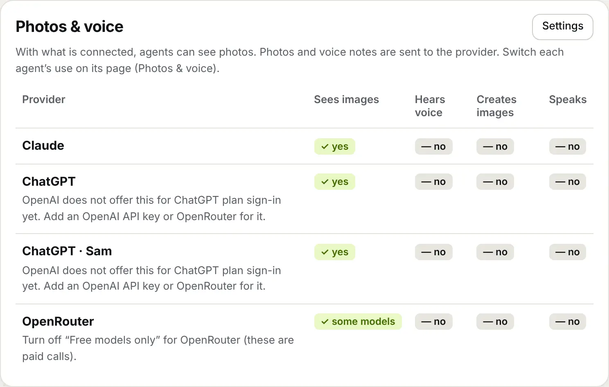

# Models, fallback and photos & voice

**Use any model you already pay for (or a free one), with an automatic backup when it fails.**

**Do it:** panel → **Models** → connect a provider (OpenRouter is one tap).

**In 30 seconds**
- Pick a model per agent and per chat, or *Auto*.
- A failing model hands over to the next in the chain; tools that already ran never run twice.
- Photos & voice depend on the provider: [see the table](#photos--voice).

| Provider | How |
|---|---|
| OpenRouter | one tap; optionally free models only |
| Anthropic / OpenAI | API key |
| OpenAI-compatible (Ollama, …) | endpoint URL |
| ChatGPT Plus/Pro | *Sign in with ChatGPT* (OpenAI's official flow, preview) |
| GitHub Copilot | your allowance via the official Copilot SDK (downloaded only if you connect it; needs 2 GB) |

> [!NOTE]
> Claude **subscriptions** (Pro/Max) can't be used by third-party apps under Anthropic's terms, so Claude needs an
> API key.

## Fallback and several accounts

- **Models → When a model fails** sets the chain. Default: any other connected provider's *Auto*. Per agent and per
  chat: inherit / switch / don't switch, or an own chain.
- A failing account is paused (1 min, doubling to 30 min; usage limits until the provider's reset time), shown as
  "Paused until 14:20 — usage limit reached".
- The owner gets a WhatsApp alert after 15 minutes or when no provider can answer.
- Several accounts per provider with a label (model refs `openai-work:gpt-…`), used *in order* (failover) or
  *spread* (least recently used).

> [!WARNING]
> Use your own accounts: some plans' terms forbid sharing accounts or getting around their limits.

Admin MCP: `list_model_accounts`, `get_model_fallback`, `set_model_fallback`, `set_account_strategy`,
`retry_model_account`.

## Photos & voice

When a connected provider supports it, agents see photos, listen to voice notes, create pictures and answer with
voice notes. Photos and voice notes are sent to that provider.

| Where | What |
|---|---|
| **Models → Photos & voice** | what each provider can do, and how to enable what is missing |
| Agent page → **Photos & voice** | per-agent switches |
| **Settings → Photos & voice** | server-wide choices, on-server speech |

| | Anthropic | OpenAI (API key) | ChatGPT sign-in | Copilot | OpenRouter | Other endpoints | This server |
|---|---|---|---|---|---|---|---|
| Sees photos / PDFs | ✓ | ✓ | ✓ | — (vision fallback) | models with image input | by model | — |
| Hears voice notes | — | ✓ `gpt-4o-mini-transcribe` | — ¹ | — | ✓ (paid) | — | Whisper tiny (optional) |
| Creates pictures | — | ✓ `gpt-image-*` listed for the key | — ¹ | — | ✓ image models (paid) | — | — |
| Speaks | — | ✓ `gpt-4o-mini-tts` (Ogg/Opus) | — | — | ✓ (paid, needs ffmpeg) | — | Piper voice (optional) |

¹ OpenAI's Sign in with ChatGPT preview lists image generation and transcription as unsupported for plan usage on
`api.openai.com` and says not to use ChatGPT's `backend-api` endpoints, so Duniya doesn't. Free-only OpenRouter makes
no paid media calls.

How each part works

- **Photos in** (and PDFs, stickers optional): only in chats that are on and when the agent is addressed (a caption
  with the trigger, a mention, a reply to the agent, or a direct message). A model that can't see images uses the
  **vision fallback model** (Settings) or kindly says it can't look at photos. Photos are temp files under
  `DATA_DIR/media-tmp` (deleted after 15 minutes); the history keeps only `[image: caption]`.
- **Voice notes in**: transcribed (OpenAI → OpenRouter → on-server engine), then handled like text; stored and shown as
  `🎤 transcript`. In groups a voice note counts as addressed when it replies to or mentions the agent. Longest: 5
  minutes (Settings).
- **Create images**: tool `media__create_image` (`prompt`, `size`, `caption`, `edit_of: "last_photo"`), only with a
  capable provider; organizers by default, participants if the agent allows it. Made in the media queue, sent as a
  WhatsApp image with a caption.
- **Voice replies**: per agent *never* / *to voice notes* / *always*; sent as a voice note (Ogg/Opus), text kept in
  the history. Replies with a confirm code or a link stay text; if speaking fails, the text is sent.
- **Usage & caps**: `transcribe`, `image` and `speech` appear in Usage and count toward caps, with the provider's
  reported cost (OpenRouter), a price per picture you set, or token prices.
- **On-server speech** (owner, Settings): Whisper tiny (listening, ~115 MB download) and a Piper voice (speaking,
  ~65 MB), run by the open-source [sherpa-onnx](https://github.com/k2-fsa/sherpa-onnx) runtime (`sherpa-onnx-node`,
  prebuilt for Linux x64 and arm64, downloaded into `DATA_DIR/speech` only when you choose to). Each job runs in its
  own low-priority process (~300 MB listening, ~180 MB speaking) and needs ffmpeg and bzip2 (installer and Docker
  image include them). Below 2 GB: see [Small servers](small-servers.md). whisper.cpp publishes no Linux binaries, so
  it is not used.
- Admin MCP: `get_photos_and_voice`, `set_photos_and_voice_settings`, `install_speech_engine`,
  `set_agent_photos_and_voice`.

---
**Next:** [Usage & spending caps](spending.md) · [Small servers](small-servers.md) · [Docs index](README.md)
