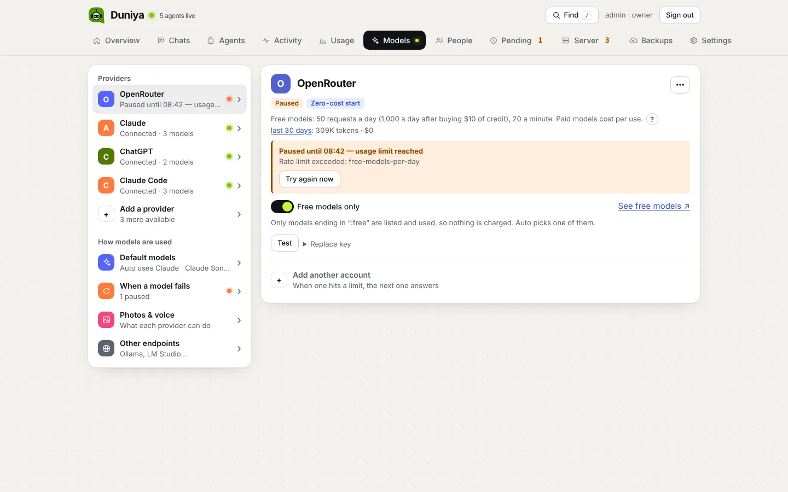
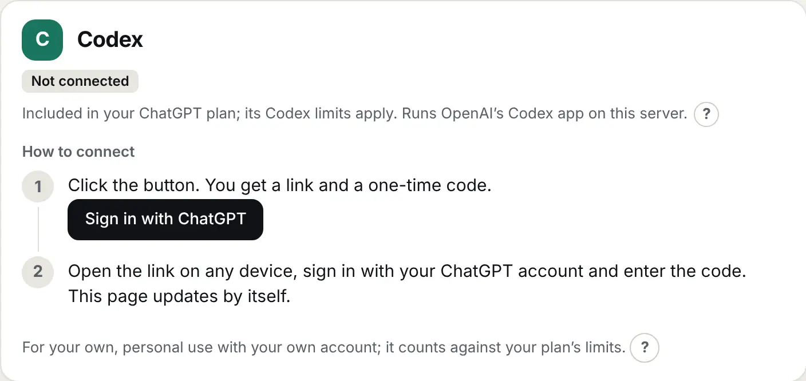
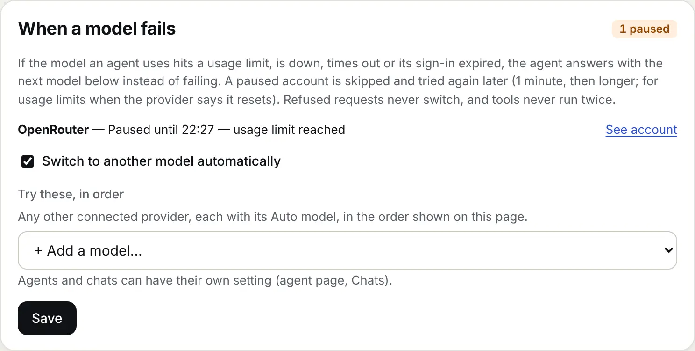
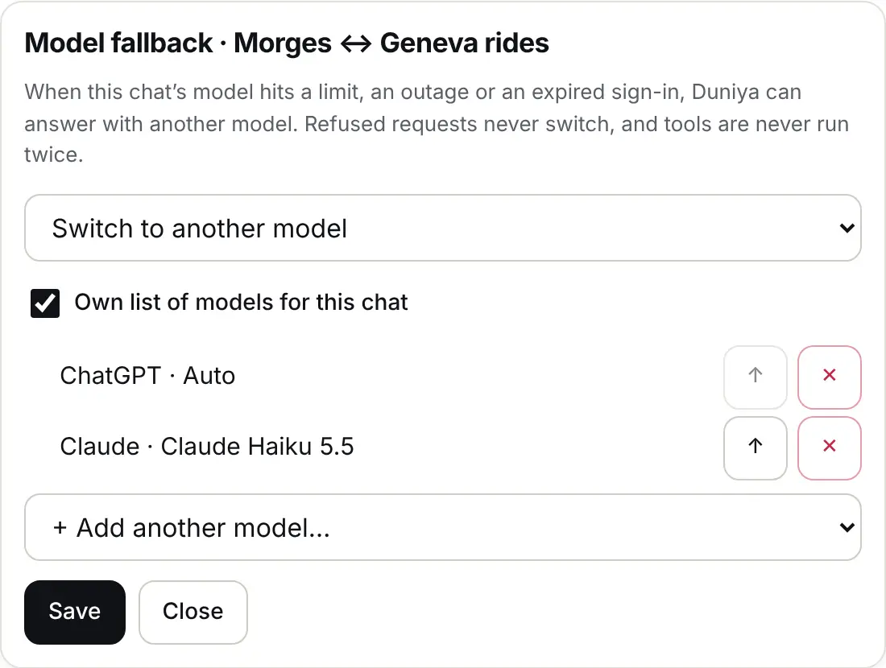

# Models, fallback and photos & voice

**Use any model you already pay for (or a free one), with an automatic backup when it fails.**

**Do it:** panel → **Models** → **Add a provider** → pick one (OpenRouter is one tap), or paste any key into
**Getting started** on Overview: Duniya recognises it.

**In 30 seconds**
- No key yet? **OpenRouter** with free models only, **Sign in with ChatGPT** with your Plus/Pro plan, or your Claude,
  ChatGPT or Copilot plan through its official app ([agent apps](#agent-apps)).
- Pick a model per agent and per chat, or *Auto*.
- A failing model hands over to the next one; tools that already ran never run twice.
- Photos & voice depend on the provider: [see the table](#photos--voice).

| Provider | How |
|---|---|
| OpenRouter | one tap; optionally free models only |
| Claude, OpenAI | API key |
| Custom (OpenAI-compatible: Ollama, LM Studio, …) | endpoint URL |
| ChatGPT | your Plus/Pro plan: *Sign in with ChatGPT* (OpenAI's official flow, preview) |
| Claude Code | your Claude Pro/Max plan through Anthropic's Claude Code app on the server ([agent apps](#agent-apps)) |
| Codex | your ChatGPT plan through OpenAI's Codex app on the server ([agent apps](#agent-apps)) |
| GitHub Copilot | your allowance via the official Copilot SDK ([agent apps](#agent-apps): downloaded only if you connect it) |

Names are the same everywhere (panel, admin MCP tools, activity): *ChatGPT*, *Claude*, *OpenAI*, *GitHub Copilot*,
*Claude Code*, *Codex*, *OpenRouter*; with several accounts of one provider, its label is added: *ChatGPT · work*.

> [!TIP]
> **Sign in with ChatGPT** ends on a page that says *This site can't be reached*: that's expected. Copy the whole
> address and paste it into the panel. It's fine without `http://` (iPad and iPhone Safari copy it that way), with
> `localhost` or `127.0.0.1`, or only the part from `code=`.

> [!NOTE]
> *Claude* uses an API key. For a Claude **Pro or Max plan**, connect **Claude Code** instead: Duniya then runs
> Anthropic's own, unmodified Claude Code app, signed in with your own account ([agent apps](#agent-apps)).

## Agent apps

**Use your own Claude, ChatGPT or GitHub Copilot plan through each vendor's official app, also on a 1 GB server.**

**Do it:** **Models** → **Add a provider** → **Claude Code**, **Codex** or **GitHub Copilot** (owner only).

**In 30 seconds**
- Duniya runs the official app on the server for each answer: Claude Code (Claude plan), Codex (ChatGPT plan), the
  Copilot SDK (Copilot plan). The app is downloaded only when you connect it, into the data folder.
- Your agents' tools (WhatsApp actions, tool services) still work, and roles and confirmations are still decided by
  Duniya: the app sees only those tools, never a shell, files or the web.
- A usage limit pauses the account until the reset the app reports; the next model answers meanwhile.
- On a small server: switch on [Small server mode](small-servers.md#small-server-mode); one app answers at a time.

**Connect**

| App | Sign-in | Download |
|---|---|---|
| **Claude Code** | On your computer run `claude setup-token` (Claude Code installed, [how](https://code.claude.com/docs/en/setup)), sign in in the browser, paste the `sk-ant-oat01-…` token it prints. Valid for a year. Duniya checks it with one tiny answer before keeping it. | about 360 MB |
| **Codex** | **Sign in with ChatGPT**: the page shows a link and a one-time code; open the link on any device, sign in, enter the code. The page updates by itself. | about 400 MB |
| **GitHub Copilot** | a fine-grained GitHub token with *Copilot requests* (steps on its page) | about 220 MB |

**What runs, measured** (Linux x64, Claude Code 2.1.326, Codex 0.169.0, Copilot SDK 1.0.34; a local stand-in for the
model, so the model's own thinking time comes on top):

| App | Memory while answering | Between answers | Start until its first request | Download (npm, peak memory) |
|---|---|---|---|---|
| Claude Code | about 200 MB | nothing runs | about 0.5 s | 355 MB, 280 MB |
| Codex | about 140 MB | nothing runs | about 0.2–0.3 s | 405 MB, 355 MB |
| GitHub Copilot | runtime about 60 MB idle | stopped after 2 min idle on small servers (10 min otherwise) | under 0.1 s | 220 MB, 295 MB |

Each app's page shows what it measured on *your* server (*about 200 MB while answering · starts in 0.6 s*).

**How it stays small**
- Started for one answer and ended with it; Copilot's runtime is stopped by the upkeep tick when idle.
- One app at a time on small servers (two or three on bigger ones); the next waits up to 2 minutes with ⏳ on the
  message, then the next model in the fallback chain answers.
- Before every start: enough free memory (the app's need + 80 MB), else the next model answers at once and the account
  is not paused. Memory tight: idle runtimes stop at once.
- A download needs about 380 MB free memory and 1.2 GB free disk; on 1 GB the installer's 2 GB swap is the safety net.

> [!WARNING]
> **Terms, in plain words (not legal advice; check the sources yourself).**
> - **Claude:** Anthropic allows *an end user signing in to the unmodified Claude Code binary with their own Claude
>   subscription*, also where a platform hosts Claude Code, and says Pro and Max limits *assume ordinary, individual
>   usage* ([Claude Code legal and compliance](https://code.claude.com/docs/en/legal-and-compliance)). `claude -p`
>   signed in with your plan draws from your subscription limits ([Use the Claude Agent SDK with your Claude
>   plan](https://support.claude.com/en/articles/15036540-use-the-claude-agent-sdk-with-your-claude-plan), updated
>   7 Oct 2026). Use your own account for your own agents; a busy group answered all day is not "individual usage".
> - **ChatGPT / Codex:** Codex signed in with ChatGPT uses your plan's Codex limits; OpenAI recommends API keys for
>   programmatic CI work and says not to share `auth.json` ([Codex authentication](https://learn.chatgpt.com/docs/auth)).
>   Duniya keeps it in the data folder (only the app's user can read it) and never shows it.
> - **GitHub Copilot:** requests count against your Copilot plan's allowance (premium requests).
> - Never share one plan between several people's servers or use several accounts to get around limits.

## Smart choice

Agents can use a **light** model for simple messages and a **strong** one when it matters: **Settings → Models →
Default models → Smart choice** sets the two models (Auto: the background and the default model), and an agent picks
**Auto: light for simple, strong when needed** under **Model**. The rules, the classifier and the savings are in
[Smarter agents](intelligence.md#smart-model-choice).

## Fallback and several accounts

Diagram as text

1. The agent's model is asked.
2. It answers: the agent replies.
3. Rate or usage limit, no credit, down, timeout or sign-in expired: that account is paused and the next model in the chain is tried.
4. Refused (HTTP 400): no switch.
5. None left, or failing for 15 minutes: the owner gets an alert on WhatsApp.

- **Several accounts of one provider:** on the provider's page, **Add another account** (the last row), then *In order* or
  *Spread*. **⋯** on an account renames it (*ChatGPT · work*) or disconnects / removes it (it asks first).
- **Models → When a model fails** sets the chain. Default: any other connected provider's *Auto*. Per agent and per
  chat: inherit / switch / don't switch, or an own chain.
- **Per chat:** Chats → the chat's page → **Fallback…** (under its model) opens the same editor as the agent's **Model** section:
  *As the agent*, *Switch to another model* or *Don't switch*, and optionally an own ordered list of models
  (↑ to reorder, ✕ to remove, at most 10). The line under the model shows what is set, e.g.
  "If unavailable: switch model: OpenAI · Auto → Anthropic · Auto".
- A failing account is paused (1 min, doubling to 30 min; usage limits until the provider's reset time), shown as
  "Paused until 14:20 — usage limit reached", or with the limit when the provider reported it: "Paused until 01:00 —
  free requests today used up, resets 01:00". The fallback entry in Activity says the same. Pauses and "reconnect" marks survive a restart or update.
- Photo turns only fall back to models that can see images (then the vision fallback model).
- The Ask box streams the answer word by word: a stream that fails before its first word falls back as usual; one
  that breaks half-way is dropped and asked again once without streaming ([details](owner-assistant.md#owner-assistant-and-the-ask-box)).
- The owner gets a WhatsApp alert after 15 minutes or when no provider can answer.
- A model is always named with its account: `auto`, `anthropic:claude-…`, `openai:auto`. Several accounts per
  provider get a label (model refs `openai-work:gpt-…`), used *in order* (failover) or
  *spread* (least recently used).

> [!WARNING]
> Use your own accounts: some plans' terms forbid sharing accounts or getting around their limits.

Admin MCP: `list_model_accounts`, `get_model_fallback`, `set_model_fallback`, `set_account_strategy`,
`retry_model_account`; per chat `set_chat_settings` (`fallback_mode`, `fallback_chain`; giving only one keeps the
other, like the panel editor).

## Usage limits

**When a plan or key hits its limit, the next model answers until the limit resets.**

**Do it:** nothing. Models shows the paused account and why ("Paused until 14:20 — usage limit reached").

**In 30 seconds**
- When a provider says a usage or rate limit was reached, that account pauses until the reset the provider names
  (Retry-After or its own reset time) and the next model in the chain answers. Activity says who answered and why.
- Duniya does not show how much of a plan is left: ChatGPT doesn't share it with this sign-in, and the other providers
  report it differently. Check it with the provider (for ChatGPT: [chatgpt.com → Settings → Usage](https://chatgpt.com/settings/usage)).
- What Duniya itself used through each account is on its page (*last 30 days*) and on **Usage**; [spending caps](spending.md)
  limit it per agent or chat.

> [!TIP]
> Fixed the cause early (a new key, more credit)? **Try again now** on the account's page clears the pause.

## Photos & voice

When a connected provider supports it, agents see photos, listen to voice notes, create pictures and answer with
voice notes. Photos and voice notes are sent to that provider.

| Where | What |
|---|---|
| **Models → Photos & voice** | what each provider can do, and how to enable what is missing |
| Agent page → **Photos & voice** | per-agent switches |
| **Settings → Photos & voice** | server-wide choices, on-server speech |

| | Claude | OpenAI | ChatGPT | GitHub Copilot, Claude Code, Codex | OpenRouter | Custom | This server |
|---|---|---|---|---|---|---|---|
| Sees photos / PDFs | ✓ | ✓ | ✓ | — (vision fallback) | models with image input | by model | — |
| Hears voice notes | — | ✓ `gpt-4o-mini-transcribe` | — ¹ | — | ✓ (paid) | — | Whisper tiny (optional) |
| Creates pictures | — | ✓ `gpt-image-*` listed for the key | — ¹ | — | ✓ image models (paid) | — | — |
| Speaks | — | ✓ `gpt-4o-mini-tts` (Ogg/Opus) | — | — | ✓ (paid, needs ffmpeg) | — | Piper voice (optional) |

¹ OpenAI's Sign in with ChatGPT preview lists image generation and transcription as unsupported with a ChatGPT plan on
`api.openai.com` and says not to use ChatGPT's `backend-api` endpoints, so Duniya doesn't. Free-only OpenRouter makes
no paid media calls.

How each part works

- **Photos in** (and PDFs, stickers optional): only in chats that are on and when the agent is addressed (a caption
  with the trigger, a mention, a reply to the agent, or a direct message). A model that can't see images uses the
  **vision fallback model** (Settings) or kindly says it can't look at photos. When fallback moves a photo turn to
  another model, models that can't see images (e.g. GitHub Copilot) are skipped; the vision fallback model is tried
  last; if none can answer, the turn is answered without the photo and says so. Photos are temp files under
  `DATA_DIR/media-tmp` (deleted after 15 minutes); the history keeps only `[image: caption]`.
- **Voice notes in**: transcribed (OpenAI → OpenRouter → on-server engine), then handled like text; stored and shown as
  `🎤 transcript`. In groups a voice note counts as addressed when it replies to or mentions the agent. Longest: 5
  minutes (Settings).
- **Create images**: tool `media__create_image` (`prompt`, `size`, `caption`, `edit_of: "last_photo"`), only with a
  capable provider; organizers by default, participants if the agent allows it. Made in the media queue, sent as a
  WhatsApp image with a caption.
- **Voice replies**: per agent *never* / *to voice notes* / *always*; sent as a voice note (Ogg/Opus), text kept in
  the history. Replies with a confirm code or a link stay text; if speaking fails, the text is sent.
- **Usage & caps**: `transcribe`, `image` and `speech` appear in Usage and count toward caps, with the provider's
  reported cost (OpenRouter), a price per picture you set, or token prices.
- **On-server speech** (owner, Settings): Whisper tiny (listening, ~115 MB download) and a Piper voice (speaking,
  ~65 MB), run by the open-source [sherpa-onnx](https://github.com/k2-fsa/sherpa-onnx) runtime (`sherpa-onnx-node`,
  prebuilt for Linux x64 and arm64, downloaded into `DATA_DIR/speech` only when you choose to). Each job runs in its
  own low-priority process (~300 MB listening, ~180 MB speaking) and needs ffmpeg and bzip2 (installer and Docker
  image include them). Below 2 GB: only with [Small server mode](small-servers.md#small-server-mode) (Settings →
  Server). whisper.cpp publishes no Linux binaries, so
  it is not used.
- Admin MCP: `get_photos_and_voice`, `set_photos_and_voice_settings`, `install_speech_engine`,
  `set_agent_photos_and_voice`.

---
**Next:** [Usage & spending caps](spending.md) · [Small servers](small-servers.md) · [Docs index](README.md)
