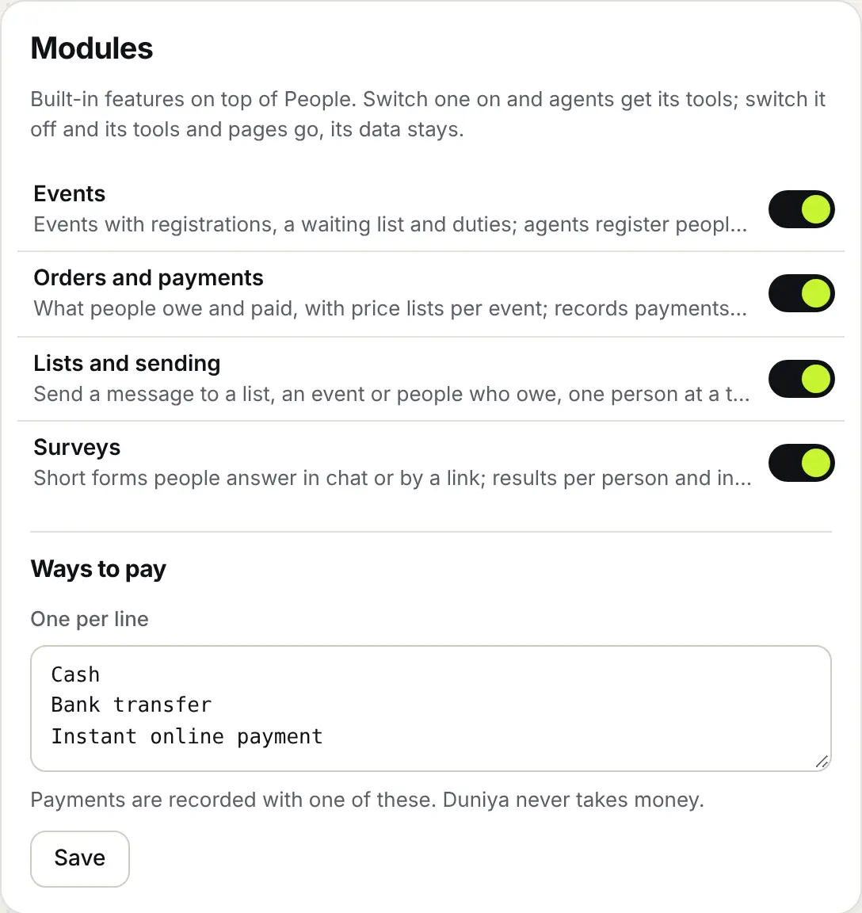

# Modules

**Switch on built-in features: Events, Orders and payments, Lists and sending, Surveys and Web search (on by default). Off keeps their data.**

**Do it:** panel → **Settings → Modules** → switch **Events** (and **Orders and payments**) on.

**In 30 seconds**
- A module adds pages under **People** (**Events**, **Orders**), sections on a person's and a household's page, entries
  in their timeline, and **agent tools**.
- Nothing of a module runs until you switch it on: its code loads only then, so a small server pays nothing for what
  it does not use. The row shows the memory it uses.
- **Off** removes its agent tools and pages; its data stays, and comes back when you switch it on again.
- Merge, undo, export and erase in People cover module rows too (also while a module is off).

## The modules

| Module | What it adds | Guide |
|---|---|---|
| **Events** | events with places, a deadline, a price list; registrations per household or person (adults and kids), a waiting list, organizer confirmation, duties, attendance, CSV | [Events](events.md) |
| **Orders and payments** | what people owe and paid: orders (from a registration by itself, or by hand), part payments, refunds, your own ways to pay, a daily list of orders due | [Orders and payments](orders.md) |
| **Lists and sending** | a message to a list, a tag, a household, an event's families or people who owe: consent checked per message, each person's own wording, the WhatsApp pace, stop signals, payment reminders | [Lists and sending](sending.md) · [Campaigns](campaigns.md) |
| **Surveys** | short forms (choices, numbers, short text) people answer in chat or by their own link; results, CSV | [Surveys](surveys.md) |
| **Web search** (on by default) | agents look up current facts with their AI provider's built-in search (Claude, ChatGPT) | [Web search](web-search.md) |

## Agent tools

When a module is on, every agent gets its tools, shown on the agent's page under **Tools** with a tick per role and
**All: participants / All: organizers**, like WhatsApp actions:

- **Participants** get the tools about themselves (register me or my household, cancel, take a duty, what do I owe).
- **Organizers** get the rest. A change about anyone other than the sender (register someone, confirm, waiting list,
  cancel, assign a duty, mark paid, refund) **waits for an organizer's `confirm CODE`**, like other agent changes.
- Untick a tool, or **All** off for a role, to take it away from that agent. Rules are decided in code, never by the
  prompt.

> [!NOTE]
> Duniya records payments; it never takes or moves money.

## Switching off

1. **Settings → Modules** → switch it off. Agents lose its tools at their next turn; the pages leave People.
2. Its data stays in the database (and in backups). Switch it on again and everything is back.

## AI assistants and the owner assistant

Admin MCP: `list_modules`, `set_module_enabled`* (* needs `confirm_action`; module `events`, `orders`, `sending` or `surveys`); each
module's tools are on its page.

---
**Next:** [Events](events.md) · [Orders and payments](orders.md) · [Lists and sending](sending.md) · [People](people.md) · [Docs index](README.md)
