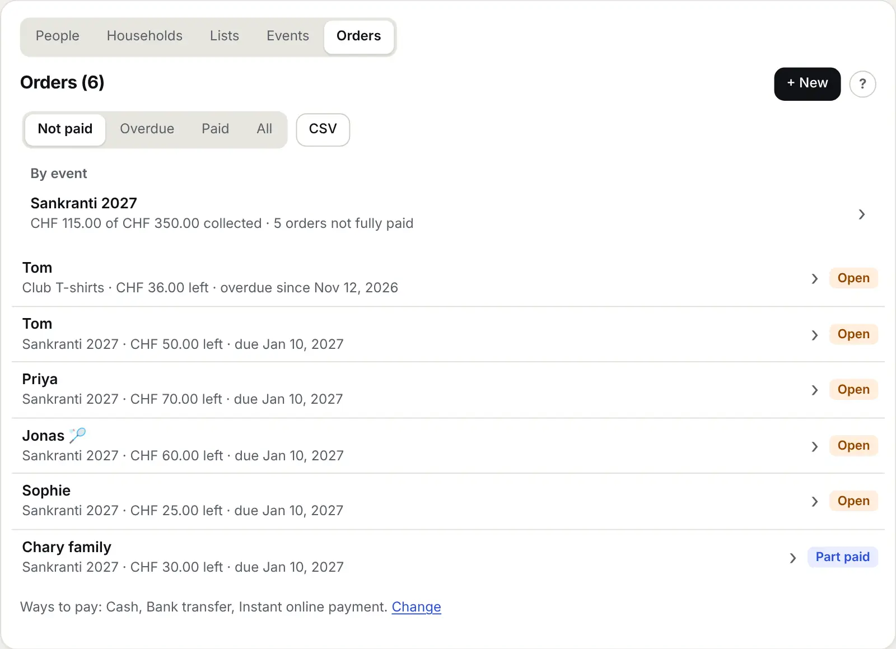

# Orders and payments

**Know who owes what and who paid, per event or for anything else. Duniya records payments; it never takes money.**

**Do it:** **Settings → Modules** → **Orders and payments** on → **People → Orders**.

**In 30 seconds**
- An order belongs to a **person or a household**, optionally to an **event** (then it is in the event's currency),
  with lines (item, quantity, price), a total and a due date.
- An event with a **price list** makes the order by itself when a registration is registered: adults × adult price,
  kids × kid price, kids under the free age at 0 (their birthday in People). New numbers change an unpaid order; a
  cancellation cancels it (if something was paid, the timeline says so and you refund).
- Record **payments** (part or full) and **refunds** with a method from **your own list** (Cash, Bank transfer,
  Instant online payment by default). Status: **Open**, **Part paid**, **Paid**, **Refunded**, **Cancelled**.
- Once a day you get one message with the open orders due within three days or overdue (owner alerts). Reminders to
  people come with list sending.

## The Orders page

1. **Not paid · Overdue · Paid · All** filter the list; **CSV** downloads it.
2. **By event** shows each event's totals (collected of total, how many orders are not fully paid); tap one to see
   only its orders.
3. A row opens the order: its lines, its payments (each can be removed), **Record a payment**, and **⋯ → Refund…**,
   **Edit…** (due date, note), **Delete…**.
4. **+ New** makes an order by hand (a person, what, how many, the price, a due date).

## Ways to pay

**Settings → Modules → Ways to pay**: one per line (e.g. *Cash*, *Bank transfer*, *TWINT*). Payments pick one; agents
offer them when someone asks what they owe.

## What agents can do

| Tool | Who | Confirm |
|---|---|---|
| `what_do_i_owe` (their own and their household's open orders, the ways to pay) | everyone | – |
| `who_has_not_paid` (per event or all, with totals) | organizers | – |
| `mark_paid`, `refund` | organizers | `confirm CODE` |

> [!TIP]
> Ask the owner assistant *"who hasn't paid for Sankranti?"*.

## AI assistants and the owner assistant

Admin MCP: `list_orders` (open, overdue, paid, refunded, cancelled or all; per event), `get_order`, `create_order`,
`record_payment`* (payment or refund), `set_payment_methods` (* needs `confirm_action`).

---
**Next:** [Events](events.md) · [Modules](modules.md) · [People](people.md) · [Docs index](README.md)
