# Owner assistant, alerts and weekly summary

**Your own agent in your own WhatsApp chat: recaps of all your chats, GIFs and pictures, voice notes, and messages into
your groups after you confirm.**

**Do it:** panel → **Settings → Owner assistant → Link my WhatsApp**, then **Agents → Owner assistant** to give it a
character.

**In 30 seconds**
- A built-in agent: your DMs to any agent number, the **Ask** box (also on your phone). Always there, cannot be deleted.
- Everything an agent can have: tool services (e.g. GIF search), WhatsApp actions, photos, PDFs, voice notes, voice
  replies, pictures, memory, schedules — set in the normal agent editor.
- Sees only chats that are on and not **Private to members**; never answers in groups.
- Changes, and anything sent into another chat, need `confirm CODE` (valid 10 minutes, also across a restart).
- Alerts and the weekly summary (counts only) are its messages too.

## Owner assistant and the Ask box

1. **Settings → Owner assistant → Link my WhatsApp** shows a one-time message `link CODE` (valid 10 minutes).
2. Send it from your phone to any agent number.
3. Confirm "Linked +41…" in the panel.
4. Message an agent number: "what did the families decide this week?", "send me a dancing GIF", "post a poll in
   Carpool: pizza or dosa?", "turn off the helper agent".

Diagram as text

1. You send a DM to an agent number.
2. It starts with an agent trigger or `confirm CODE`: that agent handles it.
3. Otherwise the owner assistant handles it, with your panel role.
4. Changes by the owner assistant need `confirm CODE`.

## Its editor: character, tools, voice, schedules, alerts

**Agents → Owner assistant** (or **Settings → Owner assistant → Character, tools, voice, schedules & alerts**) is the
normal agent editor without the parts that do not apply (chats, triggers, people, quick replies, welcome, confirmation
setup, test console — try it in the Ask box instead). The AI helper and its visual diff work here too.

| Section | What it does |
|---|---|
| **Character** | Tone, language and habits ("call me Vik, short answers"). Added to the built-in instructions; it never widens what the assistant may do |
| **Model** | Model and fallback, recent turns in context, max reply tokens, timezone (Advanced) |
| **Memory** | Notes it saves when you ask ("remember Vedika likes ILLIT"): per person, never in a chat's memory |
| **Tool services** | Global services are on by default (switch one off here); it can have its own services too. Each service's role defaults decide its tools |
| **WhatsApp actions** | Send pictures, GIFs, files, locations, contact cards, polls, reactions, replies. Group administration stays with the admin tools |
| **Photos & voice** | Look at photos and PDFs, listen to voice notes, answer with voice, create pictures (in your own chat) |
| **Alerts** | The number spending-cap, model-provider and update alerts go to. Only the owner can change it |
| **Scheduled messages to you** | The **weekly summary** (on, Monday 09:00) and your own, e.g. a morning brief. Sent to every linked owner and admin in their own chat; they run even while agents are paused |
| **Monthly spending cap** | Like any agent |

## What it may do (decided in code)

| | Owners and admins | Viewers |
|---|---|---|
| Admin tools | with their panel role; changes need `confirm CODE` | read-only, without message contents |
| Tool services | the services' organizer defaults | the services' participant defaults |
| WhatsApp actions in their own chat | right away | right away (participant set) |
| Sending into another chat | `send_message` or a WhatsApp action with the chat's name; always `confirm CODE` | never |
| Pictures | as set under Photos & voice | as set (participants) |

- **Other chats:** only chats that are on and not private, by group name, contact name or id. A chat switched off
  before you confirm gets nothing. A person who never saw the privacy line gets it once with the first message.
- **Tool services:** a tool called `confirm` (or `…_confirm`, `confirm_…`) or marked destructive is held for your code.
- **Secrets never pass through the chat:** "set the OpenAI key" gives you a one-time link (15 minutes) to paste it in
  the panel; when you save, the chat says *Saved OPENAI_API_KEY*. "Add Anu as an admin" (owners) gives you, after
  `confirm CODE`, a sign-up link (48 hours) to forward to Anu only: she chooses her own password. "Restore last
  night's backup" uses the passphrase stored on this server; a backup made elsewhere gets a link to the panel's
  Backups page. See [Admin MCP](admin-mcp.md#no-secrets-through-the-assistant).
- **Not included:** asking another agent to act in its chat (its own tools would run without a preview), and
  forwarding a photo you just sent into another chat.

> [!NOTE]
> It never answers in groups or anyone who is not linked. `!family …` still reaches that agent, and so does
> `confirm CODE` for a change an agent prepared.

> [!WARNING]
> Never paste a key or password into the chat. If a message looks like one, the assistant does not read it, store it
> or send it to the AI, and asks you to delete it and use a link instead.

| | |
|---|---|
| **Photos & voice notes** | go through the media queue like agents' (one at a time on a small server, picked up after a restart); only `[image] caption` or `🎤 transcript` is kept |
| **Ask box** | the answer streams in: each step shows as it happens (✓ looked up, ⏸ change held, ✕ failed; tool names only) and the text appears word by word; changes wait for **Confirm**. WhatsApp replies stay whole |
| **Storage** | its conversation and notes are stored separately, never in chat memory |
| **Audit** | every question and action is in Activity (`owner.*`, `whatsapp.action`, always recorded) |
| **API** | `POST /api/owner/ask` (whole answer) or `POST /api/owner/ask/stream` (newline-delimited JSON: `step`, `delta`, `restarted`, `text`, `done`, `error`; see below); the record is `GET`/`PUT /api/agents/owner-assistant` |
| **Admin MCP** | `get_owner_assistant` (link), `get_agent` / `update_agent` / `run_schedule_now` with `owner-assistant`, `preview_weekly_summary`, `set_chat_private` |
| **People who never wrote** | "assign Mochi to Vedika" works in one go: it looks up the contact and prepares the direct chat (`prepare_direct_chat`, see [Agents](agents.md#set-up-a-direct-chat-before-the-person-writes)); you confirm once |

Streamed answers: the events

- `step` — `thinking` (a model round starts), `tool` / `held` (tool name and ok only, never arguments or results).
- `delta` — a piece of the round's text; the first `delta` after `thinking` starts a new text.
- `restarted` — the stream broke after its first piece (`reason`: a code such as `network`); drop the partial text.
  The same account is asked once more without streaming, then the usual [fallback](models.md#fallback-and-several-accounts)
  continues. A stream that fails before its first piece simply falls back, so only the model that answers streams.
- `text` — the round's whole text (it wins over the pieces); `done` — the reply and held changes; `error` — the
  request failed.
- Usage and cost are recorded once per model call, from the answer that was used. Nothing is buffered beyond the
  current answer.

## Owner alerts and weekly summary

**Agents → Owner assistant → Alerts**: enter your number.

- **Cap alerts** and model-provider alerts go there as they happen ([spending caps](spending.md)).
- **Weekly summary**: the owner assistant's `weekly-summary` schedule (on, Monday 09:00; change day, time or switch it
  off in **Scheduled messages to you**). Messages handled, replies and cost per agent this week vs last, ignored
  chats, pending confirmations, update available, backup failures, a server restart waiting more than 7 days to
  finish OS updates. **Run now** sends it at once, **Preview** shows it. It goes to linked owners and admins; with
  nobody linked, to the Alerts number.
- Admin MCP: `preview_weekly_summary`; `run_schedule_now` (owner-assistant, weekly-summary); `update_agent` for the
  alert number (`alerts: { to }`) and the schedule.

> [!IMPORTANT]
> Counts only, never message contents.

**Breaking releases** (045): the alert number gets the release notes, and every owner linked to the owner assistant
gets a code: `confirm ABCD` backs up, updates, restarts and reports the result; `cancel ABCD` reminds you in 7 days.
Only owners can confirm. [Backups and updates](backups-and-updates.md#updates)

---
**Next:** [Agents](agents.md) · [Admin MCP](admin-mcp.md) · [Privacy](privacy.md) · [Docs index](README.md)
