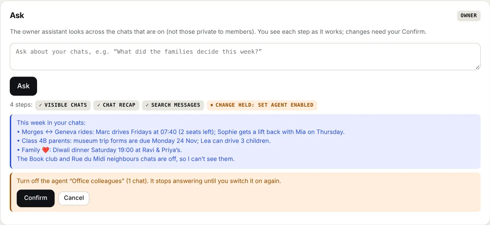
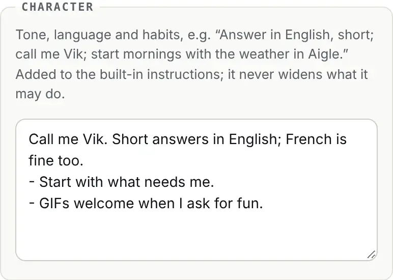

# Owner assistant, alerts and weekly summary

**Your own agent in your own WhatsApp chat: recaps of all your chats, GIFs and pictures, voice notes, and messages into
your groups after you confirm.**

**Do it:** panel → **Settings → Owner assistant → Link my WhatsApp**, then **Agents → Owner assistant** to give it a
character.

**In 30 seconds**
- A built-in agent: your DMs to any agent number, the **Ask** box (also on your phone). Always there, cannot be deleted.
- Everything an agent can have: tool services (e.g. GIF search), chat actions, photos, PDFs, voice notes, voice
  replies, pictures, memory, schedules — set on the normal agent page.
- Sees only chats that are on and not **Private to members**; never answers in groups.
- Changes, and anything sent into another chat, need `confirm CODE` (valid 10 minutes, also across a restart).
- Alerts and the weekly summary (counts only) are its messages too, and the [morning brief](#morning-brief) with
  [suggested next steps](#suggested-next-steps) you approve with one code. Ask it about your data across People,
  events, orders, sending and surveys, or [what you missed](#catch-up) in a group.

## Owner assistant and the Ask box

1. **Settings → Owner assistant → Link my WhatsApp** shows a one-time message `link CODE` (valid 10 minutes).
2. Send it from your phone to any agent number.
3. Confirm "Linked +41…" in the panel.
4. Message an agent number (or the [Telegram bot](telegram.md), once you shared your number with it): "what did the families decide this week?", "send me a dancing GIF", "post a poll in
   Carpool: pizza or dosa?", "turn off the helper agent".

Diagram as text

1. You send a DM to an agent number.
2. It starts with an agent trigger or `confirm CODE`: that agent handles it.
3. Otherwise the owner assistant handles it, with your panel role.
4. Changes by the owner assistant need `confirm CODE`.

## Its editor: character, tools, voice, schedules, alerts

**Agents → Owner assistant** (or **Settings → Owner assistant → Character, tools, voice, schedules & alerts**) is the
normal agent page without the sections that do not apply (where it answers, people, quick replies, welcome,
confirmation setup; its *Try it* section is the Ask box). It adds **Alerts**. The AI helper and its visual diff work here too.

| Section | What it does |
|---|---|
| **Character** | Tone, language and habits ("call me Vik, short answers"). Added to the built-in instructions; it never widens what the assistant may do |
| **Model** | Model and fallback, recent turns in context, max reply tokens; **Your time zone** (Advanced, see [below](#your-time-zone)) |
| **Memory** | Notes it saves when you ask ("remember Vedika likes ILLIT"): per person, never in a chat's memory |
| **Tool services** | Global services are on by default (switch one off here); it can have its own services too. Each service's role defaults decide its tools |
| **Chat actions** | Send pictures, GIFs, files, locations, contact cards, polls, reactions, replies. Group administration stays with the admin tools |
| **Photos & voice** | Look at photos and PDFs, listen to voice notes, answer with voice, create pictures (in your own chat) |
| **Alerts** | The number spending-cap, model-provider and update alerts go to. Only the owner can change it |
| **Scheduled messages to you** | The **weekly summary** (on, Monday 09:00) and your own, e.g. a morning brief. Sent to every linked owner and admin in their own chat; they run even while agents are paused |
| **Monthly spending cap** | Like any agent |

## What it may do (decided in code)

| | Owners and admins | Viewers |
|---|---|---|
| Admin tools | with their panel role; changes need `confirm CODE` | read-only, without message contents |
| Tool services | the services' organizer defaults | the services' participant defaults |
| Chat actions in their own chat | right away | right away (participant set) |
| Sending into another chat | `send_message` or a chat action with the chat's name; always `confirm CODE` | never |
| Pictures | as set under Photos & voice | as set (participants) |

- **Other chats:** only chats that are on and not private, by group name, person name or id. A chat switched off
  before you confirm gets nothing. A person who never saw the privacy line gets it once with the first message.
- **Tool services:** a tool called `confirm` (or `…_confirm`, `confirm_…`) or marked destructive is held for your code.
- **Secrets never pass through the chat:** "set the OpenAI key" gives you a one-time link (15 minutes) to paste it in
  the panel; when you save, the chat says *Saved OPENAI_API_KEY*. "Add Anu as an admin" (owners) gives you, after
  `confirm CODE`, a sign-up link (48 hours) to forward to Anu only: she chooses her own password. "Restore last
  night's backup" uses the passphrase stored on this server; a backup made elsewhere gets a link to the panel's
  Backups page. See [Admin MCP](admin-mcp.md#no-secrets-through-the-assistant).
- **Not included:** asking another agent to act in its chat (its own tools would run without a preview), and
  forwarding a photo you just sent into another chat.

> [!NOTE]
> It never answers in groups or anyone who is not linked. `!family …` still reaches that agent, and so does
> `confirm CODE` for a change an agent prepared.

> [!WARNING]
> Never paste a key or password into the chat. If a message looks like one, the assistant does not read it, store it
> or send it to the AI, and asks you to delete it and use a link instead.

| | |
|---|---|
| **Photos & voice notes** | go through the media queue like agents' (one at a time on a small server, picked up after a restart); only `[image] caption` or `🎤 transcript` is kept |
| **Ask box** | a conversation for this session: your question as a bubble, *Thinking…*, each tool as a live chip in plain words ("Checking server metrics…" → "✓ Checked server metrics", folded to *Used 3 tools* afterwards), then the answer streaming word by word with lists and bold drawn as text. **Stop** ends the answer (the model call stops, no further tool runs, the partial text is kept). After an answer: **Copy**, and the box asks for a follow-up, which sees the earlier turns. A failed answer shows the reason and **Retry**. Changes wait for **Confirm**. The same box is *Try it* on the owner assistant's page. WhatsApp replies stay whole |
| **Storage** | its conversation and notes are stored separately, never in chat memory |
| **Long questions** | one question gets up to nine rounds of looking things up or preparing changes. If that is not enough, the assistant says so after what it found: what it did stands; ask for the part that is missing |
| **Audit** | every question and action is in Activity (`owner.*`, `whatsapp.action`, always recorded), in plain words: "Checked maintenance status · via admin" (the tool's name is in the entry's details) |
| **API** | `POST /api/owner/ask` (whole answer) or `POST /api/owner/ask/stream` (newline-delimited JSON: `step` (`thinking`, `calling` before a tool runs, `tool`, `held`), `delta`, `restarted`, `text`, `done`, `error`; closing the request stops the answer; see below); the record is `GET`/`PUT /api/agents/owner-assistant` |
| **Admin MCP** | `get_owner_assistant` (link), `get_agent` / `update_agent` / `run_schedule_now` with `owner-assistant`, `preview_weekly_summary`, `set_chat_private` |
| **People** | "who is Ravi's kid?", "which household is Mia in?": it reads [People](people.md) (`list_people`, `get_person`); ties, households, notes and tags change only after your confirmation |
| **People who never wrote** | "assign Mochi to Vedika" works in one go: it finds the person in [People](people.md) and prepares the direct chat (`prepare_direct_chat`, see [Agents](chats.md#set-up-a-direct-chat-before-the-person-writes)); you confirm once |

Streamed answers: the events

- `step` — `thinking` (a model round starts), `tool` / `held` (tool name and ok only, never arguments or results).
- `delta` — a piece of the round's text; the first `delta` after `thinking` starts a new text.
- `restarted` — the stream broke after its first piece (`reason`: a code such as `network`); drop the partial text.
  The same account is asked once more without streaming, then the usual [fallback](models.md#fallback-and-several-accounts)
  continues. A stream that fails before its first piece simply falls back, so only the model that answers streams.
- `text` — the round's whole text (it wins over the pieces); `done` — the reply and held changes; `error` — the
  request failed.
- Usage and cost are recorded once per model call, from the answer that was used. Nothing is buffered beyond the
  current answer.

## Owner alerts and weekly summary

**Agents → Owner assistant → Alerts**: enter your number.

- **Cap alerts** and model-provider alerts go there as they happen ([spending caps](spending.md)), and so does a
  scheduled backup that failed three times in a row ([backups](backups-and-updates.md#backups)).
- **Weekly summary**: the owner assistant's `weekly-summary` schedule (on, Monday 09:00; change day, time or switch it
  off in **Scheduled messages to you**). Messages handled, replies and cost per agent this week vs last, ignored
  chats, pending confirmations, update available, backup failures, a server restart waiting more than 7 days to
  finish OS updates. **Run now** sends it at once, **Preview** shows it. It goes to linked owners and admins; with
  nobody linked, to the Alerts number.
- Admin MCP: `preview_weekly_summary`; `run_schedule_now` (owner-assistant, weekly-summary); `update_agent` for the
  alert number (`alerts: { to }`) and the schedule.

> [!IMPORTANT]
> Counts only, never message contents.

**Breaking releases** (045): the alert number gets the release notes, and every owner linked to the owner assistant
gets a code: `confirm ABCD` backs up, updates, restarts and reports the result; `cancel ABCD` reminds you in 7 days.
Only owners can confirm. [Backups and updates](backups-and-updates.md#updates)

## Morning brief

**One short message each morning with what needs you; nothing to report, no message.** **Settings → Owner assistant →
Morning brief**: on/off (on by default), the time (08:00 in the owner assistant's time zone) and the sections. A time
outside your [sending hours](sending-pace.md) waits for their start (the panel says when it goes out). **Preview**
shows it as it would go out now.

| Section | What it lists |
|---|---|
| Payments | open orders overdue or due in the next 3 days, per event: how many, how much is left, the first names (Orders module) |
| Questions for you | messages of the last 24 hours in chats that are on that name you, ask something, and that you have not answered in that chat since |
| Commitments due | promises people made in chats (when commitments tracking is on); ask *"which promises are overdue?"* or *"mark Ravi's hall booking done"* any time ([People → Promises](people.md#promises)) |
| Birthdays | people whose birthday is today or tomorrow (People) |
| Needs a look | answers that failed on a model error, changes waiting for a confirm code, an update, paused sends |
| New people | people new since yesterday in chats that are on |

It goes to linked owners and admins in their own chat, once a day, on the scheduler's tick (no timer of its own); a
restart or an update at that minute only delays it (it still goes out within 30 minutes). The
text is built in code from counts and names — no model call, nothing to pay.

## Your time zone

The server has one clock: yours. Set it once on the owner assistant: **Agents → Owner assistant → Advanced → Your
time zone** (start typing a city: `Asia/Kolkata`, `Europe/Zurich`). Until you do, it is the server's default
(`TZ_DEFAULT`, Europe/Zurich).

What goes by it: your day (deadlines, due dates, the morning brief, sending hours), the months of
[spending caps](spending.md), the bars per day on Usage, the times of automatic [updates and backups](backups-and-updates.md),
daily limits, and every agent that has no time zone of its own. An agent for people elsewhere gets its own under
**Advanced → Time zone**; then its schedules and "today" follow that.

## Suggested next steps

From the same data the server suggests steps: *2 people have not paid for Sankranti (due Friday) — send reminders?*, *a
paused send — resume it?*, *update 2.51.0 is ready — install it?*. Nothing is ever sent or changed until you approve:

- **In the brief:** each step ends with `reply *confirm ABCD*`: the usual confirm gate; reminders go out through Lists
  and sending (consent, a person's pace, stop words).
- **Overview → Suggested:** **Review and send** opens the send's preview as a draft (who, how many, a sample); you start
  it there. **Approve** resumes a paused send; **Open** opens Updates. **Dismiss** hides a step for good (for that event
  and due date, that version, that send).
- **Ask / your chat:** the assistant sees the same steps (`list_suggestions`) and offers them; acting needs your code.

## Ask your data

Ask the assistant (WhatsApp or the **Ask** box) about People, events, orders, sending, surveys and your chats: *which
families came last year but haven't registered?* (`compare_events`), *who usually volunteers for cooking?*
(`duty_history`), *who still owes for Diwali?*, *what did people answer in the survey?*. It uses read tools only — never
free-form database queries — and answers with names, amounts and dates. Agents' organizers get the same event tools
(organizers only, decided in code).

## Catch up

**What did I miss in the school group?** — in your chat with the assistant (`catch_up`), or **Chats → a group → What
did I miss?** in the panel: the messages since you last wrote there (or the last 24 hours; at most 120), in three short
parts — *Decided*, *Open questions*, *For you* — with links to the messages. One background model call (≤ 600 tokens
out). Not for chats that are off or private to members.

Admin MCP: `get_morning_brief`, `set_morning_brief`, `list_suggested_steps`, `approve_suggested_step` (confirmed),
`dismiss_suggested_step`, `catch_up_chat`.

---
**Next:** [Agents](agents.md) · [Admin MCP](admin-mcp.md) · [Privacy](privacy.md) · [Docs index](README.md)
