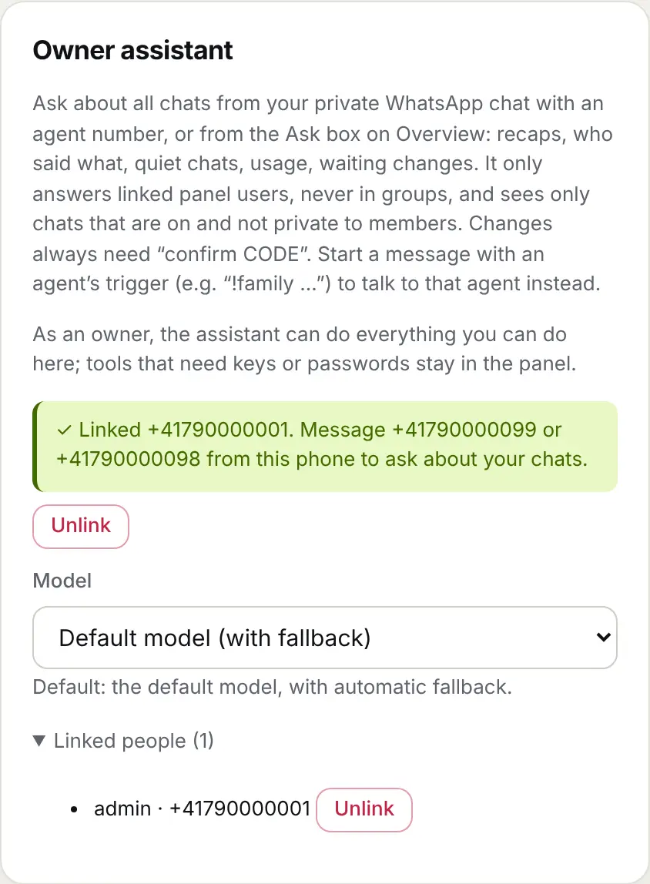

# Owner assistant, alerts and weekly summary

**Ask about all your chats from your own WhatsApp or the Ask box: recaps, who said what, why a group is quiet.**

**Do it:** panel → **Settings → Owner assistant → Link my WhatsApp**.

**In 30 seconds**
- Built in (not an agent): your DMs to any agent number, the **Ask** box, the mobile app.
- Sees only chats that are on and not **Private to members**; never answers in groups.
- Changes need `confirm CODE` (valid 10 minutes, also across a restart). Alerts and a weekly summary (counts only) go to your WhatsApp.

## Owner assistant and the Ask box

1. **Settings → Owner assistant → Link my WhatsApp** shows a one-time message `link CODE` (valid 10 minutes).
2. Send it from your phone to any agent number.
3. Confirm "Linked +41…" in the panel.
4. Message an agent number: "what did the families decide this week?", "why is the carpool group quiet?", "turn off
   the helper agent".

Diagram as text

1. You send a DM to an agent number.
2. It starts with an agent trigger or `confirm CODE`: that agent handles it.
3. Otherwise the owner assistant handles it, with your panel role.
4. Changes by the owner assistant need `confirm CODE`.

| | |
|---|---|
| **Tools** | the admin MCP tools with your panel role (viewers read-only, without message contents; tools that take keys or passwords stay in the panel), plus `list_visible_chats`, `search_messages`, `chat_recap` |
| **Ask box** | the answer streams in: each step shows as it happens (✓ looked up, ⏸ change held, ✕ failed; tool names only) and the assistant's text appears word by word (Anthropic, OpenAI, OpenRouter, other endpoints, ChatGPT; GitHub Copilot shows it after each step); changes still wait for **Confirm** (panel and mobile app). WhatsApp replies stay whole |
| **Model** | the default model with fallback, or one chosen in the same card |
| **Storage** | its conversation is stored separately, never in chat memory |
| **Audit** | every question and action is in Activity (`owner.*`, always recorded) |
| **API** | `POST /api/owner/ask` (whole answer) or `POST /api/owner/ask/stream` (newline-delimited JSON: `step`, `delta`, `restarted`, `text`, `done`, `error`; see below) |
| **Admin MCP** | `get_owner_assistant`, `set_chat_private` |
| **People who never wrote** | "assign Mochi to Vedika" works in one go: it looks up the contact and prepares the direct chat (`prepare_direct_chat`, see [Agents](agents.md#set-up-a-direct-chat-before-the-person-writes)); you confirm once. Add "and say hi" to let the agent write first in the same confirmation |

Streamed answers: the events

- `step` — `thinking` (a model round starts), `tool` / `held` (tool name and ok only, never arguments or results).
- `delta` — a piece of the round's text; the first `delta` after `thinking` starts a new text.
- `restarted` — the stream broke after its first piece (`reason`: a code such as `network`); drop the partial text.
  The same account is asked once more without streaming, then the usual [fallback](models.md#fallback-and-several-accounts)
  continues. A stream that fails before its first piece simply falls back, so only the model that answers streams.
- `text` — the round's whole text (it wins over the pieces); `done` — the reply and held changes; `error` — the
  request failed.
- Usage and cost are recorded once per model call, from the answer that was used. Nothing is buffered beyond the
  current answer.

> [!NOTE]
> It never answers in groups or anyone who is not linked. `!family …` still reaches that agent, and so does
> `confirm CODE` for a change an agent prepared.

## Owner alerts and weekly summary

**Settings → Owner alerts on WhatsApp**: enter your number.

- **Cap alerts** go there ([spending caps](spending.md)).
- **Weekly summary** (on by default once a number is set; day and time configurable): messages handled, replies and
  cost per agent this week vs last, ignored chats, pending confirmations, update available, backup failures, a server
  restart waiting more than 7 days to finish OS updates. **Send now** sends it at once.
- Admin MCP: `get_owner_alerts`, `set_owner_alerts`, `preview_weekly_summary`, `send_weekly_summary`.

> [!IMPORTANT]
> Counts only, never message contents.

**Breaking releases** (045): the alert number gets the release notes, and every owner linked to the owner assistant
gets a code: `confirm ABCD` backs up, updates, restarts and reports the result; `cancel ABCD` reminds you in 7 days.
Only owners can confirm. [Backups and updates](backups-and-updates.md#updates)

---
**Next:** [Admin MCP](admin-mcp.md) · [Privacy](privacy.md) · [Docs index](README.md)
