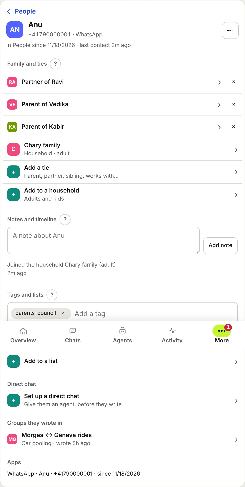

# People

**One place for everyone around your agents: who is who, families and kids, notes, tags and lists.**

**Do it:** panel → **More → People** → tap a person (or **+ Add** for someone new, a kid without a phone too).

**In 30 seconds**
- Everyone appears by themselves: people who write in, or are members of, a chat that is **on**, and every contact
  WhatsApp syncs from your phone. One person across WhatsApp and Telegram (the same phone number is the same person).
  Chats that are off add nobody.
- A person's page shows their apps, **Family and ties**, **Notes and timeline**, **Tags and lists**, their chats,
  **Consent** and **Agents that can see them**.
- **Households** group adults and kids. A kid without a phone is never messaged: they are reached through the adults.
- Agents see only the people of their own chats (or everyone, if you choose so per agent), and get a short card about
  whoever writes to them. **Hide** keeps someone out of all of that.
- **Merge** two entries of the same human in one tap, with 30 days to undo. **Export** anyone.
- Ask the owner assistant *"who is Ravi's kid?"* or *"which household is Mia in?"*.

## The People screen

- **People · Households · Lists** (**Promises** when an agent tracks them, and **Events · Orders** when those
  [modules](modules.md) are on) sit at the top; each is a list, and a row opens its page (`#people/<id>`,
  `#people/households/<id>`, `#people/lists/<id>`).
- **People (N)** counts everyone (hidden people aside); with a search or a filter it says how many match, e.g.
  *People (12 of 640)*.
- One row per person: name, their apps (*WhatsApp · Telegram*, or *No app*) and the last contact (*from your phone*
  when they only came from your contacts).
- **Search** finds names (yours, phone contact, business, profile), nicknames, numbers, tags and notes. **Show**
  filters by **Source** (*From chats*, *From your phone*, *Added by you*), app (*No app* finds the kids), tag, list,
  household, or **Hidden**.
- **Agents may use the names from your phone contacts** (owner, on by default, at the bottom): switch it off if your
  address book holds private labels; agents then see business or profile names.
- Press **/** anywhere: Find anything lists people, households and lists too.

## Where people come from

| Source | How | When |
|---|---|---|
| **From chats** | they wrote in a chat that is on, or are a member of a group that is on | at once when they write; members when a group is switched on, when its members change, and every 12 hours |
| **From your phone** | WhatsApp synced their number with a name from your address book or their profile | after the sync, 300 per minute at most (the upkeep) |
| **Added by you** | **+ Add**, or an AI assistant through the admin tools | at once |

Only identities and names come in: no message is read for it. Leaving a group takes the person out of that group's
people, not out of People. Someone from your phone who later writes in a chat that is on counts as *From chats*.

## A person's page

**Header:** name, number, apps, nickname, birthday, *in People since* and the last contact. **⋯** holds **Edit…**
(name, nickname, number, birthday, *Shared*), **Hide…** (or **Show again**), and for the owner **Merge…** and
**Export**.

- **Shared:** participants may look this person up through agents (*find person*, *get person*). Organizers see
  everyone the agent may see.
- **Their chats:** the direct chat (or **Set up a direct chat**) and **Their groups**: the groups that are on where they
  wrote (*wrote 2 h ago*) or are a member. A direct chat's page links back with **Person page ›**; names in a chat's
  *Messages* and in group member lists open the person too.
- **Consent** and **Agents that can see them**: see below.
- **Apps:** each app account with the name it showed and since when.

A number that wrote in a chat but is not in People (for example before you switched the chat on) still has a page with
**Add to People**.

## Consent

One row per purpose: **Saw the privacy notice**, **May receive updates**, **May receive marketing**, each *Yes* or
*No* with where it came from and when. *Not asked* counts as **no**.

- *Saw the privacy notice* is recorded by itself: when the notice is posted in a group that is on (everyone known to be
  in it, and later members when they show up), and when the notice line is added to a direct-message answer.
- Change any row with its menu; it records your user name and the time. [Lists and sending](sending.md) messages only
  people who said yes to its purpose (*updates* or *marketing*), checked right before each message; a reply **stop**
  records *No* (*Replied STOP*), **start** records *Yes* again.

## What agents see

Each agent's **People** section has **People access** (decided in code, never by the prompt):

| Setting | The agent's People tools and sender card see |
|---|---|
| **Its own chats** (default) | people who wrote in, or are members of, the chats assigned to it, plus the **Lists shared with it** |
| **Everyone in People** | everyone (also people only from your phone) |
| **Nobody** | no People tools, no card |

- **When you write to an agent yourself** (your number linked to the owner assistant, on any app, in any chat), that
  turn sees everyone, like the owner assistant. Other people's turns in the same group stay scoped.
- **Hidden** people are never shown to an agent.
- **The sender card:** each turn, the agent gets a few lines about who is writing: name (the one it may use), nickname,
  households, tags and your latest notes and agent notes. Never message text.
- **Agent tools** (`people:` rules; participants get *find* and *get* of *Shared* people only): *find person*, *get
  person* (their card), *add note* (marked as the agent's), *tag person*, *add to list*. A change about anyone other than
  the sender waits for an organizer's *confirm XXXX*. Agents can never merge, hide, export or erase.
- **Agents that can see them** on a person's page lists the agents and why (*In its chats*, *A list shared with it*,
  *Everyone in People*).

## Roles that follow a person

An agent's organizers and extra participants can be **people**, **lists** (e.g. *organizers = the Committee list*) or
numbers. A person is an organizer on every app they use: on Telegram too once they shared their number with the bot. A
saved number still works and matches the person who holds it.

## Family and ties

**Add a tie** → choose *Parent of*, *Child of*, *Partner of*, *Sibling of*, *Works with* or *Something else…* (your own
word and its other side, e.g. *Godmother of* / *Goddaughter of*) → find the person → **Add tie**.

Each tie reads right from both pages: *Anu · Parent of Vedika* shows as *Child of Anu* on Vedika's page. **×** removes
a tie from both.

### Suggestions

Agents with **Suggest family ties** on (agent → *Promises & people*) notice when someone in a chat that is on says *my
daughter Vedika*, *my wife Rupa*, *my brother Kiran*. **People → Suggestions** lists them: **Add tie** makes the tie (and
adds Vedika when nobody in People has exactly that name); **No** rejects it for good — it is never suggested again.
Only family words count (wife, husband, partner, daughter, son, kid, child, mother, mum, mom, father, dad, brother,
sister); nothing else about a person is inferred. Admin MCP: `list_tie_suggestions`, `decide_tie_suggestion`.

## Promises

**People → Promises** (shown when an agent has *Track promises* on, [Smarter agents](intelligence.md#commitments)):
every promise people made in your chats, across agents.

- **Open · Overdue · Done · All**, then **Everyone** (a person), **All agents** and **All chats**. Open ones come
  overdue first (*Overdue since 17 Nov*), then by due date, undated last.
- Each row: the person (→ their page), what they promised, when it is due, the chat (→ the chat) and **the message ›**
  it came from, and the agent.
- **Done** / **Reopen**; **⋯ → Due date…**, **Edit…**, **Drop (no reminder)**, **Delete…**. A new due date or reopening
  lets the agent's one gentle reminder go out again when it is due.
- Owners and admins change them here; an agent's organizers change those of its chats from the chat.
- Admin MCP and the owner assistant: `list_commitments` (status *overdue* too, by person, agent or chat),
  `update_commitment`, `delete_commitment` (asks to confirm).

## Preferences

A person's page → **Preferences**: the **language** they write in (from their latest messages), the **hours** they
usually write (in your time zone; once they wrote at least 20 messages over 5 days, at least 6 hours wide) and the **app** they answer on when they use both WhatsApp and Telegram. Learned from
messages in chats that are on, a few people per upkeep tick; each can be set by you (*Automatic* gives it back).

- **Languages**: English, French, German, Spanish, Italian, Portuguese and Dutch by their common words; Telugu, Hindi,
  Tamil, Kannada, Malayalam, Bengali, Gujarati, Punjabi, Urdu, Arabic, Russian, Ukrainian, Greek, Hebrew, Thai,
  Chinese, Japanese and Korean by their alphabet; Telugu and Hindi written in Latin letters (*Sare Vikram garu*,
  *kya haal hai*) by a short word list — agents then answer the same way. A language is learned from at least three
  of their recent messages and changes only when most of their recent messages are in another one; a message mixing
  Telugu and English counts for the language they mostly write. Messages that say nothing (*ok*, 👍) change nothing.
- Agents answer them in that language (the card about the sender says so); when a message is in another language,
  they follow the message.
- [Lists and sending](sending.md#the-pace) sends to them inside their hours (and always inside your sending hours) and
  on their app.

Their **Commitments** (promises they made in chats, [Smarter agents](intelligence.md#commitments)) are on their page too.
Admin MCP: `get_person_preferences`, `set_person_preferences`.

## Households

1. **Households → + New** (e.g. *Chary family*, an address if you like), or **Add to a household** on a person's page.
2. **Add a person** and choose **Adult** or **Kid**. A person can be in several households (parents who live apart,
   grandparents).
3. A household's page lists adults first, then kids; a kid without any app shows *reached through the adults*.

> [!IMPORTANT]
> A person without an app (a kid) has no chat, so no agent can ever message them. Their page says who reaches them:
> the adults of their households who have an app.

## Notes and timeline

- Write a note and tap **Add note**. Notes show who wrote them: you (your user name) or *Agent* (an AI assistant or the
  owner assistant through the admin tools).
- Agent notes never hold message text: a note that copies one of the person's stored messages is refused, unless your
  logging policy keeps message contents (*verbose*, [Privacy](privacy.md)).
- The timeline also shows what happened: added to People, joined a household, merged, merge undone. Modules write
  here too (registrations, payments; [Lists and sending](sending.md) lists the messages a person got on their page,
  [Surveys](surveys.md) their answers).

## Tags and lists

- **Tags** are free words (*badminton*, *driver*): type one and press Enter; **×** removes it. They save at once.
- **Lists** are named groups you fill by hand (*Badminton Tuesdays*, *Christmas cards*): **Lists → + New**, then
  **Add a person**, or **Add to a list** on a person's page.

## Hide, merge, export

- **Merge…** (owner): choose the other entry of the same human; their apps, notes, ties, households, tags and lists
  move here, and so do their event registrations, duties and orders, their promises, and what was learned about them
  (suggested ties; language and hours when this entry has none). The page then offers **Undo merge** for 30 days. When there is evidence (a verified phone number of one
  person belongs to the other), the page suggests the merge: one tap.
- **Export** (owner) downloads everything stored about the person as JSON: their page, names, notes, ties, households,
  tags, lists, registrations, duties, orders and payments, and their stored messages.
- **Hide…**: they leave People lists and search, and agents no longer see them (tools and the sender card). Their
  notes, ties and chats stay, and your phone's contacts never bring them back as someone new. **Show → Hidden** lists
  them; **Show again** undoes it.
- **Erase** (a true delete, for privacy requests) is not in the panel: ask an AI assistant with the admin tools
  (`erase_person`, owner only, with a confirmation). See [Privacy](privacy.md#delete-a-person).

## Events, orders and payments

With the [modules](modules.md) switched on, People also holds [Events](events.md) (registrations, waiting list, duties)
and [Orders and payments](orders.md): **People · Households · Lists · Events · Orders**. A person's and a household's
page then show their registrations, duties and orders, and their timeline says when they registered or paid.

## AI assistants and the owner assistant

Admin MCP tools ([Manage from ChatGPT or Claude](admin-mcp.md)): `list_people`, `get_person`, `add_person`,
`update_person`, `add_person_note`, `set_person_tie`, `remove_person_tie`, `set_person_tags`, `merge_people`* ,
`undo_merge`*, `export_person`, `set_person_hidden`, `set_person_consent`, `erase_person`*, `list_households`, `get_household`, `save_household`,
`set_household_member`, `list_people_lists`, `save_people_list`, `set_list_member`, `people_names_status`,
`refresh_contact_names`, `set_contact_names_for_agents`* (* needs `confirm_action`).

The [owner assistant](owner-assistant.md) uses the same tools: it reads People directly and every change waits for
your confirmation.

---
**Next:** [Lists and sending](sending.md) · [Surveys](surveys.md) · [Events](events.md) · [Orders and payments](orders.md) · [Chats](chats.md) · [Privacy](privacy.md) · [Docs index](README.md)
