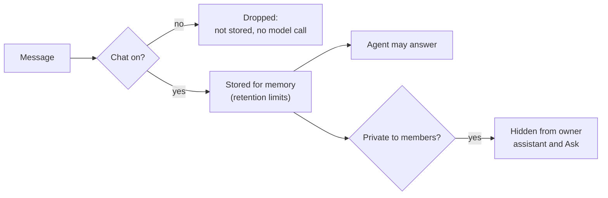
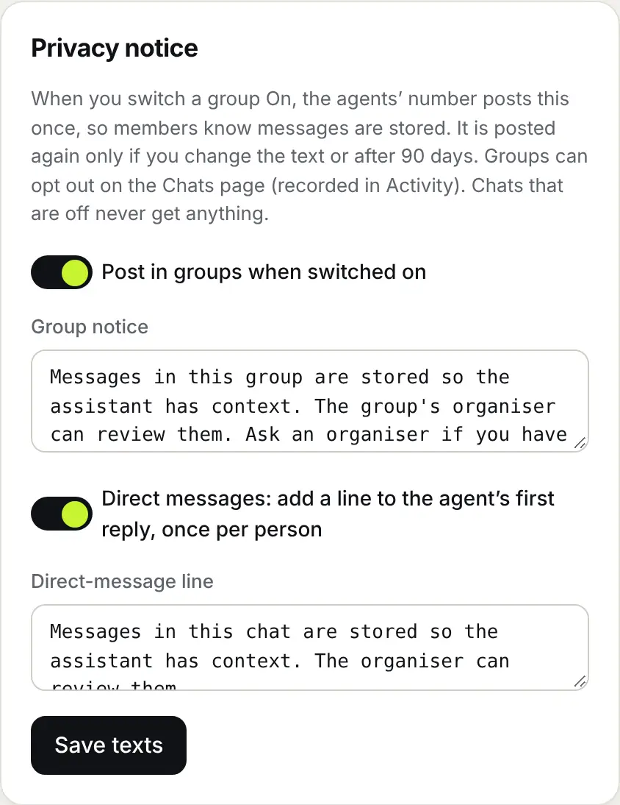
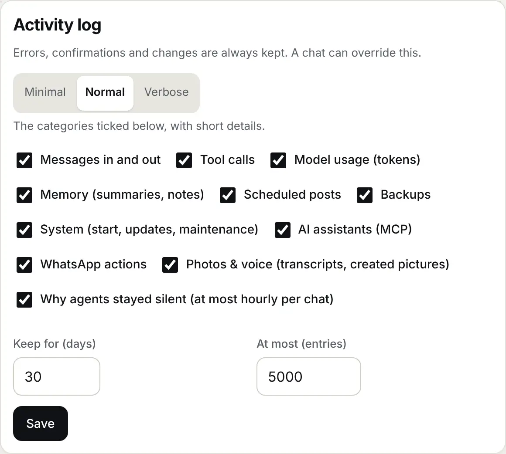

# Privacy: silent by default, privacy notice, logging

**Nothing is stored or sent to a model until you switch a chat on, and groups are told once.**

**Do it:** panel → **Chats** → switch only the chats you want **on**.

**In 30 seconds**
- Off chats are dropped before storage and before any model call.
- Switching a group on posts a one-time notice (your text; per-group opt-out).
- Every look at stored messages is logged; contents are logged only where your policy allows.

## Privacy notice

When a group is switched on, the number posts once "Messages in this group are stored so the assistant has
context…" (edit under **Settings → Privacy notice**).

- Posted again after the group was off only if the text changed or after 90 days.
- Per-group opt-out on **Chats** (recorded).
- Direct messages get a line in the agent's first reply, once per person (can be switched off).
- Admin MCP: `get_privacy_notice`, `set_privacy_notice`, `set_chat_privacy_notice`.

## What is kept, and who sees it

| | |
|---|---|
| **Stored messages** | only chats that are on, for memory, with retention limits. Admins and owners can read them; every look is in the activity log. Erase a chat's memory with one click |
| **Activity log** | minimal, normal or verbose, by category and per chat, with retention. Errors, confirmations, configuration changes and channel status are always recorded |
| **Summaries** | the weekly summary and *Why agents stayed quiet* keep counts only |
| **Personal details** | agents don't post phone numbers, emails, health or payment details in groups |

> [!WARNING]
> Use a **dedicated WhatsApp number** and tell your groups that the assistant keeps context.

---
**Next:** [Owner assistant](owner-assistant.md) · [Agents](agents.md) · [Docs index](README.md)
