# Privacy: silent by default, privacy notice, logging

**Nothing is stored or sent to a model until you switch a chat on, and groups are told once.**

**Do it:** panel → **Chats** → switch only the chats you want **on** (choosing an agent for a chat that is off
switches it on too, as does **Switch on** in Getting started).

**In 30 seconds**
- Off chats are dropped before storage and before any model call (only the id and time of the newest message are
  kept, so recent messages can be loaded from your phone when you switch the chat on).
- Switching a group on posts a one-time notice (your text; per-group opt-out).
- Every look at stored messages is logged; contents are logged only where your policy allows.

Diagram as text

1. A message arrives.
2. Chat off: dropped, not stored, no model call.
3. Chat on: stored for memory (within the retention limits) and the agent may answer.
4. Chat private to members: hidden from the owner assistant and Ask.

## Privacy notice

When a group is switched on, the number posts once "Messages in this group are stored so the assistant has
context…" (edit under **Settings → Privacy notice**).

- Posted again after the group was off only if the text changed or after 90 days.
- Switching on also loads the group's recent messages from your phone, so "stored" covers those earlier messages too.
- Per-group opt-out on **Chats** (recorded).
- Direct messages get a line in the agent's first reply, once per person (can be switched off). An intro the agent
  sends to a [prepared direct chat](chats.md#set-up-a-direct-chat-before-the-person-writes) carries it too.
- A [welcome message](agents.md#quick-replies-welcome--faq) for new members comes after the notice when the notice is
  still due.
- Each person's page records that they saw it (*Consent → Saw the privacy notice*, with the source and date):
  everyone known to be in the group when it is posted, later members when they show up, and people who got the
  direct-message line ([People → Consent](people.md#consent)).
- Admin MCP: `get_privacy_notice`, `set_privacy_notice`, `set_chat_privacy_notice`.

## Consent for messages to lists

- [Lists and sending](sending.md) messages a person only when their page says *Yes* to the purpose (*May receive
  updates* or *May receive marketing*), checked in code right before each message. *Not asked* counts as no.
- A reply **stop** (*unsubscribe*, *arrête*, *basta* and the like, or asking the agent in any words) records *No* for
  that purpose with the source and time, confirms once and pauses the run; **start** records *Yes* again.
- Chats that are off, hidden people and people without an app are never messaged. The first message to someone in a
  direct chat carries the privacy line, like any first reply.
- What was sent is stored with the run (the text each person got, when, whether they replied) and in the chat's
  messages; **Export** and **Erase** of a person include it.

## Survey links and answers

- Each person gets their own link (`/s/…`); only a hash of it is stored. Anyone with the link can answer as that
  person, so it is sent only to them. No sign-in, no cookies; the page shows every text as text, takes the form only
  from itself and slows down anyone who opens links too fast.
- Answers (and how: chat or link) are stored per person and survey; the owner and admins see them, agents' organizers
  see the answers of people their agent may see. **Export** and **Erase** of a person include them; deleting a
  survey deletes its answers.

## What is kept, and who sees it

| | |
|---|---|
| **Stored messages** | only chats that are on, for memory, with retention limits (90 days and 5 000 per chat by default, pruned every hour; **Server → Health**). Switching a chat on loads its recent messages from your phone ([Agents → Earlier messages](chats.md#earlier-messages-when-a-chat-is-switched-on)). Admins and owners can read them; every look is in the activity log. Erase a chat's memory with one click |
| **Search messages** | the owner only, over chats that are on and not *Private to members*; each search is in the activity log with its words and the number found, never message text ([Agents → Chats](chats.md#search-messages-owner)) |
| **Answer ratings** | 👍 / 👎 on an agent's answers (*Review*): who rated and when, no copy of the text; gone with the answer. Answers in private chats are not shown ([Review and teach](agents.md#review-and-teach)) |
| **People** | a person is stored when they write in, or are a member of, a chat that is on, when WhatsApp syncs their number from your phone, or when you add them: their app ids and phone, the name their app showed, the chats (that are on) they are in, and what you add (name, nickname, birthday, ties, households, notes, tags, lists, consents). Agent notes never copy message text unless the activity log is *verbose*. Agents see only the people of their own chats unless you choose *Everyone in People* per agent, and never hidden people; the card about the sender never holds message text ([People → What agents see](people.md#what-agents-see)). **Hide** someone to keep them out of lists and agents; **Export** anyone ([People](people.md#hide-merge-export)) |
| **Names and member tags** | phone contact, business and profile names from your linked phone (each synced number is a person, *From your phone*; agents use the same name you see, phone contact names included, unless you switch that off on the People screen); group member tags only for chats that are on, erased with the chat's memory ([Agents → Contacts](chats.md#which-name-is-shown)) |
| **Telegram phone numbers** | a person's phone is stored with their Telegram id only when they share their own contact with the bot (*Share my number*); it joins them to the same person as on WhatsApp ([Telegram](telegram.md#share-my-number-one-person-on-both-apps)). A contact someone else forwards is never used |
| **Chats that are off** | the id, time and sender id of the newest message only (no text, no names), to ask the phone for history later |
| **Activity log** | minimal, normal or verbose, by category and per chat, with retention. Errors, confirmations, configuration changes and channel status are always recorded |
| **Summaries** | the weekly summary and *Why agents stayed quiet* keep counts only |
| **What is learned about people** | opt-in per agent: **promises** (who, what, due, the message it came from; erased with the person or the chat's memory) and **family ties** (suggested only; nothing saved without your tap; rejected ones never again; only family words). For everyone in chats that are on: **preferences** (language, usual hours, app), shown and editable on their page, erased with the person. Nothing about health, beliefs or other sensitive matters is inferred ([People → Preferences](people.md#preferences)) |
| **Morning brief & catch-up** | the brief is built in code from counts, names, amounts and due dates and goes only to linked owners and admins; nothing is stored but "sent today" and suggestion keys (to keep dismissed ones dismissed). Catch-up sends the messages since you last wrote in that group (at most 120, chats that are on and not private) to your background model, on demand |
| **Lessons** | short rules per agent (and optionally per chat) that you approve, proposed from your 👎 and corrections; the proposal call sends the question and answer (or your correction) to your background model. Join-in feedback keeps counts per chat. Delete any lesson on the agent's **Lessons**; erasing a chat's memory deletes its lessons and feedback ([Lessons](intelligence.md#lessons)) |
| **Smarter agents** | [Smart model choice](intelligence.md#smart-model-choice) keeps per answer the tier, a short reason and the cost (never text); its classifier sends the message alone (≤ 400 characters) to your light model. [Self-check](intelligence.md#self-check) compares figures in code and keeps counts only |
| **Changes made without asking** | when an organizer's clear request is applied at once ([How sure before changing things](agents.md#how-sure-before-changing-things)), Activity keeps the tool, its input and who asked (role), like any tool call; the summary names the change, never message text. Tools that declare themselves destructive always wait for a yes, and participants never change things |
| **Web search** | what the AI searches for goes to its provider (Anthropic or OpenAI), like the conversation itself; Duniya sends nothing else ([Web search](web-search.md)) |
| **Tool services** | a tool's input goes to its service when the agent uses it. **Shared on its own** (GIFs, stickers): only mood and style words go to the service (e.g. *party telugu movie*), never message text, names, numbers or emails; names people use in the chat, the sender's, the agent's and the group's are removed first. Duniya keeps the ids of the last 30 results posted per chat (to avoid repeats) and each service's credit (shown in the panel, never in messages) and, with a daily limit, a count per agent and service ([Tool services](tool-services.md#share-results-on-its-own)) |
| **Welcomes** | a hash of the group and the new member's id, so each person is welcomed once (no names or numbers); the activity log says how many were welcomed |
| **Personal details** | agents don't post phone numbers, emails, health or payment details in groups |
| **Keys and passwords** | never through a chat or a model: entered on one-time panel links; a key pasted to the owner assistant is not read, stored or logged ([Owner assistant](owner-assistant.md#what-it-may-do-decided-in-code)) |

## Delete a person

For a privacy request ("delete everything about me"), the panel's **Hide** is not enough: it keeps their data. Ask an
AI assistant connected with the [admin tools](admin-mcp.md) (or your owner assistant) to **erase** them
(`erase_person`, owner only): it shows what goes and waits for your confirmation, then deletes their stored messages in
every chat, their direct chat's memory, notes, ties, household memberships, tags, list entries, consents, app
accounts, and their event registrations, duties, orders and payments ([modules](modules.md)). The activity log keeps only counts. If they write again in a chat that is on, or WhatsApp syncs their number
from your phone again, they come back as a new person; **Hide** them then.

> [!WARNING]
> Use a **dedicated WhatsApp number** and tell your groups that the assistant keeps context.

---
**Next:** [Owner assistant](owner-assistant.md) · [Agents](agents.md) · [Docs index](README.md)
