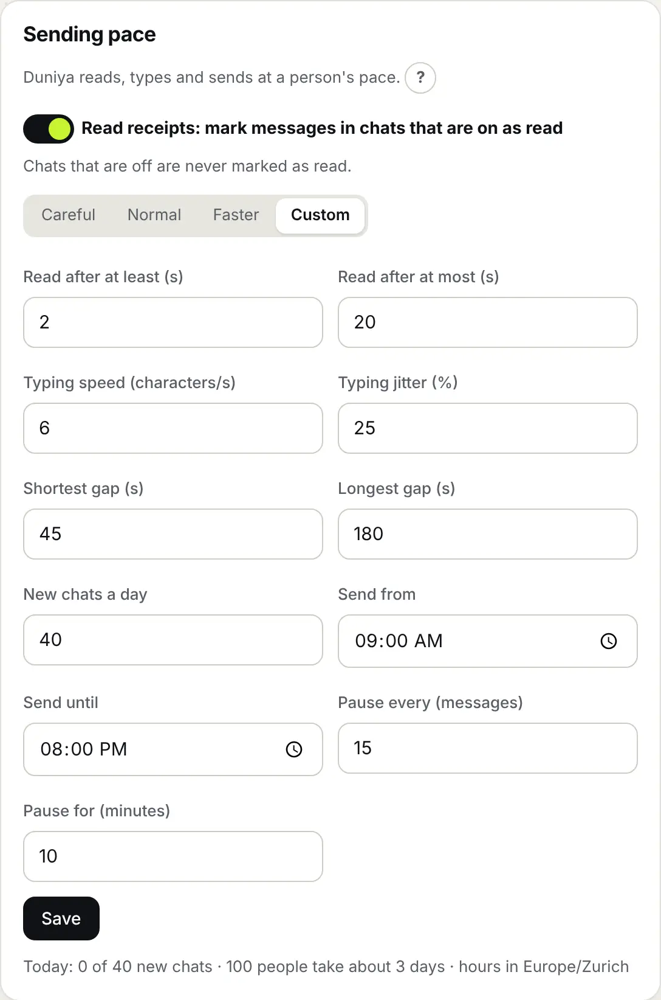

# Sending pace

**Duniya reads, types and sends on WhatsApp at a person's pace: blue ticks after a natural pause, "typing…" that fits
the reply, and a daily limit on new chats.**

**Do it:** panel → **Settings → Sending pace** → pick **Careful**, **Normal** or **Faster** (or **Custom**) → **Save**.

**In 30 seconds**
- **Normal** is on by default: messages in chats that are on are read after 2–20 seconds, replies "type" for up to
  8 seconds, at most 40 new chats a day between 09:00 and 20:00.
- **Chats that are off are never touched**: no blue ticks, nothing stored ([Chats](chats.md)).
- Every wait is random within its range (bell-shaped, never a fixed interval), so nothing looks like a machine.
- The same pace drives [sending to lists](sending.md): the gap between messages, the longer pause, the daily cap and
  the sending hours.

## What happens to a message

1. A message arrives in a chat that is **on**. Its read receipt is due after a random delay within **Read after**.
2. If the agent answers, the message is read when its delay is over, then **typing…** shows. The model works meanwhile,
   so the read delay rarely makes the answer later.
3. Typing lasts about *reply length ÷ typing speed* (with jitter), **at most 8 seconds**, then the reply goes out.
4. Messages the agent leaves alone are read too, at the next incoming message or the server's 30-second check, so a
   little later than their delay.

> [!NOTE]
> Telegram bots have no read receipts: on Telegram only the typing time applies.

## Presets

| | Careful | Normal (default) | Faster |
|---|---|---|---|
| Read after | 5–45 s | 2–20 s | 1–8 s |
| Typing speed | 4 characters/s | 6 characters/s | 9 characters/s |
| Gap between messages to a list | 1.5–5 min | 45 s–3 min | 20 s–1.5 min |
| A longer pause | 15 min every 10 | 10 min every 15 | 5 min every 25 |
| New chats a day | 20 | 40 | 80 |
| Sending hours | 09:00–20:00 | 09:00–20:00 | 09:00–20:00 |

**Custom** starts from the pace in force; change any range and **Save**. The panel checks every value (for example,
the shortest gap can't be longer than the longest) and points at the field.

## New chats a day

- An **intro** to a prepared chat ([Chats](chats.md)) counts as a new chat. At the limit the intro is refused with the
  reason; the count resets at midnight in the owner assistant's time zone.
- A number **linked on this server in the last week** starts lower (about an eighth of the limit on day one) and
  reaches the full limit after seven days (warm-up).
- The page shows today's count and how long sending to 100 people would take at this pace.

> [!TIP]
> A new number, or one that was recently restricted by WhatsApp? Choose **Careful** for a few weeks.

## Admin MCP

`get_sending_pace` and `set_sending_pace` (preset, read receipts, any custom range) — see
[Manage from ChatGPT or Claude](admin-mcp.md).

---
**Next:** [Connect WhatsApp](whatsapp.md) · [People](people.md) · [Privacy](privacy.md) · [Docs index](README.md)
