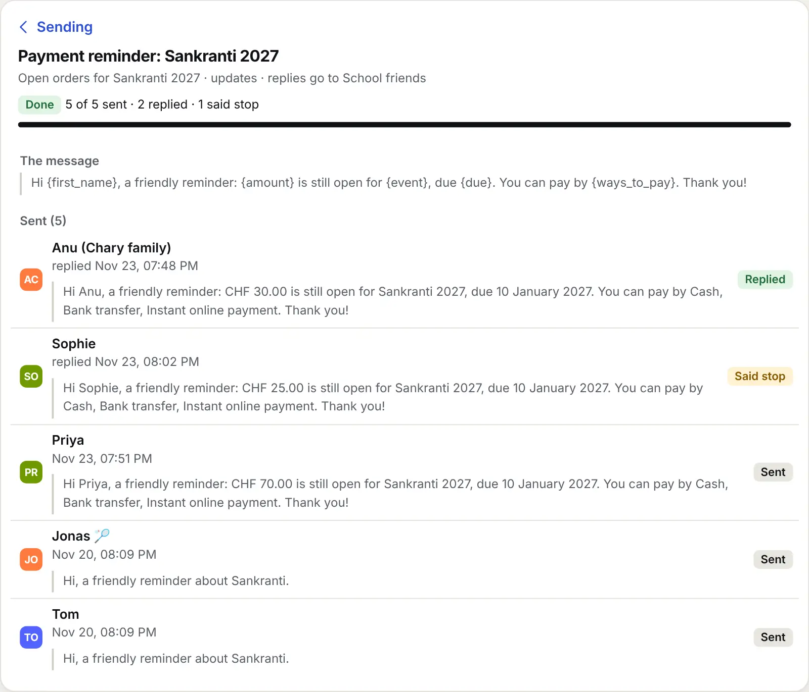

# Lists and sending

**Send a message to a list, an event's families or everyone who still owes: each person gets their own wording, one
at a time at a person's pace, and only if they said yes.**

**Do it:** **Settings → Modules** → **Lists and sending** on → **People → Sending → + New message** → **Preview** →
**Send to N people**.

**In 30 seconds**
- **To:** a list, a tag, a household, the people registered for an event, people with an open order (all, or of one
  event), or a saved audience. Or **one post in a group** instead of 1:1 messages.
- **Consent is checked in code** right before every message: the purpose (**updates** or **marketing**) must be *Yes*
  on the person's page. *Not asked* counts as no. Hidden people, people without an app and chats you switched off are
  skipped too; the preview lists who and why.
- **Each person gets their own wording:** the agent rewrites your message for them (their name, household, event,
  open amount) and must keep every fact word for word, or your message goes out as written. Nothing is invented.
- **Telegram** when they use it with your bot (fast), **WhatsApp** otherwise, at the [sending pace](sending-pace.md):
  sending hours, typing, a random gap, a longer pause now and then, a daily limit, slower for people who never wrote.
- **Nothing is sent before you confirm** the preview: who, how many, which app, how long, who is skipped and why,
  three samples. Agents can prepare a message too; an organizer confirms it with `confirm CODE`.
- Replies go to the agent you chose, like any message. **"stop"** (or *unsubscribe*, *arrête*, *basta*, …) records
  *No* and confirms once; **"start"** undoes it.

> [!WARNING]
> Pacing lowers the risk that WhatsApp restricts or bans your number, but it does **not** remove it. WhatsApp's terms
> restrict bulk and automated messaging. Send only to people who know you and expect the message, keep lists small,
> and use a dedicated number ([Connect WhatsApp](whatsapp.md)).

## Send a message

1. **People → Sending → + New message**.
2. **Title** (for you), **How** (each person in their own chat, or one post in a group), **To** and the list, tag,
   household or event.
3. **Purpose**: *Updates* (news about things they take part in: an event, a payment) or *Marketing*.
4. **Replies go to**: the agent that answers when people write back. Direct chats that are not set up yet are switched
   on with it (the preview says how many).
5. **Message**, with the facts it may use: `{first_name}`, `{name}`, `{household}`; for events `{event}`, `{date}`,
   `{place}`, `{people}` (e.g. *2 adults, 1 kid*); for open orders `{amount}`, `{due}`, `{ways_to_pay}`.
6. **More options**: **Pause when this many in a row do not answer** (default 20; 0 for reminders nobody needs to
   answer) and **Save this audience…** (keeps the choice under a name for next time).
7. **Preview** → check the samples and who is skipped → **Send to N people**.

## Who gets it

| Audience | Who |
|---|---|
| A list, a tag | its people; a kid without a phone is reached through an adult of their household |
| A household | one message: the first of its adults who can get it (people who wrote to this number first) |
| An event | its **registered** people; a registered household gets **one** message, to one adult who agreed |
| Open orders | everyone with an order not fully paid (of one event, or all), one message per household, with the open amount |

Skipped, with the reason on the preview and the message's page: *Said no to updates*, *Not asked about updates*, *Hidden in
People*, *No app to reach them*, *Their chat is switched off*, *A household without adults*. Consent is checked again
right before each message, so a *No* recorded meanwhile still counts.

## The pace

One message at a time, on the server's 30-second check (no extra timers), and it carries on after a restart.

- Only within the **sending hours** (09:00–20:00 by default, the owner assistant's time zone).
- The chat's unread messages are **read first**, then **typing…** for the length of the message.
- On WhatsApp a **random gap** follows each message (Normal: 45 s–3 min), **twice as long** for someone who never wrote
  to this number, and a **longer pause** every N messages.
- **Daily limit:** people who never wrote count as new chats (Normal: 40 a day, lower for a number linked this week);
  people who wrote may get three times as many. At the limit the run **waits for tomorrow by itself**.
- Telegram has no WhatsApp gaps or limits: a few seconds apart.

At Normal pace 100 people who wrote before take about four hours; people who never wrote, 40 a day.

Each person's [usual hours](people.md#preferences) count too: a message waits (others go first) until their hours,
inside your sending hours; a person who uses both apps gets it on the one they answer on.

## Stop signals

A run **pauses** and you get an owner alert (and the run's page says why) when:

- someone replies **stop** (or asks the agent not to get messages),
- **N people in a row** did not answer within half an hour (your setting; 0 = never),
- **3 messages in a row** could not be sent,
- WhatsApp is **logged out**, or has not been connected for **15 minutes**.

Look at it, then **Resume** or **Stop**. The daily limit and the sending hours only make it wait.

> [!NOTE]
> WhatsApp does not tell anyone when a person reports or blocks a number. A sudden quiet after a message, or several
> stops, is the signal to stop and rethink the message.

## Stop and start

- **stop**, *unsubscribe*, *stopp*, *arrête*, *basta*, *para*, *baja*, … as the whole reply (within 30 days of a list
  message): their consent for that purpose becomes **No** (*Replied STOP*), they get one confirmation, and the run
  pauses. Saying it again sends nothing.
- Other phrasings (*"please don't send me these"*, any language): the agent records it with its **stop messages**
  tool and confirms.
- **start** sets it back to *Yes* (*Replied START*).

## Payment reminders and event messages

- **People → Orders → Remind everyone who has not paid**: a new message to everyone with an open order (of the event you filter by), with
  a friendly reminder to start from: amount, due date, ways to pay. Preview, then start.
- **Automatic reminders**: on an event's page **⋯ → Automatic payment reminders…** → *On*, days before the due date,
  the agent, the message. Once per due date, people with an open order who agreed to updates get it by themselves;
  your switch is the confirmation. You get an owner alert when it starts.
- **Message the registered people**: on an event's page, under **Messages**: one message per household.

## A message's page

Progress (sent of total, replied, said stop, skipped, failed), **Pause / Resume**, **⋯ → Stop…**, what it is waiting
for, the message, and each person as a row: their state (*Sent*, *Replied*, *Said stop*, *Waiting*), when, and the
wording they got; a tap opens their page. It updates by itself. **People → Sending** keeps the history (*Messages*,
*Campaigns*, *Saved audiences*); a person's page lists the messages they got (*Messages from lists*), and an event's
and a survey's page list the messages sent to their people.

## Surveys and campaigns

- A message can carry a [survey](surveys.md): `{survey}` and each person's own `{survey_link}`; they answer in the chat
  or on the link page.
- A [campaign](campaigns.md) is a few messages over days, confirmed once: follow-ups skip people who replied,
  registered, paid or finished the survey.

## Agents

With the module on, agents get (**Tools** on the agent's page):

- **stop messages** (everyone): the sender does not want messages from lists.
- **sending status** (organizers): the latest runs and their counts.
- **send to list** (organizers): prepares a message to a list, tag, household, event or open orders; only people this
  agent may see ([People access](people.md#what-agents-see)) get it; it **always waits for an organizer's
  `confirm CODE`** with the preview.

## AI assistants and the owner assistant

Admin MCP ([Manage from ChatGPT or Claude](admin-mcp.md)): `list_sends`, `get_send`, `send_to_people`* (preview →
confirm), `control_send` (pause, resume, stop), `save_send_audience`, `set_payment_reminders`*, and
`set_person_consent` (* needs `confirm_action`). The [owner assistant](owner-assistant.md) uses the same tools: *"remind
everyone who hasn't paid for Sankranti"* shows you the preview first.

---
**Next:** [Campaigns](campaigns.md) · [Surveys](surveys.md) · [Sending pace](sending-pace.md) · [People](people.md) · [Orders and payments](orders.md) · [Privacy](privacy.md) · [Docs index](README.md)
