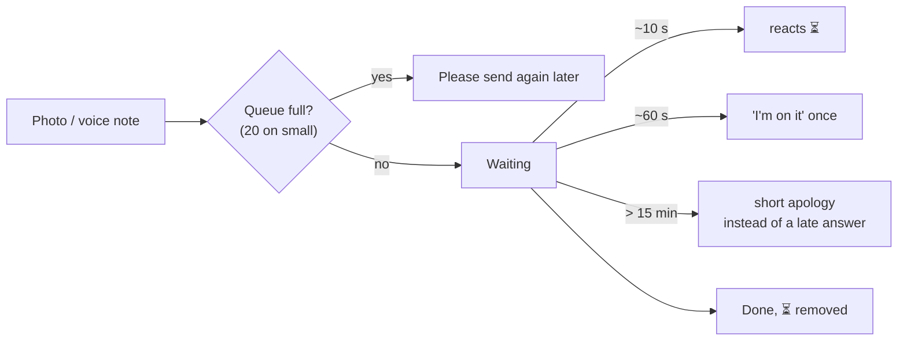

# Small servers

**A free 1 GB / 1 vCPU VM runs Duniya fine; heavy features adapt so they never take WhatsApp down.**

**Check it:** panel → **Server** shows the size ("Small server: 1 GB memory, 1 CPU…").

**In 30 seconds**
- Size is detected at startup (RAM incl. a container limit, CPUs): **small** < 2 GB or 1 CPU, **large** ≥ 8 GB and 4
  CPUs, **medium** otherwise.
- Photos and voice notes queue up (one at a time on small servers); text never waits.
- Under memory pressure optional work pauses; replies continue.

Examples: OCI `VM.Standard.E2.1.Micro`, Google `e2-micro`. Size also in `/api/status` (`server.size`).

## What adapts

| | Small | Medium | Large |
|---|---|---|---|
| Media jobs at once | 1 | 2 | 3 |
| Local tool services at once | 2 | 6 | 12 |
| On-server speech | below 2 GB: *Small server mode* only | yes | yes |
| Copilot helper | below 2 GB: no | yes | yes |

## The media queue

Photo and voice turns, pictures and voice replies queue in SQLite (survives a restart), in order per chat.

Max age: `MEDIA_JOB_MAX_AGE_MIN` (15). [Settings](settings.md)

## Guardrails

- **Limits**: media over `WA_MEDIA_MAX_MB` is refused before downloading (WhatsApp's declared size). Every download,
  conversion, transcription and picture has a timeout; ffmpeg runs with `nice` and a memory cap; temp files are
  always removed.
- **On-server speech** below 2 GB: only with **Small server mode (experimental)** in **Settings → Photos & voice**
  (~900 MB minimum; slow, one at a time). Each job checks free memory first (listening ~400 MB, speaking ~300 MB,
  +150 MB in small server mode); otherwise the provider is used or the agent asks for text.
- **Memory pressure** (> 70 %): summaries, on-server speech and picture creation pause (one activity entry), then
  resume.
- **Copilot** helper (~400 MB download): refused below 2 GB. **Local tool services** over the limit: the least
  recently used one stops until needed.

> [!TIP]
> Try it locally: `DEMO_SMALL=1 node scripts/demo-panel.mjs` pretends to be a 1 GB / 1 CPU server.

---
**Next:** [Photos & voice](models.md#photos--voice) · [Oracle Cloud](deploy/oci-free-tier.md) · [Docs index](README.md)
