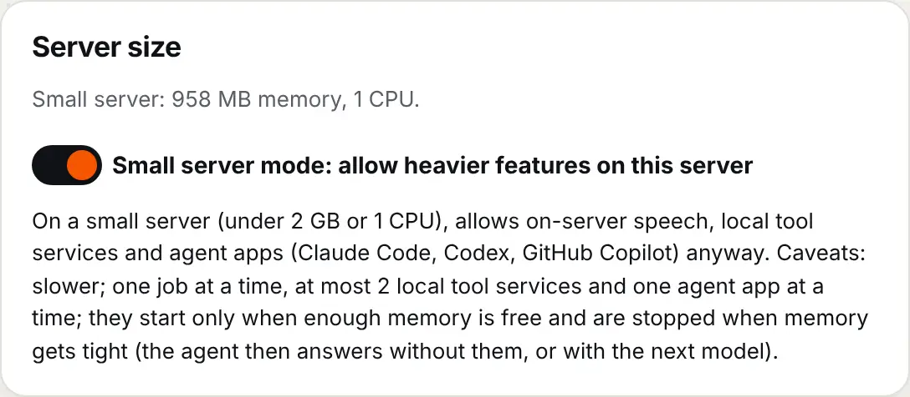

# Small servers

**A free 1 GB / 1 vCPU VM runs Duniya fine; heavy features adapt so they never take WhatsApp down.**

**Check it:** panel → **Server** shows the size ("Small server: 1 GB memory, 1 CPU…").

**In 30 seconds**
- Size is detected at startup (RAM incl. a container limit, CPUs): **small** < 2 GB or 1 CPU, **large** ≥ 8 GB and 4
  CPUs, **medium** otherwise.
- Photos and voice notes queue up (one at a time on small servers); text never waits.
- Under memory pressure optional work pauses; replies continue.
- On-server speech and local tool services are off on small servers; **Small server mode** (Settings → Server)
  allows them anyway, slower and one at a time.

Examples: OCI `VM.Standard.E2.1.Micro`, Google `e2-micro`. Size also in `/api/status` (`server.size`).

## What adapts

| | Small | Medium | Large |
|---|---|---|---|
| Media jobs at once | 1 | 2 | 3 |
| Local tool services | *Small server mode* only, 2 at once | 6 at once | 12 at once |
| On-server speech | below 2 GB: *Small server mode* only | yes | yes |
| Copilot helper | below 2 GB: no (not even with *Small server mode*) | yes | yes |

## Small server mode

One server-wide switch: **Settings → Server → Small server mode: allow heavier features on this server** (owner only;
also `set_small_server_mode` for [AI assistants](admin-mcp.md), with a confirmation).

1. Open **Settings**, find the **Server** card.
2. Switch on **Small server mode**. Every refusal that it can lift says so: *…or switch on Small server mode in
   Settings → Server*.

| With the switch on | Extra limits that stay |
|---|---|
| On-server speech (Settings → Photos & voice) | about 900 MB minimum, smallest models, one voice note at a time, starts only with enough free memory (+150 MB), paused when memory is tight |
| Local tool services (by hand, from Browse, by the AI assistants) | at most 2 run at once, each started when first used, all stopped when memory is tight (they start again when needed) |

> [!WARNING]
> Slower, and heavier work waits or is refused at busy moments; the agent then answers without those tools or asks
> for text. The installer's 2 GB swap is the safety net. Hosted tool services and providers are faster and safer here.

> [!NOTE]
> **Not covered:** GitHub Copilot sign-in. Its ~400 MB download and helper process run inside the app's 700 MB memory
> cap next to the app itself, so on 1 GB they fail or get the app stopped. It stays refused below 2 GB.

Before 2.17 the switch was in **Settings → Photos & voice** and covered only on-server speech; an existing setting is
carried over.

## The media queue

Photo and voice turns, pictures and voice replies queue in SQLite (survives a restart), in order per chat.

Diagram as text

1. A photo or voice note arrives.
2. Queue full (20 on small servers): "please send again later".
3. Otherwise it waits in the queue.
4. After about 10 s the agent reacts with ⏳.
5. After about 60 s it says "I'm on it" once.
6. After 15 min it sends a short apology instead of a late answer.
7. When done, the answer comes and ⏳ is removed.

Max age: `MEDIA_JOB_MAX_AGE_MIN` (15). [Settings](settings.md)

## Guardrails

- **Limits**: media over `WA_MEDIA_MAX_MB` is refused before downloading (WhatsApp's declared size). Every download,
  conversion, transcription and picture has a timeout; ffmpeg runs with `nice` and a memory cap; temp files are
  always removed.
- **On-server speech** below 2 GB: only with [Small server mode](#small-server-mode)
  (~900 MB minimum; slow, one at a time). Each job checks free memory first (listening ~400 MB, speaking ~300 MB,
  +150 MB in small server mode); otherwise the provider is used or the agent asks for text.
- **Memory pressure** (> 70 %): summaries, on-server speech and picture creation pause (one activity entry), then
  resume.
- **Copilot** helper (~400 MB download): refused below 2 GB, with or without Small server mode.
- **Local tool services** (each one an extra Node.js process): on a small server, adding or changing one is refused
  on every path (agent editor, Settings → Tool services, Browse tool services, import, duplicate, AI assistants)
  with the same message, unless [Small server mode](#small-server-mode) is on. Hosted services work as usual. Over the
  limit, the least recently used one stops until needed.
- **Local tool services saved before** (on a bigger server, before 2.17, or from a backup) stay in the configuration
  but are **not started** while the server is small and the switch is off: the agent answers without their tools,
  the agent editor says *Not started on this server* and why, the activity log says it once, and Install is refused.
  Switch on Small server mode, move to a bigger server, or remove them.

> [!TIP]
> Try it locally: `DEMO_SMALL=1 node scripts/demo-panel.mjs` pretends to be a 1 GB / 1 CPU server.

---
**Next:** [Photos & voice](models.md#photos--voice) · [Oracle Cloud](deploy/oci-free-tier.md) · [Docs index](README.md)
