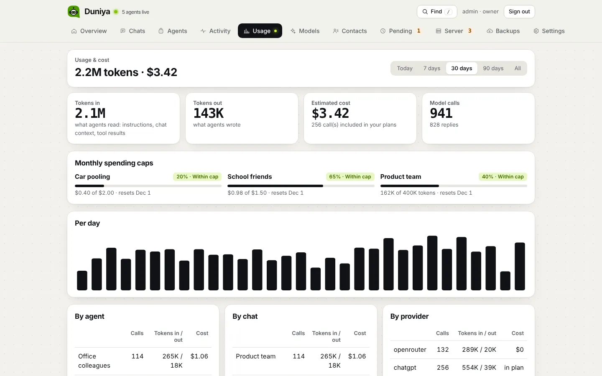
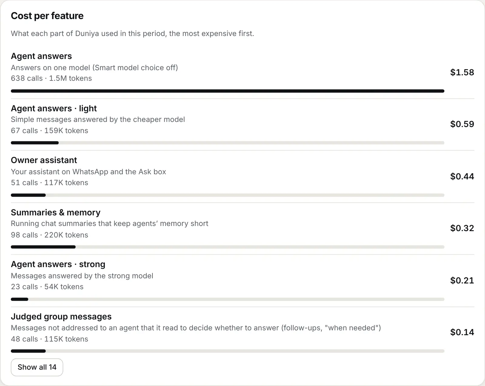
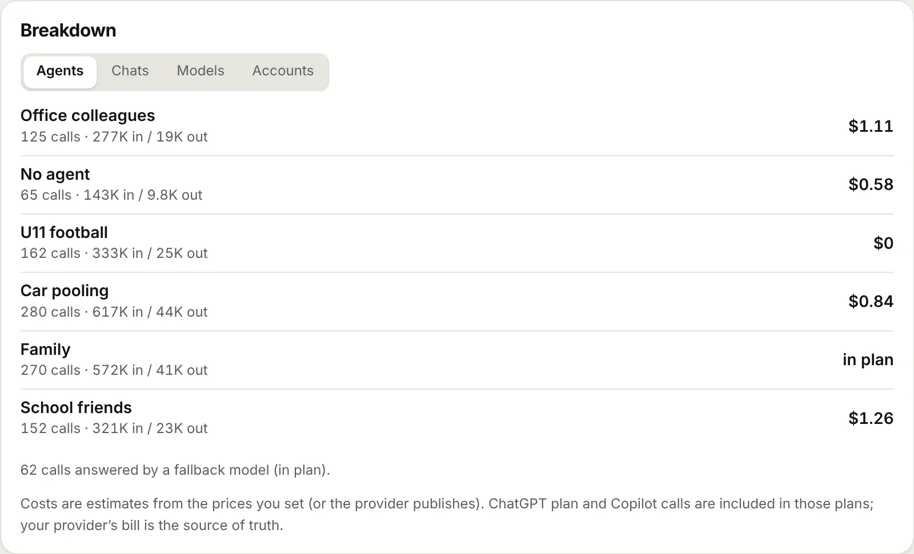
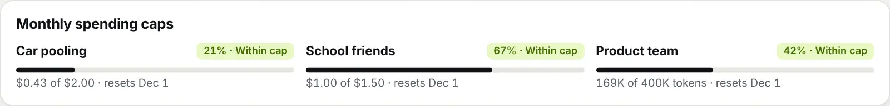

# Usage, cost and spending caps

**See what every agent and chat costs, and cap it per month.**

**Do it:** agent page or **Chats → Spending cap** → set a monthly cap.

**In 30 seconds**
- **Usage**: the totals, your caps, **Cost per feature**, a bar per day, then **Breakdown**: *Agents · Chats · Models ·
  Accounts*, one row each (name · calls and tokens · cost), and how many calls a fallback model answered.
- Prices are yours, published, plans ("included") or free: never guessed.
- Caps: one alert at 80 %; quiet (or a cheaper model) at 100 %.
- Agents on [Smart model choice](intelligence.md#smart-model-choice): **Usage → Smart model choice** shows how many
  answers a light model gave, the cost per answer and what it saved. **Cost per feature** lists the classifier
  (*Choosing light or strong*), the light and strong answers and *Self-check rewrites* separately.

## Cost per feature

**Usage → Cost per feature**: what each part of Duniya used in the period, the most expensive first: one row per
feature with a short line, calls, tokens, a bar and the cost; the top six, then **Show all**.

| Feature | What it counts |
|---|---|
| Agent answers (· light, · strong) | answers to messages; *light* / *strong* for agents on Smart model choice |
| Judged group messages | messages not addressed to an agent that it read to decide whether to answer (*follow-ups*, *when needed*) |
| Choosing light or strong · Self-check rewrites · Lessons proposed | the [Smarter agents](intelligence.md) extras |
| Promises | noticing promises, and when they are done |
| Catch-ups · Summaries & memory | *What did I miss?*, and running chat summaries |
| Voice notes in · Voice replies · Pictures made | [Photos & voice](models.md#photos--voice) |
| Web searches | searches agents ran with their AI provider's built-in web search ([Web search](web-search.md)) |
| Sending: per-person wording · Surveys: invites | each person's own wording of a message to a list, a campaign step or a survey invite |
| AI helper · Owner assistant · Scheduled posts · Tests | the AI helper, your assistant (WhatsApp and the Ask box), schedules, the test console |
| Built-in: FAQ, quick replies, welcome | answers without AI (free) |

Every model call is tagged with its feature where it is made, so nothing is guessed. Admin MCP: `get_usage` (always with
`features`, also `group_by: feature`).

## Prices

**Usage → Breakdown → Models** shows each model's price per million tokens (*price not set*, *free*, or the plan that
includes it). To set or change one: the model's **⋯ → Set price…** (input and output, in USD per million tokens; empty
removes it). Admin MCP: `set_model_price`.

## Spending caps

1. Agent page → **Spending cap**, or **Chats** → a chat → **Spending cap**.
2. Choose cost in USD and/or tokens per month.
3. Optional: a cheaper model to switch to at 100 %.

| At | What happens |
|---|---|
| 80 % | one WhatsApp alert to the owner ([owner alerts](owner-assistant.md#owner-alerts-and-weekly-summary)) |
| 100 % | the agent stays quiet in that scope, or switches to the cheaper model, until the month ends (server timezone) |

> [!NOTE]
> Cost caps count only priced calls (your prices, published prices, plans and free models). Kinds: reply, summary,
> transcribe, image, speech.

Admin MCP: `get_usage`, `set_model_price`, `get_spending_caps`, `set_spending_cap`.

---
**Next:** [Owner alerts & weekly summary](owner-assistant.md#owner-alerts-and-weekly-summary) · [Models](models.md) ·
[Docs index](README.md)
