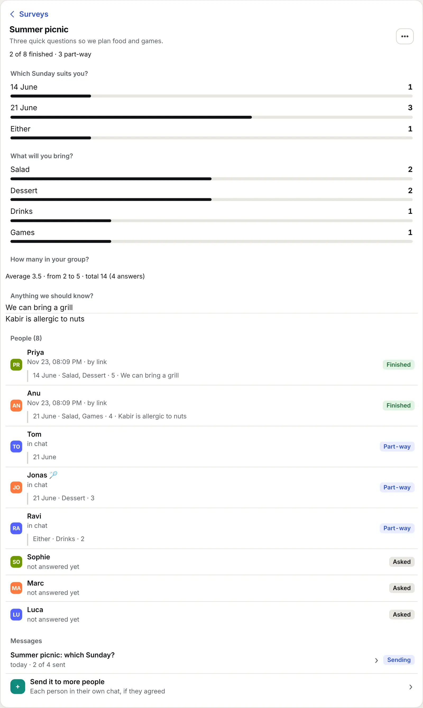

# Surveys

**Ask a few questions and get the answers in one place: people answer in the chat, where the agent asks one question at
a time, or with their own link.**

**Do it:** **Settings → Modules** → **Surveys** on → **People → Surveys → + New** → **Send it to people…**.

**In 30 seconds**
- A survey has a title, a short intro and up to 20 questions: **one choice**, **several choices**, a **number** or a
  **short text**; each needs an answer or is optional.
- Send it like any message ([Lists and sending](sending.md)): same consent, pace and stop signals. The message may use
  `{survey}` (its title) and `{survey_link}` (that person's own link).
- **In the chat:** when they reply, the agent sees that they have an open survey and asks the next question; their
  answer is checked in code (a choice by its words or number, a number) and saved.
- **By link:** a small page on your panel's address, no sign-in, one link per person. Every text on it is shown as
  text, the form only works from that page, and it slows down anyone who opens links too fast.
- **Results:** counts per choice with bars, the average of numbers, the latest short texts, each person's answers,
  **CSV**. A person's page lists their answers; ask the owner assistant *"what did people answer?"*.

## Make a survey

1. **People → Surveys → + New**.
2. **Title** and an **Intro** (optional; the link page shows it).
3. For each question: the text, the **Answer** (one choice, several choices, a number, short text), its choices, and
   **Needs an answer** on or off. **+ Question** adds one.
4. **Create survey**. **⋯ → Edit…** changes it later. Once people have answered, you can reword questions and choices
   (the answers go with a reworded choice) and add a choice at the end, but not add or remove questions, change their
   kind or remove a choice (that would mix up the answers).

## Send it

1. On the survey's page, **Send it to people…** (later: **Messages → Send it to more people**), or **People → Sending →
   + New message** and pick the **Survey**.
2. Choose who, the purpose and the agent; the message starts as *"Hi {first_name}, a few quick questions about
   {survey}: answer here in the chat, or at {survey_link}"*. Change it as you like.
3. **Preview** → **Send to N people**. Each person gets their own link; the preview shows it as `…/s/…`.

> [!NOTE]
> Links need the address people can open: your domain ([Domains and access](domains-and-access.md)), or `PUBLIC_URL`.
> Without one, remove `{survey_link}`: people answer in the chat.

## Answers in the chat

- The agent's card about the person says *Open survey for them: "Summer picnic" (1 of 4 answered)* and the next
  question, so it asks it when they write.
- Its tools: **my surveys** (their open surveys and the next question) and **answer survey** (saves one answer, or
  skips an optional question, and returns the next one). Organizers also get **survey results**.
- Answers are checked in code: *"Cake"* is not one of the choices, *"three"* is not a number; the agent asks again.
- Only surveys the person was sent can be answered; a closed survey takes no answers.

## Results

On the survey's page: how many finished and how many are part-way; per question the counts (bars), the average,
lowest, highest and total of numbers, the latest short texts; **People**: one row per person asked (*Finished*,
*Part-way*, *Asked*; finished first) with their answers and how (chat or link), a tap opens their page; **Messages**:
what carried the survey. **⋯ → Download CSV** (spreadsheet-safe), **Close it** (no more answers), **Delete…**.

## AI assistants and the owner assistant

Admin MCP ([Manage from ChatGPT or Claude](admin-mcp.md)): `list_surveys`, `get_survey_results`, `save_survey`,
`delete_survey`*, and `send_to_people` with `survey` (* needs `confirm_action`).

---
**Next:** [Campaigns](campaigns.md) · [Lists and sending](sending.md) · [People](people.md) · [Docs index](README.md)
