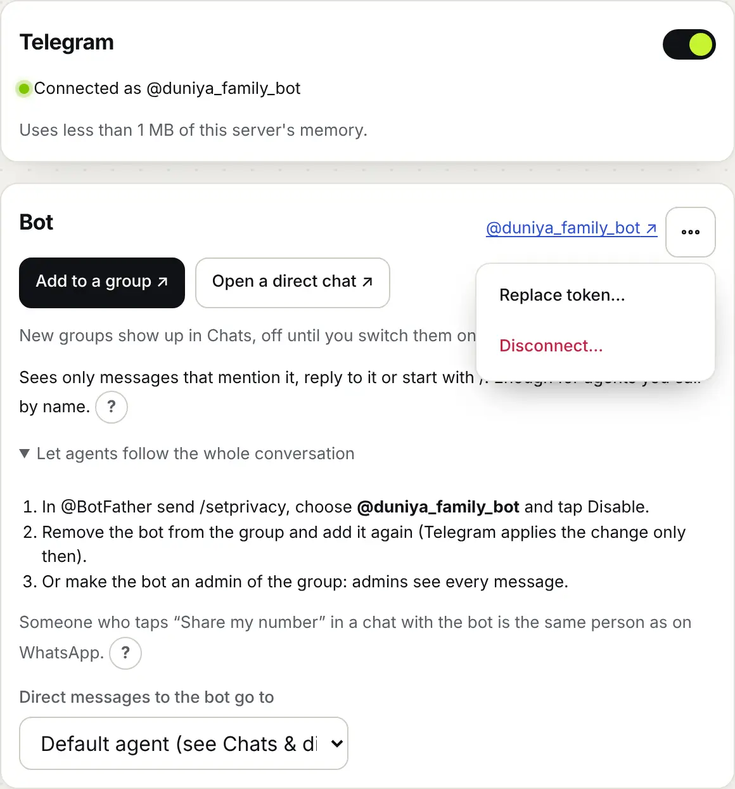

# Connect Telegram

**Add a Telegram bot in two minutes: the same agents, memory and roles answer in your Telegram groups and chats.**

**Do it:** panel → **Settings → Channels → Telegram** → **Paste the bot token** (from @BotFather).

**In 30 seconds**
- Telegram works through an official **bot**, not your own account: nothing can get banned, and it costs nothing.
- The token goes in on a one-time secure page, is stored encrypted, and is never shown again.
- Groups show up in **Chats**, **off** until you switch them on, just like WhatsApp groups ([Chats](chats.md)).
- People tap **Share my number** in a direct chat with the bot. The same phone number on WhatsApp and Telegram is the
  same person, with the same role.
- Nothing of Telegram runs on the server until a token is stored. Then it uses a few MB and one connection.

## Create the bot and connect it

1. In Telegram, open [@BotFather](https://t.me/BotFather), send `/newbot` and choose a name and a username (it must
   end in `bot`, e.g. `rao_family_bot`). BotFather answers with a **token**.
2. In the panel: **Settings → Channels → Telegram → Paste the bot token**. A secure page opens. Paste the token and
   tap **Save**. Something that doesn't look like a token is refused with a short reason.
3. **Back to the panel**: the page says **Connected as @your_bot**. Telegram is on.

> [!TIP]
> Managing Duniya from ChatGPT or Claude? Ask it to *connect a Telegram bot*: `set_secret` with
> `TELEGRAM_BOT_TOKEN` gives you the same one-time link ([admin MCP](admin-mcp.md)).

## Add the bot to a group

1. **Settings → Telegram → Add to a group**: Telegram opens and asks which group.
2. The group appears in **Chats** (off). Choose its agent: that switches it on, and the
   [privacy notice](privacy.md) is posted once, as on WhatsApp.
3. In the group, people call the agent like on WhatsApp: mention it (`@your_bot …`), reply to one of its messages, or
   use its wake word.

## Privacy mode

By default a Telegram bot sees only messages that mention it, reply to it or start with `/`. That is enough for
agents you call by name. The Telegram page shows which mode your bot is in.

Agents that **follow the conversation** (memory of everything said, follow-up replies, the FAQ for every message)
need to see every message. Either:

1. In @BotFather send `/setprivacy`, choose your bot and tap **Disable**. Then **remove the bot from the group and add
   it again**: Telegram applies the change only then.
2. Or make the bot an **admin** of the group: admins see every message.

Members can see in the member list whether a bot reads all messages.

## Share my number: one person on both apps

Telegram never tells bots phone numbers. So that roles (organizers, participants), names in People and your
[owner assistant](owner-assistant.md) work on Telegram:

1. The person opens a direct chat with the bot (**Open a direct chat** on the Telegram page, or `t.me/your_bot`) and
   taps **Start**.
2. The bot offers **Share my number**. One tap sends their own contact.
3. The bot confirms. From then on they are the same person as on WhatsApp, with the same role in every agent.

> [!IMPORTANT]
> Only a person's **own** contact links their number. A contact card someone forwards links nobody. Until they link
> it, people count as participants. If an organizer asks for something only organizers may do, the agent tells them
> how to link.

The owner links the same way: share your number with the bot, and if that number is linked to your panel user
([owner assistant](owner-assistant.md)), your Telegram messages reach your owner assistant.

## What agents can do on Telegram

| | |
|---|---|
| **Same as WhatsApp** | answers, wake words, follow-ups, quick replies, FAQ, welcome for new members, memory, notes, polls (votes are counted), reactions, photos and voice notes in (up to 20 MB), pictures, files and voice replies out, locations, contact cards, edit and delete their messages, spending caps |
| **Group tools** (bot is admin) | rename, description, picture, *only admins send*, *only admins edit info*, invite link (show, reset), leave |
| **Not on Telegram** | adding or removing people by phone number, profiles, blocking, earlier messages (bots can't read history), member tags, *approve new members* |

Telegram accepts only some reaction emoji: agents' ✅ becomes 👌, for example. Long answers are split into several
messages. If Telegram makes a group a *supergroup* (its id changes), the chat keeps its agent, settings and memory.

## Settings → Channels → Telegram

| | |
|---|---|
| **On / off** (owner) | **off** closes the connection and frees its memory; agents stop answering on Telegram. The token stays |
| **Add to a group** / **Open a direct chat** | Telegram links for the bot |
| **What the bot sees** | privacy mode, with the steps above |
| **Direct messages to the bot go to** | the agent that answers people who write to the bot privately (default: **Settings → Chats & direct messages**) |
| **Replace token** | a new token from @BotFather (`/revoke` there makes the old one stop) |
| **Disconnect** (owner) | removes the token; chats keep their memory, the bot stays in Telegram |

If the page says *Another program is reading this bot's messages*, the same token runs on a second server: stop it
or make a new token. A webhook left by another tool is removed automatically.

Admin MCP: `list_channels` (with the bot's name and privacy mode), `set_channel_enabled`, `set_secret`
(`TELEGRAM_BOT_TOKEN`), `set_telegram_dm_agent`.

---
**Next:** [Chats](chats.md) · [Connect WhatsApp](whatsapp.md) · [Docs index](README.md)
