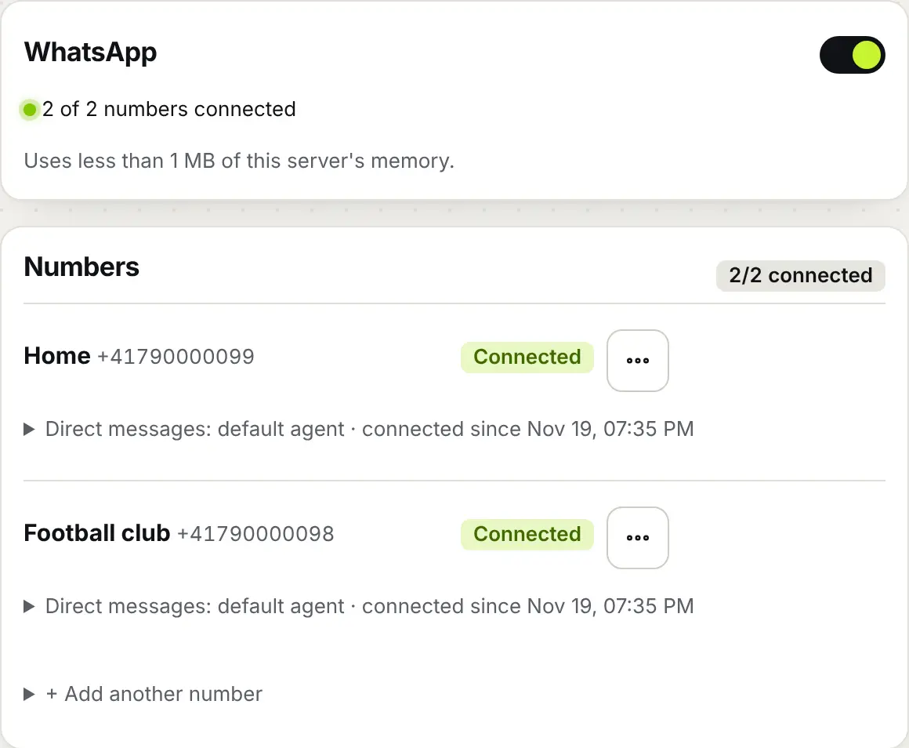

# Connect WhatsApp

**Link a WhatsApp number as a linked device in under a minute; add more numbers whenever you like.**

**Do it:** panel → **Overview** → **Getting started** (or the **WhatsApp numbers** card) → scan the QR code.

**In 30 seconds**
- Use a **dedicated number** for the agents (a prepaid SIM is fine): unofficial clients can be banned.
- Duniya is a normal linked device, like WhatsApp Web. Keep the phone charged and online now and then.
- Every chat starts **off**: linking a number stores nothing until you switch a chat on ([Chats](chats.md)).

## Link a number

1. On the phone of the agents' number: **WhatsApp → Settings → Linked devices → Link a device**.
2. Scan the QR code on **Overview**. Same phone, can't scan? Under the QR code: **Link with a pairing code** → enter
   the number → **Get code**, then on the phone *Link with phone number instead* and type the code.
3. The card says **Connected** with the number. Your groups and people appear under **Chats**.

> [!WARNING]
> Duniya uses the open-source [Baileys](https://github.com/WhiskeySockets/Baileys) library, not the official
> WhatsApp Business API. Agents only answer when addressed and are rate-limited to keep the risk of a ban low, but use
> a number you can afford to lose.

## The WhatsApp numbers card

| | |
|---|---|
| **Status** | *Connected*, *waiting for scan* or *reconnecting*; the header shows *WhatsApp 2/2 connected* |
| **⋯ → Reconnect** | starts the connection again (optional: it reconnects by itself, with growing pauses up to a minute) |
| **⋯ → Unlink** | signs the server out of WhatsApp; agents stop on this number until you scan again (asks first) |
| **⋯ → Remove** (owner, extra numbers) | removes the number; its chats keep their memory |
| **Direct messages** | which agent answers people who write to this number privately (default: **Settings → Chats & direct messages**) |

A number that keeps reconnecting for 15 minutes is reported to the owner once. A restart or update keeps the link.

## Several numbers

1. **Overview → WhatsApp numbers → + Add another number** (owner) → give it a name (*Shop*, *Club*) → **Add number**.
2. Scan its QR code with that number's phone.

Replies always leave from the number the chat belongs to. Chats on the first number keep their WhatsApp id; chats on
other numbers are `<number>#<chat id>`.

> [!TIP]
> To talk to agents from your **own** phone (recaps, sends, alerts), don't link it as a number: link it to the
> [owner assistant](owner-assistant.md) instead (`link CODE`).

Admin MCP: `list_whatsapp_numbers`, `add_whatsapp_number`, `remove_whatsapp_number` (confirmation required).

---
**Next:** [Add a model](models.md) · [Chats](chats.md) · [Docs index](README.md)
